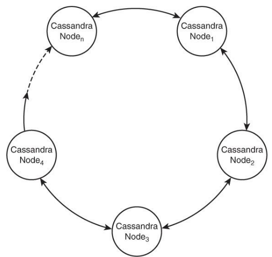
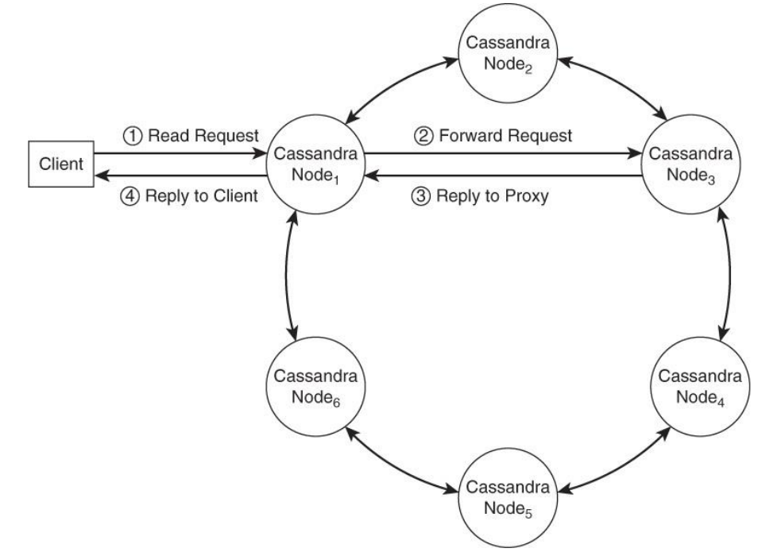

# 1. Index

<!--toc:start-->

- [1. Index](#1-index)
- [2. Column Database](#2-column-database)
  - [2.1. Columnar Compression](#21-columnar-compression)
  - [2.2. Single Row Operation Penalty](#22-single-row-operation-penalty)
  - [2.3. Big Table: Google NoSQL Database](#23-big-table-google-nosql-database)
    - [2.3.1. Keyspaces](#231-keyspaces)
      - [2.3.1.1. Row Keys](#2311-row-keys)
      - [2.3.1.2. Columns and Column Families](#2312-columns-and-column-families)
      - [2.3.1.3. Example: Ordering and Compression](#2313-example-ordering-and-compression)
  - [2.4. Cassandra and HBase](#24-cassandra-and-hbase)
    - [2.4.1. Partitioning in Cassandra and HBase](#241-partitioning-in-cassandra-and-hbase)
    - [2.4.2. Column Architecture: HBase](#242-column-architecture-hbase)
    - [2.4.3. Column Architecture: Cassandra](#243-column-architecture-cassandra)
  - [2.5. Internal Mechanisms](#25-internal-mechanisms)
    - [2.5.1. Commit Logs](#251-commit-logs)
    - [2.5.2. Bloom Filters](#252-bloom-filters)
    - [2.5.3. Consistency Level and Replication](#253-consistency-level-and-replication)
    - [2.5.4. Anti Entropy](#254-anti-entropy)
    - [2.5.5. Communication Protocols](#255-communication-protocols)
    - [2.5.6. Cassandra Read and Write Protocol](#256-cassandra-read-and-write-protocol)
    <!--toc:end-->

# 2. Column Database

Column Databases are a type of DBMS used to handle **huge amount of data** in
_masterless distributed configurations_.

They are used in order to perform two types of processing:

- **OLTP** (Online Transaction Processing): This is the traditional type of processing
  used in relational databases (_ACID transactions_). It is used to handle a
  large number of small transactions, such as inserting, updating, or deleting records.
- **OLAP** (Online Analytical Processing): This is a type of processing used for
  fast analyze large amounts of data in an interactive way. It is typically
  used in **Business Intelligence** applications.

Differently from relational databases, it **does not store data in rows**, but rather
in **columns**.

Historically, this was a huge change, since all OLTP processing was mainly oriented
towards handling **one record at a time** processing.

In this **record-oriented** approach, _CRUD_ operations (Create, Read, Update, Delete)
were the _most time-critical ones_.

In particular, **reporting programs** were typically iterated through entire tables
while running in background (in batch mode). Still, **queries time response**
was not a critical issue, so it was not considered a prominent problem.

However, when _business intelligence_ applications started to spread, **OLAP**
processing assumed a **big relevance**, making queries time response a
critical issue.

This happended because when processing data for making analytics, we are typically
not interested in retrieving all information about a record, but rather on
**one specific attribute of a set of records**.

With row-based storage, this means that, in order to recover a single
attribute, we have to first **access the whole record**.

This is a huge waste of time, since we are not interested in the other attributes.

If all the values of a specific attribute were to be stored together on the disk
(or on a specific block), we could access them all at once, without having to
read the other attributes, resulting in a **faster response time**.

For example, supposing we have a sql table with 6 attributes (`ID`, `Name`, `DOB`,
`Salary`, `Sales`, `Expenses`), and we want to know the sum of all the `Salaries`
of all the employees.

```sql
SELECT SUM(salary)
FROM salePersons;
```

The above query will **scan all the blocks** of the table (supposing we have
one record per block), and for each record, it will **read all the
attributes** in order to extract the `Salary` attribute.

In case of **columnar storage**, we would occupy just 6 blocks (one for each attribute),
and on it we will have stored all the values of that attribute for all the records.

This means that, in order to compute the sum of all the salaries, we will have
to read **just one block** (the one containing all the salaries), and we will
not waste time reading the other attributes.

## 2.1. Columnar Compression

Data compression algorithms basically **remove redundancy** within data values.
Their compression ratio is typically proportional to the amount of redundancy
in the data.

This happens before **compression algorithms** detect redundancy more easily when
the process **small groups of nearby values**.

When using columnar storage, we can store **similar values together** for each columns
(for example we can sort them), and this allows us to **compress data more
efficiently**, achieving _high compression ratio_ with _low computational overheads_.

For instance, the example of having sorted columns allows us to store just the first
value of a columns, and then store just the **difference** $(\Delta)$ from
the preceding value.

## 2.2. Single Row Operation Penalty

As we might have expected, column databases perform **poorly** during _single-row
modification_.

The **overhead** needed for reading rows can be partly reduced by caching multicolumn
data in memory, but this is not a solution for **highly dynamic data**.

In general, in column databases handling a single row means accessing to more
than one block on the disk.

However, modern architectures of column databases are designed to **minimize
this penalty**.

## 2.3. Big Table: Google NoSQL Database

NoSQL databases discussed so far may help us solve the problem of handling
**huge amount of data**.

However, each of them comes with some **limitations**:

- **Key-Value** databases lack support for organizing _many attributes_ and
  keeping **frequently used data** together.
- **Document** databases may not have some of the useful features of relational
  databases, such as a **SQL-like query language** or **secondary indexes**.

To overcome these limitations, in 2006 Google® developed a new type of
database called **Big Table**, for large services such as _Google Earth_ and _Google
Finance_.

Its main features are:

- **Column based** with a **_dynamic_** control over columns, meaning that we
  can add new columns at any time, without having to modify the schema of the
  database. Furthermore, for each row we can have multiple instances of data
  uploaded in different times.
- Data values are accessed by **row** identifier, **column** name, and a
  **time stamp**
- Reads and writes of a row are **atomic**
- **Rows** are maintained in a **sorted order**

<div class="grid2">
<div class="">

Hence, a data record is a **row** composed of values associated to columns in several
**column families**.

Each _family_ consists of a set of **related columns** (i.e., that are
frequently used together).

**Column values** within a column family are **kept together** on the disk, whereas
values of the same row, but belonging to different families, my be stored far.

One limitation of Big Table is that column families **must be defined a priori**.

Applications may **add** and/or **remove** columns inside families.

On the right we can see an use example.

</div>
<div class="">
<figure class="75">

<figcaption>

In the end a _column family_ is equivalent to a **key-value** couple,
where the **key** is the _row-identifier_, _column-name_ and _timestamp_.

</figcaption>
</figure>

</div>
</div>

On the image below we can see an example of a column family with two columns,
saved in different time instants.


This means that:

- **Row Identifier** $\to$ similar role to relational db _primary key_
- **Column Name** $\to$ similar role to key-value db _key_
- **Timestamp** $\to$ allows for multi versions of a column value to exists

### 2.3.1. Keyspaces

It is the **top-level logical container** that holds _tables_, _column families_,
_row keys_ and related _data structures_ (such as _replication strategies_ and
_replication factors_).

Typically, there is one keyspace per application.

#### 2.3.1.1. Row Keys

Row keys are one of the components used to **uniquely identify** values stored
in a database.

They are also used to **partition** and to **order** data, as data of a
specific row key are **_never deployed across multiple nodes_**.

The algorithms for data partitioning and ordering depend on **specific databases**,
meaning that our data could be partitioned and ordered differently depending on
the database we are using.

As an example, `Cassandra` adopts the **partitioner** algorithm, which is a specific
object that is used for partitioning and ordering data.

Moreover, by default, the partitioner **randomly distributes** rows across nodes
by using a **hash function** on the row key.

#### 2.3.1.2. Columns and Column Families

A column, along with a row key and version/time stamp, is used to **uniquely
identify** a value stored in a database.

The values may be _typed_ (e.g., integer, string, etc.), like in `Cassandra`, or
_untyped_ (e.g., binary data), like in `Big Table`.

Version/Time stamp is a way to **order values of a column**

Columns that are frequently used together are grouped into **column families**,
which are analogous to _tables_ in relational databases.

However, unlike relational databases, rows in column families are **sorted by
row key**, while individual cell values can have multiple timestamped
versions. Also, column families are **defined a priori**, but columns can be modified
dynamically,just by making a reference to them from the _client application_.

<figure class="">

<figcaption>

Here we can clearly see that several rows of the same column family can have
different columns.

</figcaption>
</figure>

#### 2.3.1.3. Example: Ordering and Compression

Let's see a practical example with 5 rows and 2 column families, each with up to
3 columns:

<div class="flexbox" markdown="1">
  <table>
    <thead>
        <tr>
          <th rowspan="2">Row Key</th>
          <th colspan="3">Profile (CF)</th>
          <th colspan="3">Activity (CF)</th>
        </tr>
        <tr>
          <th>name</th>
          <th>age</th>
          <th>city</th>
          <th>last_login</th>
          <th>posts</th>
          <th>likes</th>
        </tr>
    </thead>
    <tbody>
      <tr>
        <th>U001</th>
        <td>Alice</td>
        <td>28</td>
        <td>Pisa</td>
        <td>2025-01-15</td>
        <td>12</td>
        <td>134</td>
      </tr>
      <tr>
        <th>U002</th>
        <td>Bob</td>
        <td>34</td>
        <td>Rome</td>
        <td>2025-01-14</td>
        <td>5</td>
        <td>87</td>
      </tr><tr>
        <th>U003</th>
        <td>Carla</td>
        <td>29</td>
        <td>-</td>
        <td>2025-01-15</td>
        <td>-</td>
        <td>21</td>
      </tr><tr>
        <th>U010</th>
        <td>David</td>
        <td>-</td>
        <td>Milan</td>
        <td>2025-01-10</td>
        <td>8</td>
        <td>64</td>
      </tr><tr>
        <th>U020</th>
        <td>Eva</td>
        <td>27</td>
        <td>Pisa</td>
        <td>2025-01-15</td>
        <td>20</td>
        <td>203</td>
      </tr>
    </tbody>
  </table>
</div>

We can see how rows are stored in **increasing lexicographic order** of the
row key.

Compression works by exploiting the way Big Table stores data per column
family (in separate files) and compresses it by exploiting:

- Similarity of values across consecutive rows
- Sparsity (missing cell, posts, etc.)
- Compression algorithms (e.g., _prefix compression_ and _block compression_)

A simplified example of the physical organization of a compressed column
family could be the following:


To further compress data, we can exploit repetition of a value across rows.
For example, in compressing the `city` column, we can use the following dictionary:

- `-` (missing) $\to$ `0`
- `Pisa` $\to$ `1`
- `Rome` $\to$ `2`
- `Milan` $\to$ `3`

This will mean that instead of having the five strings, we just will be
storing the sequence `12031`.

## 2.4. Cassandra and HBase

`HBase` and `Cassandra` are both **column-oriented databases** that are
designed to handle **large-scale data** in a distributed environment.

However, they have different architectures and design principles.

### 2.4.1. Partitioning in Cassandra and HBase

To see how both `Cassandra` and `HBase` define their _partition key_ and how
they distribute data in the cluster let's see the following table

|                           Aspect                           |                                                   Cassandra                                                    |                         HBase                          |
| :--------------------------------------------------------: | :------------------------------------------------------------------------------------------------------------: | :----------------------------------------------------: |
|                    **_Partition Key_**                     |                               Part of the **Primary Key** (one or more columns)                                |                     **_Row Key_**                      |
|                     **_Primary Key_**                      |       Identifies a row and defines its partitions.<br>Formed as `<partition_key [,clustering_columns]>`.       |                           -                            |
| **_Clustering Column_**<br><small>(Cassandra Only)</small> | Optional columns that identify and _order_ rows within the same partition (e.g., timestamp, customer_id, ...). |                           -                            |
|                **_Partitioning Algorithm_**                |                                      **Hash-Based** (typically `Murmur3`)                                      | **Range-Based** on contiguous interval of the Row Key. |
|                 **_Unit of Partitioning_**                 |                                                 **Partition**                                                  |                       **Region**                       |
|                     **_Row Ordering_**                     |                                   By **clustering columns** with a partition                                   |            Lexographic order of the Row Key            |
|                     **_Replication_**                      |                Partitions replicated on multiple nodes (with a configurable replication factor)                |            Data replicated in storage layer            |

For example, in `Cassandra` we could have the following table schema:

```sql
CREATE TABLE orders (
  customer_id TEXT,
  order_ts TIMESTAMP,
  amount DOUBLE,

  PRIMARY KEY (
    customer_id,  -- partition key
    order_ts        -- clustering columns
  )
);
```

Partitioning by `customer_id` will mean that all the record with a
certain value (e.g., `C001`) will be stored **on the same node**, in a format
**_ordered by `order_td`_**.

Instead, for `HBase` suppose to have the following _row key design_:

```log
Row Key: country#customer_id
```

Rows will be ordered lexicographically by the _Row Key_, with each region storing
contiguous ranges of them.

In this case all columns of a row will be stored in the same region.

### 2.4.2. Column Architecture: HBase

`HBase` is a distributed, scalable, and column-oriented database, with an architecture
inspired by a _master-slave_ model, based on the `Hadoop`/`HDFS` environment.

It works by separating the end nodes that handle the user requests in **Region Servers**
(slaves).

The **Regions** in a specific region server contain all the rows between the
specified keys.

The architecture is based on two _masters_:

- **Hmaster**: assign regions to Region Server
- **Zookeeper**: keeps track of the status of the Region Servers and the Hmaster,
  enabling coordination between nodes within a `Hadoop` cluster.

Furthermore, we have:

- **NameNode**: Manages metadata about the location and properties of data
  in `HDFS`, allowing `HBase` to quickly locate where its data files are stored.
- **DataNode**: Stores the actual data blocks for `HBase` tables in `HDFS` and
  serves them to `HBase` when requested.


### 2.4.3. Column Architecture: Cassandra

`Cassandra` is a _distributed_, _masterless_, and _peer-to-peer_ column-oriented
database, designed for high availability and fault tolerance.

All `Cassandra` nodes are equal, running the **same software**.

This way, there is no single point of failure, although different nodes may serve
**different function** for the cluster.

This approach comes with several advantages:

1. **Simplicity**: The architecture is simpler, as there is no need for a
   master node to coordinate the cluster.
2. No node can be a **single point of failure**
3. _Scaling up/down_ is fairly **straightforward**, as new nodes can be added
   or removed without disrupting the cluster.
4. Servers **communicate** with each other
5. When a node is **removed** servers hosting _replicas of data from the
   removed node_ will respond to read/write requests, automatically re-balancing
   the load, and introducing little to no down time.



## 2.5. Internal Mechanisms

To understand how distributed Columns DBMSs ensure efficient data access,
durability and high availability, we will explore the **main mechanisms**
adopted by distributed databases, with particular reference to `Cassandra`.

### 2.5.1. Commit Logs

**Commit Logs** are **_append-only files_**, meaning they always write data to
the end of the file.

These files allow column databases to **avoid waiting too much** for the
definitive writes on persistent supports.

Whenever a write operation is sent to the database, it is first stored into
the commit log.

Then, the data is updated into the specific server and disk block. Eventually, the
write is _propagated_ to all the peers that have a replica of the data in background
(asynchronous).

These can be very useful even in case of failure, since they allow **data recovery**
just by reading its entries and writing them into the partitions.

They are also used in **in-memory databases**.

When we write an entry one node will handle the request (suppose `Server1`). He
will write the entry into its own **commit log** and then proceed to asynchronously
replicate it in the entry to the other nodes.

### 2.5.2. Bloom Filters

**Bloom Filters** are **_probabilistic data structures_**, that help to
**reduce** the number of **reading operations**, avoiding reading
partitions that certainly **do not contain** a specific searched key.

In general, a Bloom filter tests whether or not an element is a member of a set,
by giving two answers: `no` and `maybe`.

The `no` answer is **always correct**, while `maybe` is **not always correct**,
meaning that it can give a _false positive_.

To understand better how they work, let's consider a **specific partition**: an
_array of $n$ binary values initialized to all_ `0`.

Let's also consider a set of $k \ll n$ _hash functions_ which **map each data**
to be stored into the partition in an element of the array.

When a new data is **added** (**write**) to the partition, all the hash
functions are calculated on the key and the corresponding bit are set to `1`.

When a _read_ operation is required, all the hash functions will be calculated
on the key, and the access to the partition will be actually performed
**if and only if** all the corresponding element in the array are set to `1`.

This means that, if we have even one `0`, **we are sure that the key is not present**
in the partition, and we can avoid reading it.

This does not avoid false positive.

For example, suppose we have `n = 10` and `k = 3`.

When we insert `K101` our three hash gives us $h_1(K101) = 1, h_2(K101) = 6,
h_3(K101) = 8$.
Our array will be `[0, 1, 0, 0, 0, 0, 1, 0, 1, 0]`.

When we want to lookup for `K105` our three hash gives us $h_1(K105) = 1,
h_2(K105) = 6, h_3(K105) = 9$. While bit `1` and `6` are set, having bit `9` as
`0` gives us the certainty that `K105` is **not present** in the partition.

If instead we lookup for a `K110` which produces $h_1(K110) = 6, h_2(K110) = 8,
h_3(K110) = 1$, our bloom filter tells us that the value **may be present** even
if its not.

Furthermore, if we deleted `K101` we cannot reset its corresponding bits, since
they may be used by other keys, and removing them would lead to the possible
introduction of **false negatives**. Hence, we introduce even more **false positives**.

There are some consideration on $n$ and $k$ that we can do to optimize
the probability of false positive such as using:

- $n = O(h)$
- $k = \log_2\left(\frac{n}{h}\right)$

Where $h$ is the number of value to check against the filter.

### 2.5.3. Consistency Level and Replication

**Consistency level** refers to the consistency **_between copies of data on different
replicas_**.

We can consider different level of consistency:

- **Strong Consistency**: All replicas of a data item are guaranteed to be
  consistent at all times. This means that when a write operation is performed,
  all replicas are updated before the operation is considered complete.
- **Low Consistency**: At least one replicas must be updated immediately after
  a write operation, while the others can wait. This can lead to temporary
  inconsistencies between replicas and can result in **stale reads**.
- **Moderate Consistency**: All the intermediate solutions between strong and low
  consistency.

The consistency level depends on the specific **application requirements**.

Consistency level is strictly related to the **replication process**, which
regards where to **place replicas** and **how to keep them updated**.

Usually, there is a _pre-defined server_ for the first replica, which becomes
in charge of **identifying the position of the other replicas** among the
available servers.

This **primary server** is often determined by a hash function, and different
databases can have different replication strategies.

For example, `Cassandra` uses clusters organized in **logical rings**.
Additional replicas are stored in **successive nodes** in the rings in _clockwise
directions_.

### 2.5.4. Anti Entropy

**Anti-entropy** is the process of **_detecting differences in replicas_**.

It is very important to **detect and resolve inconsistencies** among replicas
**_exchanging a low amount of data_**.

One way to do this check, is to use **hash trees**: Each _leaf node_ stores
a hash computed **over a specific subset of records** (which includes both _keys_
and _values_) within a partition.

Each internal node will instead store a hash **computed from the hashes of its children**.

To understand how this work, lets consider a database partitioned in 4 data groups
$D_1, D_2, D_3, D_4$.

For each group we compute a hash $H_i = h(D_i)$ using all the key-value pairs
in the partition.

These values will become our _leaves_.

After, we take the hashing values in couples, and compute the hash of the **concatenation**
$(\parallel)$ of the two hashes: $H_{ij} = h(H_i \parallel H_j)$.

We then proceed recursively until we reach the root of the tree, which will
contain a hash $H_{root} = h(H_{12} \parallel H_{34})$.

When we want to check for differences between two replicas, we **can just compare
their root**, thus reducing exponentially the amount of data to exchange.

If the two root hashes differ, we will be sire that there is a differernce in the
data.

To find it, we proceed in a binary search manner starting from the _root_:

1. Check if the two nodes are equal. If they are different continue.
1. Check the left children of the _nodes_ we are equal. If they are continue, otherwise
   restart from the first point.
1. Check the right children of the _nodes_ we are equal. If they are continue, otherwise
   restart from the first point.

By doing this we will rapidly (_logarithmic time_) find the **leaf** that contains
the difference.

At that point we can perform a linear search to find the actual value(s) that differ.

Hash algorithms, such as `SHA-256`, which are commonly used in **hash-trees** are
designed to **_minimize the risk of collisions_**.

However, no hashing algorithm is truly collision-tree, and we can just
make do with the **extremely low probability** for secure algorithms such as `SHA-256`
or `SHA-3`.

Therefore, in a well-designed system collisions are unlikely, but the risk should
still be considered, especially in highly critical applications, since they would
lead to an **undetected discrepancy** and therefore a **failure to identify
differences** between copies of the data.

### 2.5.5. Communication Protocols

The nodes in a distributed database communicate with each other using
**communication protocols**.

What we would like to have is that **all nodes are aware of the status of the other
nodes**.

> [!NOTE]
> This is not a course where we will discuss the details of communication
> protocols, but we will just give a brief overview.

This can be done following different protocols:

- **All-to-All**: every node sends one message to each of the other nodes. In
  total $M = n(n-1) \in O(n^2)$ messages are sent, which rapidly becomes
  unmanageable as the number of nodes increases.
- **Centralized**: one node gets elected as the _leader_, and all the other nodes
  send their messages to it. The leader then sends a single message to all the
  other nodes. In total $M = 2(n-1) \in O(n)$ messages are sent, which is more
  manageable than the _All-to-All_ approach, but introduces a _single point of failure_
  and _non-negligible overhead_ in the leader.
- **Gossip**: each node _randomly selects_ a small number of other nodes to send
  its message to. Each of those nodes then randomly selects a small number of
  other nodes to send the message to, and so on. This approach is more scalable
  than the _All-to-All_ and _Centralized_ approaches, but it can take longer for
  all nodes to receive the message. When we send a message to a node, we also
  insert informations relating the status we received, "flooding" the informations.

### 2.5.6. Cassandra Read and Write Protocol

In a `Cassandra Cluster`, **any node _can handle a client request_** .

This is doable, because all nodes have information about the **state** of the cluster,
and can act as a **proxy** for the client, forwarding internally the request to
the appropriate node in the cluster.



In case the forwarded node is not available, in reads we can select one of the other
nodes that has a replica of the data, while in writes we may have two scenarios:

1. The operation will be lost, thus the target node will be in inconsistent state
   after its recover.
1. A specific node can be designated to receive write operations and forward them
   to the target node when it becomes available.

What `Cassandra` does is **initiates a _hinted handoff_**:

1. The proxy node creates a data structure to store information about: _the write
   operation_ and _where it should ultimately be sent_, confirming the write to
   the client
2. It starts _periodically checking_ the status of the target server
3. When the target becomes available once again, it **sends the write operation**
