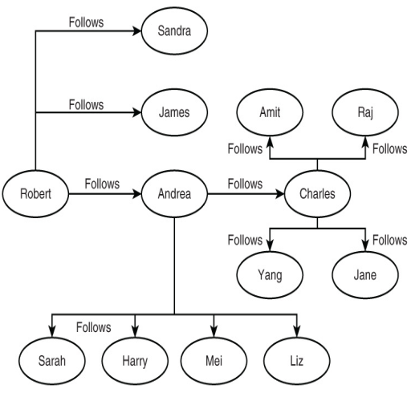
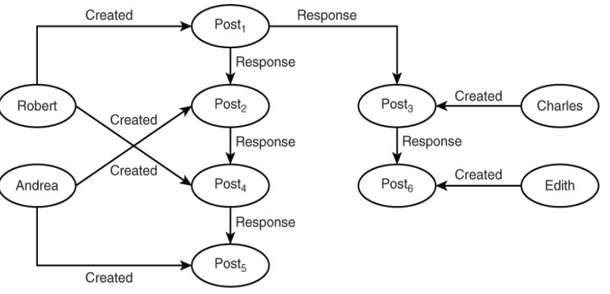
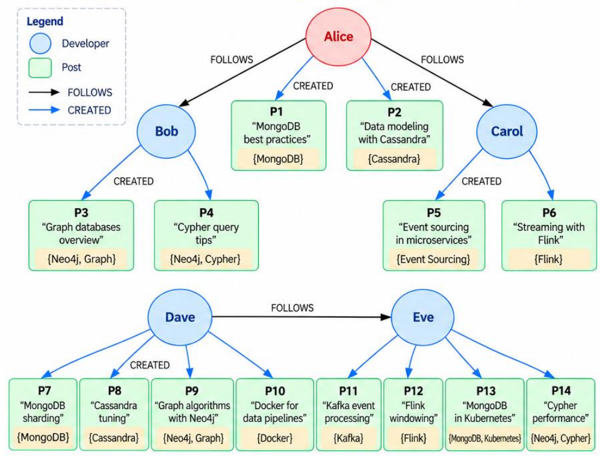
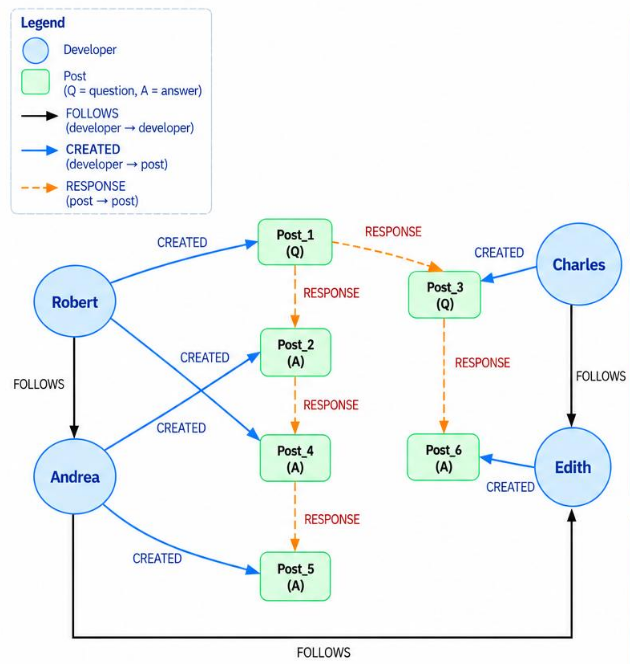

# 1. Index

<!--toc:start-->

- [1. Index](#1-index)
- [2. Design a Social Network](#2-design-a-social-network)
  - [2.1. Developers and Developers](#21-developers-and-developers)
  - [2.2. Developers and Posts](#22-developers-and-posts)
  - [2.3. Suggestions](#23-suggestions)
  - [2.4. Ranking](#24-ranking)
  <!--toc:end-->

# 2. Design a Social Network

Let's consider the database developer as the _main actor_ of the **social network**.

The main use cases may be:

1. **Join** and **leave** the site
1. **Follow** other developers
1. **Post** questions for other with expertise in a specific topic
1. **Answer** posted questions
1. **Suggest** new connections with other developers based on shared interests
1. **Rank** members according to their number of connections, posts and answers

We can identify the entities and their relationships as follows:

- **Developers**: the main users of the social network
  - _Name_
  - _Location_
  - _Years of Experience_
  - _Areas of Interest_
- **Posts**
  - _Date Created_
  - _Topic Keyword_
  - _Post Type_ (question, tip, news, ...)
  - _Title_
  - _Body_

Considering these two entities, the following **candidate relations** can be analyzed:

- _Developer_ - _Developer_
- _Developer_ - _Post_
- _Post_ - _Developer_
- _Post_ - _Post_

Instead of considering **all the possible combinations** for the identification
of candidate relations, which is unsustainable when the number of entities
increases, we can focus on the combinations that are **reasonably** likely
to **support queries** related to the **application requirements**.

## 2.1. Developers and Developers

For example, if a developer **follows** another developer, it is likely that the
first developer is _interested_ in reading the other's posts.

The depth of the path (how many edges to travels for identifying the interesting
posts) is a _parameter_ that can be defined and handled **at the application level**.

In the image on the right, we can see a _graph_ representation of how the `Follows`
relations can grow.

If we use `Node4J` we must be careful in handling the fact that the DBMS considers
our _one-directional_ `Follows` relation as a _bidirectional_ relation.

## 2.2. Developers and Posts

When establishing the relation between a developer and a post, we must keep in mind
that in our _use case_ we are just interested only in **who created a post** and
not on which posts a developer has read. Therefore, we can define a
**one-directional** edge `Created` between a developer and a post.

Furthermore, we said that developers can **answer** questions posted by other developers,
creating a new post. In this case, we can define a **one-directional** edge `Response`
between Posts, introducing a _hierarchical_ structure in the graph.

## 2.3. Suggestions

Now we have to find a way to make **suggestions** to developers about other
developers they may want to follow.

We can make these suggestions based on _topics of interest_.
To identify the topics of interest we can either:

1. Make the developer **echo** their interests in their profile
1. **Infer them based on his/her posts** and the posts of the developers he/she
   follows

To implement the second approach we can differentiate the posts based on a different
**priority level** (_weight_) for posts created by the developer and posts created
by the developers he/she follows.

Basing us on the image on the right, we can infer the interest of `Alice`:

- **L1 Topics (weight = 2)**: `MongoDB`, `Cassandra`
- **L2 Topics (weight = 1)**: `Neo4J`, `Graph`, `Event Sourcing`, `Flink`

At this point, to suggest a new developer for `Alice` we consider the developers
she doesn't follow yet (`Dave` and `Eve`), infer their topics and compute a _similarity
score_ using weight:

- `Dave`: $L1 + L2 = 4 + 2 = 6$
- `Eve`: $L1 + L2 = 2 + 2 = 4$

The recommendation engine will then suggest `Dave` to `Alice` because he has a
higher score.

However, this policy used like this may lead to **efficiency problems**, since we
have to _scan every user_ to compute the similarity score.

To optimize this process we can modify our policy, for example, by **limit the
developer pool** only to the _follower-of-a-follower_.

At the same time, we can also tweak how the suggestions of posts are make, maybe
by limiting the pool only to the _posts of the developers a developer follows_,
or _only to the post of the developer followee that are topic of interests for
him/her_.

## 2.4. Ranking

Considering the image on the right, we can define different **rankings** for
example based on _number of connections_, _number of posts_ and _number of answers_.

To do that we might use some **counters** for each developer, that are updated
every time a new connection is made, a new post is created or a new answer is posted.

This kind of analytics are just related to _incoming_ and _outgoing_ edges, so
they can be easily computed by the DBMS, without the need to scan the entire graph.

