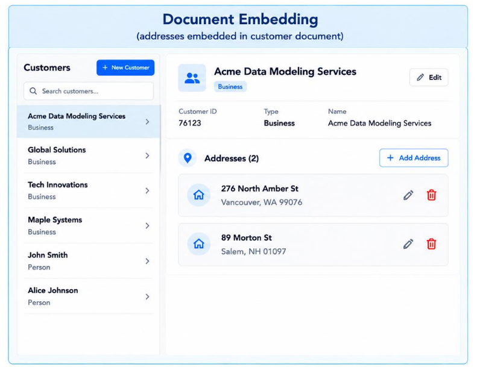
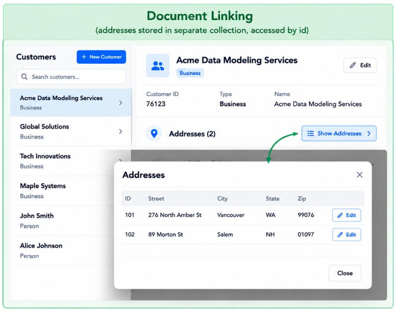
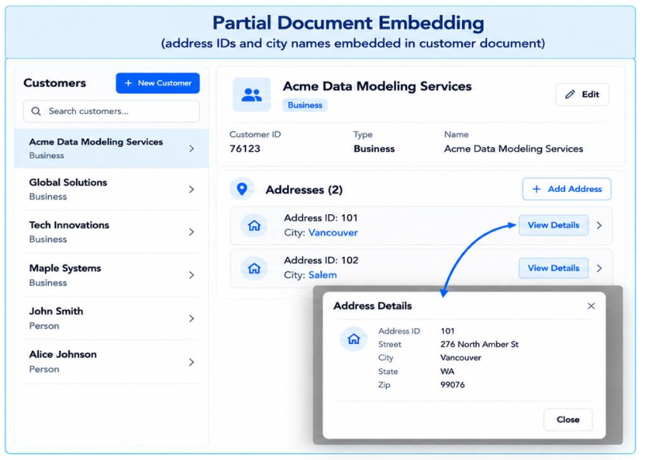

# 1. Index

<!--toc:start-->

- [1. Index](#1-index)
- [2. Document Database](#2-document-database)
  - [2.1. XML Documents](#21-xml-documents)
    - [2.1.1. XML Ecosystem](#211-xml-ecosystem)
    - [2.1.2. XML Databases](#212-xml-databases)
    - [2.1.3. Drawbacks](#213-drawbacks)
  - [2.2. JSON Documents](#22-json-documents)
    - [2.2.1. JSON Databases](#221-json-databases)
  - [2.3. Document Embedding](#23-document-embedding)
    - [2.3.1. Example](#231-example)
  - [2.4. Many to Many Relations](#24-many-to-many-relations)
    - [2.4.1. Example: Time Series](#241-example-time-series)
  - [2.5. Indexing Document Database](#25-indexing-document-database)
  - [2.6. Read and Write-Heavy Applications](#26-read-and-write-heavy-applications)
  - [2.7. Transactions Processing Systems](#27-transactions-processing-systems)
  - [2.8. Sharding](#28-sharding)
    - [2.8.1. Partitioning Algorithms](#281-partitioning-algorithms)
  - [2.9. Design Tips](#29-design-tips)
    - [2.9.1. Organize Collections](#291-organize-collections)
    - [2.9.1.1. Impact of Code](#2911-impact-of-code)
    <!--toc:end-->

# 2. Document Database

Document Databases are **non-relational** databases that store data
as structured documents, typically in formats like `XML` or `JSON`.

They ensure **high flexibility**, allowing to handle _complex data
structures_.

Like _key-value databases_, document databases are **schema-less**.
Unlike _key-value databases_, they allow **complex operations**
such as _queries_ and _filtering_, with some even allowing
**ACID transactions**.

## 2.1. XML Documents

`XML` stands for _eXtensible Markup Language_. Like all markup
language the documents content follow a specific **structure**.

Specifically, `XML` uses **tags** to provide _extra information_
giving a reader more information on what the _data means_.

Its capable of representing almost **any form of information**
in a structured way.

Along with `CSS` (_Cascading Style Sheets_) it allowed **second
generation websites** to separate _content_ from _presentation_.

Being based on _Unicode Text_, it is the basis for many data
**interchange protocols**, such as `SOAP` (_Simple Object
Access Protocol_) to which it was a foundation, because
of its efficiency in transmission.

Today it is a **standard** also for many document types,
including word processing documents and spreadsheets (`docx`,
`xlsx` and `pptx` are all `XML` based).

Other advantages are:

- **Platform independence**: One `XML` document can be displayed in
  differently in different media and software platform.
- **Modularization**: `XML` documents can be easily split into smaller
  parts and recombined.

An example of an `XML` document is:

```xml
<songs>
  <item>
    <title>Kind of Blue</title>
    <artist>Miles Davis</artist>
    <tracks>
      <track length="9:22">So What</track>
      <track length="9:22">Freddie Freeloader</track>
      <track length="5:37">Blue in Green</track>
      <track length="11:33">All Blues</track>
      <track length="7:27">Flamenco Sketches</track>
    </tracks>
  </item>
  <item>
    <title>Blue Train</title>
    <artist>John Coltrane</artist>
    <tracks>
      <track length="10:43">Blue Train</track>
      <track length="9:21">Moment's Notice</track>
      <track length="7:15">Locomotion</track>
      <track length="8:43">I'm Old Fashioned</track>
      <track length="11:12">Lazy Bird</track>
    </tracks>
  </item>
</songs>
```

### 2.1.1. XML Ecosystem

When dealing with `XML` documents there are several things to consider.

The first is the **XML Schema**. It defines the structure of an XML document,
including the elements and attributes that can appear in it, their data types,
and the relationships between them. It ensures that XML documents adhere to a
specific format and can be validated against the schema.

```xml
<xs:element name="book">
  <xs:complexType>
    <xs:sequence>
      <xs:element name="title" type="xs:string"/>
      <xs:element name="author" type="xs:string"/>
      <xs:element name="year" type="xs:gYear"/>
    </xs:sequence>
  </xs:complexType>
</xs:element>
```

Another thing is **XSLT**, a language used to transform XML documents into other
formats, such as `HTML` or `PDF`. It allows developers to create templates
that define how the data in an XML document should be presented.

```xml
<xsl:template match="book">
  <div>
    <h1><xsl:value-of select="title"/></h1>
    <p>Author: <xsl:value-of select="author"/></p>
    <p>Year: <xsl:value-of select="year"/></p>
  </div>
</xsl:template>
```

When we want to navigate through elements and attributes
in an XML document, the syntax used is called **XPath**:

```xpath
/book/title
/book/author
//book[@id='b1']
/book/chapter[1]/title
```

We can query this language using the `XQuery` language:

```xquery
for $b in /books/book
where $b/year > 2010
return $b/title
```

### 2.1.2. XML Databases

The tools described above are used to create and interact with **XML
Databases** from the _client layer_.

They interact with the _processing layer_, that parses the documents
and executes the queries, and the _storage layer_, that stores the
actual documents creating and updating _indexes_, for text search, and _Document
Object Model_ (_DOM_), for a tree-based representation.

RDBMSs did not get replaced by XML databases, instead they started supporting them
by allowing the storage of XML documents in _BLOB_ columns.

Their typical use cases are:

- **Content Management**: Store and organize documents (e.g., articles,
  reports, manuals) in a structured way.
- **Data Interchange**: Exchange structured data (e.g., SOAP web services)
- **Enterprise Documents**: Store documents (e.g., docx, xlsx, pptx)
- **Integration**: Use `XML` with existing RDBMSs to store and query
  structured data.

### 2.1.3. Drawbacks

`XML` is very powerful and flexible, but it comes with some drawbacks.

The first is that it is **verbose** and **repetitious**, thus increasing the amount
of storage required. This property makes `XML` _documents_ **computationally
expensive to parse** and **wasteful of space**.

In general, they are used as **content-management systems**, for example as a
collection of text files. All the other possible usage got replaced by other formats,
like `JSON` or `YAML`, since they are more compact and easier to parse.

## 2.2. JSON Documents

`JSON` stands for _JavaScript Object Notation_. It is a lightweight data-interchange
format that is easy for humans to read and write, and easy for machines to
parse and generate.

Thanks to their integration with `JavaScript`, `JSON` documents have often been
preferred over `XML` documents, especially for **data interchanging** in web
applications.

Despite its name, `JSON` is (mostly) a language-independent way of specifying
objects as _name-value_ pairs.

```json
{
  "skillz": {
    "web": [
      {
        "name": "html",
        "years": 5
      },
      {
        "name": "css",
        "years": 3
      }
    ],
    "database": [
      {
        "name": "sql",
        "years": 7
      }
    ]
  }
}
```

An **object** is an _unordered set of name/value pairs_:

- The pairs are enclosed within braces `{}`
- There is a colon `:` between the name and the value
- Pairs are separated by commas `,`

An **array** is an _ordered collection of values_:

- The pairs are enclosed within brackets `[]`
- Values are separated by commas `,`

`JSON` values can be `strings`, `numbers`, `objects`, `arrays`, `boolean`, or `null`.

If we want to compare `JSON` with `XML`, we can say that they both:

- Are human and machine readable
- Are hierarchical
- Are language independent
- Are supported in APIs of many programming languages
- Have simple syntax

As for the differences, beside having a different syntax, `JSON` is
_less verbose_ and _easier to parse_, including _arrays_.

For example, we can compare the two formats representing the same data:

<div class="grid2">
<div class="">

```xml
<users>
  <user>
    <username>SammyShark</username>
    <location>Indian Ocean</location>
  </user>
  <user>
    <username>PollyParrot</username>
    <location>Caribbean Sea</location>
  </user>
  <user>
    <username>WallyWalrus</username>
    <location>Arctic Ocean</location>
  </user>
  <user>
    <username>BettyBeluga</username>
    <location>Atlantic Ocean</location>
  </user>
</users>
```

</div>
<div class="">

```json
{
  "users": [
    {
      "username": "SammyShark",
      "location": "Indian Ocean"
    },
    {
      "username": "PollyParrot",
      "location": "Caribbean Sea"
    },
    {
      "username": "WallyWalrus",
      "location": "Arctic Ocean"
    },
    {
      "username": "BettyBeluga",
      "location": "Atlantic Ocean"
    }
  ]
}
```

</div>
</div>

From this example we can compute that the XML document size is `416 bytes`,
while the `JSON` document size is `273 bytes`, which is a $\sim 34\%$ reduction.

One `JSON` drawback is that the names **must not be** `JavaScript`
reserved words, while `XML` allows any name.

### 2.2.1. JSON Databases

A `JSON` **document** is the basic unit of storage.
It includes one or more **key-value pairs**, and may also contain
_nested documents_ and/or _arrays_.

```json
{
  "id": 123,
  "name": "Alice",
  "address": {
    "city": "Wonderland",
    "zip": "12345"
  },
  "phones": ["123-456-7890", "987-654-3210"],
  "email": "alice@ex.com",
  "age": 30,
  "active": true
}
```

_Arrays_ as well can contain simple values or nested documents.

We call **Collection** a set of documents sharing some _common purpose_, even
if they have different fields and structures.

## 2.3. Document Embedding

A normal document database could _theoretically_ implement a **third
normal form schema**, simulating the relational database tables.

We must try to **_avoid to re-build a relational database_** using
`JSON` or `XML` documents.

When we have something like this example:

```json
{
  "id": 123,
  "title": "CAMPUS REMEMBER",
  "category": "Action",
  "Actors": [
    { "actor_id": 1, "name": "John Doe" },
    { "actor_id": 2, "name": "Jane Smith" },
    { "actor_id": 3, "name": "Bob Johnson" }
  ]
}
```

This allows us to retrieve both a film and its actors in a single query.

However, is it plausible to think that \_actors_could appear across multiple
documents.

In a complex design this could lead to **issues** and possibly **inconsistencies**
if one of the actor's attributes changes.
Moreover, some `JSON` databases have a **document size limit** (e.g., `16MB`
in `MongoDB`),
which could be a problem if we have a lot of actors.

To solve this problem we can use **Document Linking** (or _document references_),
rolling back to something similar to a relational database.
We will then have a collection of films and a collection of actors, and we
link them using the
actors' `id`:

```json
{
  "id": 123,
  "title": "CAMPUS REMEMBER",
  "category": "Action",
  "actors": [1, 2, 3]
}
```

```json
{
  "actor_id": 1,
  "name": "John Doe"
}
{
  "actor_id": 2,
  "name": "Jane Smith"
}
{
  "actor_id": 3,
  "name": "Bob Johnson"
}
```

This is allowed for simple linking. Instead, if we start collecting multiple
documents simulating complex joins we probably chose the wrong data model and
we should consider revert back to a relational database.

Apart from this consideration, there is no equivalent of _third normal form_
that defines a "correct" model.

### 2.3.1. Example

<div class="grid2">
<div class="">

Lets consider the **customer** entity which may have associated a list of
address entities.

This relation is a **one-to-may**, and, since logically different customers
addresses are not related, we can just **embed** the information in the
_customer document_.

```json
{
  "customer_id": 76123,
  "name": "Acme Data MOdeling Services",
  "person_or_business": "business",
  "address": [
    {
      "street": "276 North Amber St",
      "city": "Vancouver",
      "state": "WA",
      "zip": "99076"
    },
    {
      "street": "89 Morton St",
      "city": "Salem",
      "state": "NH",
      "zip": "01097"
    }
  ]
}
```

This model works just fine. That said, we must still address the _document
size_ issue. Commonly, it is rare that a customer has more than a few
addresses, so in this case is not a problem.

</div>
<div class="">

</div>
</div>

Nonetheless, if we have a **one-to-many** relation where the "many" side is
**unbounded**, we should consider using **document linking** instead of
_embedding_. This is also suggested in several database documentations.

<div class="grid2">
<div class="">

Instead, id we have a button that will recall the addresses only if requested,
we could be thinking of using the _document linking_ approach.
The final choice will depend on several factors, like:

- Size of the "many" side (we already addressed this)
- Average number of times the addresses are requested

The linking approach will become something like this:

```json
{
  "_id": 76123,
  "name": "Acme Data MOdeling Services",
  "person_or_business": "business",
  "address_ids": [101, 102]
}
```

```json
{
  "_id": 101,
  "street": "276 North Amber St",
  "city": "Vancouver",
  "state": "WA",
  "zip": "99076"
}
```

```json
{
  "_id": 102,
  "street": "89 Morton St",
  "city": "Salem",
  "state": "NH",
  "zip": "01097"
}
```

The **id-index** is defined by default by several document databases,
so we can use it to retrieve the addresses.

</div>
<div class="">

</div>
</div>

One last choice we can make is to use a **hybrid approach**
where we embed the most accessed informations, but decide to link the rest.

This is called **Partial Embedding**.

<div class="grid2">
<div class="">

In this case, we can embed the informations required by the mockup (`id` and `city`),
and using the `id` we save all the other informations in a separate document.
This way have access to the most common informations without having to query the
database, still allowing to retrieve the rest of the informations if needed.

```json
{
  "_id": 76123,
  "name": "Acme Data MOdeling Services",
  "person_or_business": "business",
  "address": [
    {
      "address_id": 101,
      "city": "Vancouver"
    },
    {
      "address_id": 102,
      "city": "Salem"
    }
  ]
}
```

```json
{
  "_id": 101,
  "street": "276 North Amber St",
  "city": "Vancouver",
  "state": "WA",
  "zip": "99076"
}
```

```json
{
  "_id": 102,
  "street": "89 Morton St",
  "city": "Salem",
  "state": "NH",
  "zip": "01097"
}
```

This allows us to be faster than the _linking approach_, keeping the
database size smaller than the _embedding approach_.

This has a price we have to pay: since informations are duplicated, we
have to **propagate any updates made in one or the other document**.

</div>
<div class="">

</div>
</div>

## 2.4. Many to Many Relations

Let's consider an example of application in which:

- A **student** can be enrolled in many courses
- A **course** can have many students enrolled to it

We can model the situation considering the following two collecitons:

<div class="grid2">
<div class="">

```json
{
  {
    "courseId": "C1667",
    "title": "Introduction to Data Modeling",
    "instructor": "Dr. Smith",
    "credits": 3,
    "enrolledStudents": [ "S1001", "S1002" ]
  },
  {
    "courseId": "C1668",
    "title": "Advanced Database Systems",
    "instructor": "Dr. Johnson",
    "credits": 3,
    "enrolledStudents": [ "S1001", "S1003" ]
  }
}
```

</div>
<div class="">

```json
{
  {
    "studentId": "S1001",
    "name": "Brian Nelson",
    "gradYear": 2024,
    "courses": [ "C1667", "C1668" ]
  },
  {
    "studentId": "S1002",
    "name": "Emily Davis",
    "gradYear": 2025,
    "courses": [ "C1667" ]
  },
  {
    "studentId": "S1003",
    "name": "Michael Brown",
    "gradYear": 2024,
    "courses": [ "C1668" ]
  }
}
```

</div>
</div>

In this case, it could be more efficient to use a **partial embedding** approach,
where we embed the most accessed information (like `courseId` and `title`) in
the student documents, and link to the full course documents for additional details.

The same could be done for the course documents, embedding the `studentId` and
`name` of enrolled students, while linking to the full student documents for
more information.

<div class="grid2">
<div class="">

```json
{
  "studentId": "S1001",
  "name": "Brian Nelson",
  "gradYear": 2024,
  "courses": [
    {
      "courseId": "C1667",
      "title": "Introduction to Data Modeling"
    },
    {
      "courseId": "C1668",
      "title": "Advanced Database Systems"
    }
  ]
}
```

</div>
<div class="">

```json
{
  "courseId": "C1667",
  "title": "Introduction to Data Modeling",
  "instructor": "Dr. Smith",
  "credits": 3,
  "enrolledStudents": [
    {
      "studentId": "S1001",
      "name": "Brian Nelson"
    },
    {
      "studentId": "S1002",
      "name": "Emily Davis"
    }
  ]
}
```

</div>
</div>

This allows us to have _faster reads_, without needing joins, at the cost
of needing to propagate updates to the embedded information.

### 2.4.1. Example: Time Series

Suppose we need to track the location, fuel consumption and other metrics of
the trucks in a company fleet _every three minutes_, and save them in a _fleet
management database_.

A single data transmission from a truck could look like this:

```json
{
  "truckId": "T1234",
  "driver_name": "Jane Doe",
  "timestamp": "2024-06-01T12:00:00",
  "fuel_consuption_rate": "8.5 mpg",
  "location": {
    "lat": 37.7749,
    "lon": -122.4194
  },
  "speed": 78,
  "engineTemperature": 90,
  ...
}
```

Using a full embedding approach, we would have a single document for each truck
with an attribute `operational_data` containing an array of all the data
transmissions. This could lead.

To slim the size we can use an hybrid approach, where we only save the most important
information, such as `timestamp`, `fuel_consumption_rate`, and `location`, in
the main truck document, while linking to separate documents for the full
operational data.

```json
{
  "truckId": "T1234",
  "driver_name": "Jane Doe",
  "operational_data": [
    {
      "timestamp": "2024-06-01T12:00:00",
      "fuel_consumption_rate": "8.5 mpg",
      "location": {
        "lat": 37.7749,
        "lon": -122.4194
      }
    },
    ...
  ]
}
```

```json
{
  "timestamp": "2024-06-01T12:00:00",
  "fuel_consumption_rate": "8.5 mpg",
  "location": {
    "lat": 37.7749,
    "lon": -122.4194
  },
  "speed": 78,
  "engineTemperature": 90,
  ...
}
```

This could still have a **performance problem**, due to how document are handled
by the DBMS.

When we create a new document, the DBMS allocates a certain amount of space for
it (e.g., 4 KB). If the document grows beyond that size, the DBMS has to relocate
it to another location with sufficient space.
After copying the document to the new location, the DBMS must _free_ the previous
location.

These operations can **adversely affect performance**, especially if they
happen frequently.

A solution for avoiding this problem is to **allocate sufficient space _when
we create the document_**.

In this case, we could _pre-allocate_ a list of measurements (e.g, 200 for a day),
allowing the DBMS to store them in a single document without needing to
relocate it.

```json
{
  "truckId": "T1234",
  "driver_name": "Jane Doe",
  "operational_data": [
    {
      "timestamp": "2024-06-01T12:00:00",
      "fuel_consumption_rate": "8.5 mpg",
      "location": {
        "lat": 37.7749,
        "lon": -122.4194
      }
    },
    {
      "timestamp": null,
      "fuel_consumption_rate": null,
      "location": null
    },
    ...
  ]
}
```

## 2.5. Indexing Document Database

Indexes are **special data structures** that store a small portion of the
collection's data set in an **easy to traverse form**.

They are usually _ordered by the value of the field_, to support _efficient
quality matches_ and _range-based queries_, avoiding the need to scan every
document in a collection.

The index is usually composed by a **key** and an array of **pointers** to
the documents that contain that key.

This way, when we search for a key, we will only need to open the documents
pointed by the record in the index, instead of doing a full collection scan.

## 2.6. Read and Write-Heavy Applications

We define **read-heavy applications** those applications that follow the schema:

1. Issuing a Query
2. Getting the results
3. Formulating a new query based on the results

In this kind of applications, the use of **several indexes** can allow the user
to quickly access the database.

As for **write-heavy applications**, for example the trucks we saw before,
increasing the number of indexes requires us an _higher amount of time_ required
to update the indexes and closing a write operation.

In conclusion, the number and type of indexes to adopt must be identified as a
**trade-off** solution between read and write performance.

## 2.7. Transactions Processing Systems

These systems are designed for _fast write operations_ and _targeted reads_.

This kind of system usually relies on a **two-document model**:

- **Document DB Tuned for Writes (OLTP)**: it allows an high write throughput,
  and a low latency reads by key. It uses many small transaction being optimized
  for operational workloads.
- **Document DB Tuned for Reads (OLAP)**: it allows complex queries and aggregations,
  handling large volumes of data.

All the updates are propagated from the OLTP to the OLAP through a periodical
**Extract, Transform, Load (ETL)** process.

## 2.8. Sharding

**Sharding**, or **horizontal partitioning**, is the process of _dividing data blocks
into chunks_.

Each block, labeled as a _shard_ is deployed on a **specific node of a cluster**.

Each node can contain **only one shard**, but each shard _can be replicated_ on
multiple nodes.

Using the sharding technique can allow us to **handle heavy loads** and **increase
the number of users**, as data may be distributed across a variable number of
servers that may be _added or removed_ as needed.

This solution is cheaper than _vertical scaling_ and, if combined with
replication, can also ensure **high availability** and **fast responses**.

To implement sharding with a specific Document Databases, its designer has to
select:

- **Shard Key**: one r more fields **_that exists in all documents_** in a
  collection, used to separate documents (e.g, unique ID, name, date,
  category, etc.)
- **Partitioning Algorithm**: a function that **_maps the shard key to a
  specific shard_**.

### 2.8.1. Partitioning Algorithms

There are three main categories of partition algorithms, based on:

- **Range**: if the shard key is a number or a date, we can use this kind of
  algorithm to divide the data into ranges (e.g., 1-100, 101-200, etc. or
  monthly ranges).
- **Hashing**: we can use a hash function to determine where to place a document.
  We can also use _Consistent Hashing_ [described when we were talking on
  KV-DB](./Key%20Value%20Database#2312-consistent-hashing) to avoid _hot spots_.
- **List**: we can use the values on an atomic shard key to determine where to
  place a document. For example, if a product database has several types, we can
  divide the products into shards based on their type (e.g., electronics,
  clothing, etc.).

## 2.9. Design Tips

### 2.9.1. Organize Collections

To design efficiently document database, we must understand what is a **Collection**.
A **collection** is a _set of documents_ stored and managed by a Document DBMS.

Unlike relational tables, a collection can contain documents with **different
structures** (_polymorphic schema_).

In general, collections should store documents about the entity of _same type,
or at least sharing \_common purpose_.

Suppose we have to model `SystemEvents`, naturally categorized as
`ClickStreamEvent` and `ServerLogEvent` we can chose to store them in a **single
collection** or **multiple collections**.

In a **Single Collection** approach all events types stored together.

```json
// -- system_events collection -- //
{
  "event_type": "click_stream",
  "datetime": "...",
  "session_num": "...",
  ...
}
{
  "event_type": "server_log",
  "datetime": "...",
  "server_IP_addr": "...",
  ...
}
```

This comes with some advantages:

- Single collection to query, with a single common index
- Simple schema management
- More efficient for different event types queries

And some disadvantages:

- Documents are mixed together
- May require filtering
- Different event types can gave different access patterns

Meanwhile, in a **Multiple Collections** approach each event is stored in a
separate collection, with its own structure.

We can use _linking_ to mimic some hierarchical relationships between entities.

For example, since both `click_stream` and `server_log` events are related to
a `SystemEvent`, we can create a general entity `SytemEvent` with a specific
`id` and `datetime` and other _common attributes_.

Then we implement `click_stream` and `server_log` as separate collections,
each with a link to the `SystemEvent` entity.

```json
// -- system_events collection -- //
{
  "event_id": "...",
  "datetime": "...",
  ...
}
```

```json
// -- click_stream_events collection -- //
{
  "event_id": "...",
  "datetime": "...",
  "session_num": "...",
  "client_IP_addr": "...",
  "referring_URL": "...",
  ...
}
```

```json
// -- server_log_events collection -- //
{
  "event_id": "...",
  "datetime": "...",
  "event_type": "...",
  "server_IP_addr": "...",
  "descr": "...",
  ...
}
```

This comes with some advantages:

- Each collection stores a single document type
- Tailored index for each event type
- Different retention and management policies for each collection
- Potentially more efficient for specific event type queries

As well as some disadvantages:

- Queries across multiple collections may require joins or multiple queries
- More collections to manage
- Common operations can be more complex, requiring multiple queries or joins

In the end, the choice **depends only on the _application workload_**, and not
on the logical structure of the entities.

#### 2.9.1.1. Impact of Code

Another parameter to consider when choosing if using one or more collections is
the structure of the application code.

If an application code contains a substantial amount of logic that applies to all
documents of a given types, relegating the type-specific operations to different
function/modules, it is an indication to **create separate collections** for each
document type.

```py
def process_event(event):
    # Common operations for all event types

    if event["event_type"] == "click_stream":
        process_click_stream_event(event)
    else event["event_type"] == "server_log":
        process_server_log_event(event)
```

Instead, if the application code is mostly common to all documents, and only
a small amount of codes handles _specialized_ or _specific_ operations (like when
documents only differ for optional fields), it is an indication to **use a single
collection**, with optional attributes.

```py
def process_book(doc):
  book = {}
  book["title"] = doc["title"]
  book["author"] = doc["author"]
  book["year"] = doc["year"]
  # ...
  book["descr"] = doc["descr"]

  if doc.get("ebook") == True:
    book["descr"] = book["descr"] + " (ebook)" + str(doc["ebook_size"])
```
