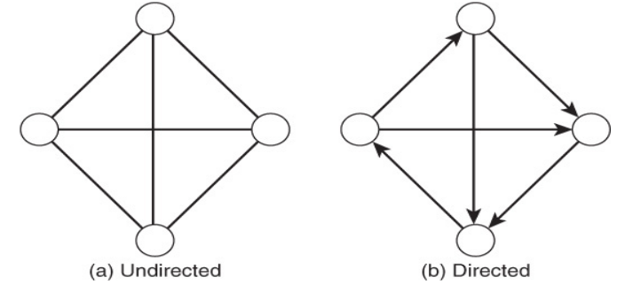
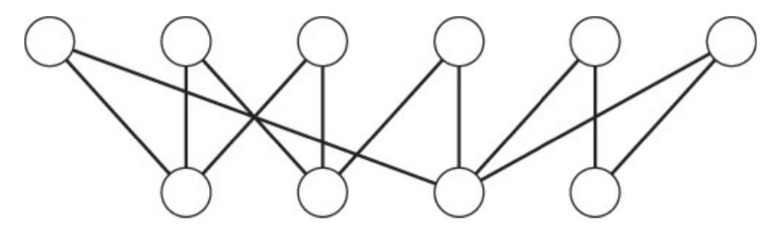
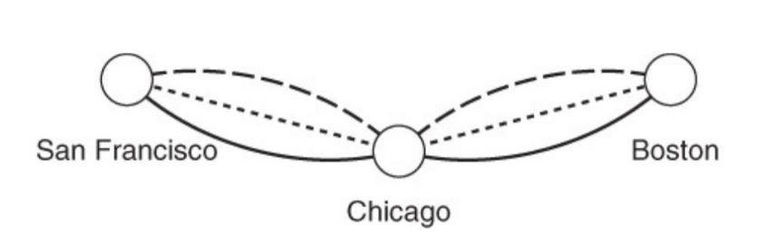
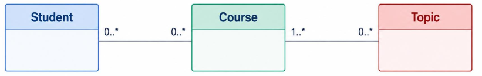
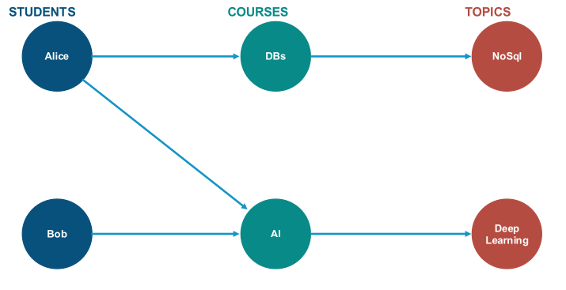
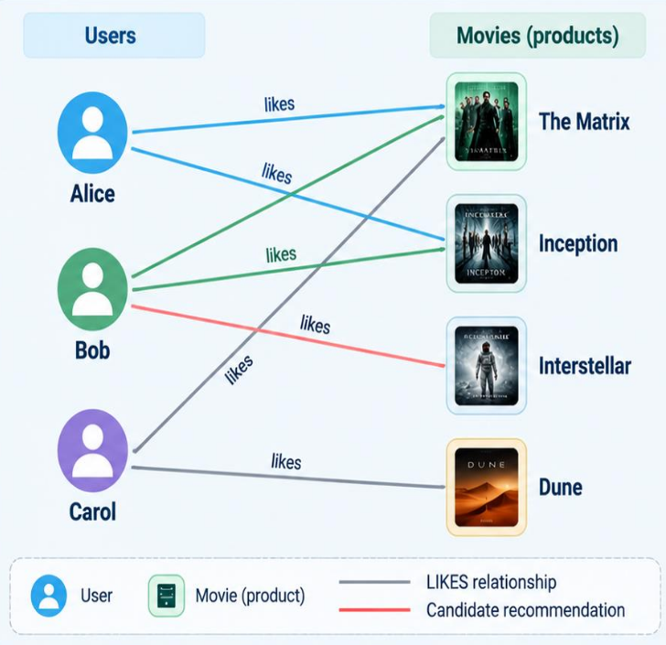
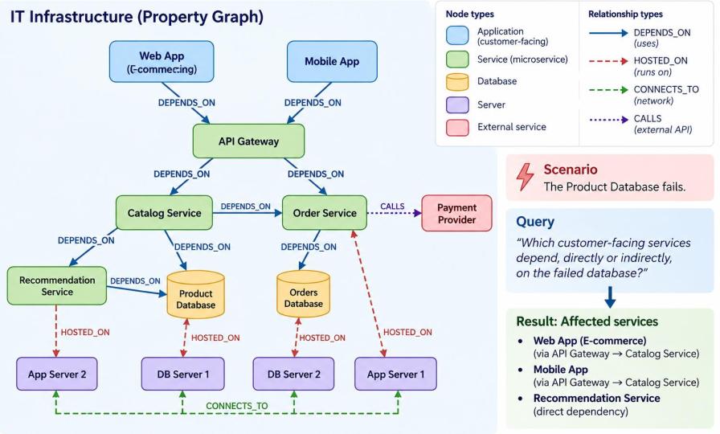
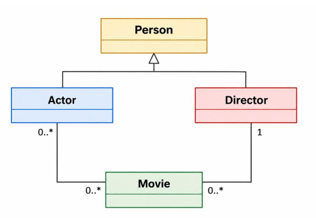
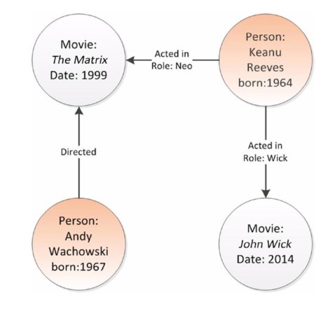
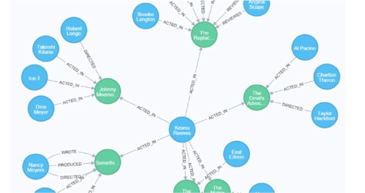

# 1. Index

<!--toc:start-->

- [1. Index](#1-index)
- [2. Graph Database](#2-graph-database)
  - [2.1. Introduction to Graphs](#21-introduction-to-graphs)
    - [2.1.1. Graphs Metrics](#211-graphs-metrics)
    - [2.1.2. Graph Traversal](#212-graph-traversal)
    - [2.1.3. Isomorphism](#213-isomorphism)
    - [2.1.4. Betweenness of a Vertex](#214-betweenness-of-a-vertex)
    - [2.1.5. Flow Networks](#215-flow-networks)
    - [2.1.6. Bipartite and Multi Graphs](#216-bipartite-and-multi-graphs)
  - [2.2. Using Graph Databases](#22-using-graph-databases)
    - [2.2.1. Graph vs Relational Database](#221-graph-vs-relational-database)
    - [2.2.2. Graph Oriented Design](#222-graph-oriented-design)
    - [2.2.3. Example: Recommendation](#223-example-recommendation)
    - [2.2.4. Best Suited Scenarios](#224-best-suited-scenarios)
    - [2.2.5. Costs of Graphs](#225-costs-of-graphs)
  - [2.3. Graph Database Design](#23-graph-database-design)
    - [2.3.1. Advices](#231-advices)
      - [2.3.1.1. Neo4j Storage Model](#2311-neo4j-storage-model)
  - [2.4. Example: Hollywood DB](#24-example-hollywood-db)
  <!--toc:end-->

# 2. Graph Database

## 2.1. Introduction to Graphs

**Graph Databases** is a type of NoSQL database that uses graph structures.

In this type of database, instances of entity are represented through
_vertices_ (or _nodes_) that _may gave a **relation**_ with another instance.

The relations are represented through **edges** (or **links**), and they
are typically associated with one or more property (weight, distance, etc.),
representing some value about the _strength_ of the relation.

The edges can be _directed_ or _undirected_. _Directed edges_ are used to represent
a **one-way relationship** between two nodes, while _undirected edges_ are
used to represent a **two-way relationship** between two nodes.

The presence (or absence) of a direction depends on **specific applications**, and
makes a **Graph** either **Directed** or **Undirected**.



We call the _set of vertices and edges_ that connect two vertices a **path**.
It allows to **capture information about the relations** of those vertices.

On some graph, there may be **multiple paths** between two vertices. In those case,
the problem of **finding the best path** is often taken into consideration.

There also can be **loops**, which are relation of a vertex to itself.

We can perform mathematical operations on graph, such as:

- **Union**: Combines the set of vertices and edges from two or more graphs
- **Intersection**: Is the set of vertices and edges that are _common_ to both
  graphs

In general, the output of both these operations is a new graph (or an empty one).

### 2.1.1. Graphs Metrics

Some useful metrics of graphs include to evaluate time and memory occupancy
required to handle a specific operation on a graph are:

- **Order**: the number of vertices in the graph
- **Size**: the number of edges in the graph

On top of those, other important metrics are the **Degree Centrality** and the
**Closeness Centrality**.

The **Degree Centrality** measures the _degree_ of the vertices (the number of
edges incident to it), measuring their importance within the graph.

Instead, **Closeness Centrality** measures the _average distance_ from a
vertex to all the other, based on the _shortest-paths distances_.

For a _connected graph_, we calculate the closeness centrality of a vertex $v$ as:

$$
  C_C(v) = \frac{n - 1}{\sum_{u \ne v}{d(v,u)}}
$$

Vertices with **high closeness** can reach the others through a **few number of
connections**.

### 2.1.2. Graph Traversal

Graph traversal is the process of **exploring a graph** by moving from one
vertex to another along its edges according to a specific strategy.

There are several traversal strategies, with the most common being:

- **Breadth-First Search (BFS)**: Explores all vertices at the current depth before
  moving to the next level.
- **Depth-First Search (DFS)**: Explores as far as possible along each branch before
  backtracking to visit unexplored vertices.

In both cases, the traversal may visit all vertices or only a subset of them, depending
on the objective.

The main purposes of graph traversal may include:

- The exploration of all vertices reachable from the starting vertex (also called
  **root**)
- Reading or updating properties associated with vertices and edges.
- Discovering connections and paths between vertices.

For example, we might want to explore a network of cities starting from a
specific city, progressively visiting other cities by following existing road connections.

In this case, the traversal strategy determines the order in which vertices
are explored.

### 2.1.3. Isomorphism

Tho graphs are **Isomorphic** if there exists a **one-to-one correspondence** between
their vertices that _preserves adjacency_.

In particular:

- The graphs have the same number of vertices and edges.
- Corresponding vertices have _the same connections_.

The visual representation of isomorphic graphs may differ, but they are considered
equivalent in terms of their structure.

This property is particularly useful because it allows us to **recognize equivalent
graphs structures**, independently of their visual representation.

The related concept of **sub-graph isomorphism** is also important, as it
allows us to identify recurring structural patterns within larger graphs.

### 2.1.4. Betweenness of a Vertex

**Betweenness Centrality** measures how _frequently_ a vertex lies on the
**shortest paths** connecting other pairs of vertices.

Vertices with high betweenness centrality are considered **important connectors**
within the graph, as they often act as **bridges or bottlenecks**, connecting
different regions of a network.

Removing an high betweenness vertex can significantly disrupt the flow of
information or resources, but won't necessarily imply the disconnection of the graph.

### 2.1.5. Flow Networks

A **Flow Network** is a **directed graph** in which each edge has a **non-negative
capacity** representing the **_maximum amount of flow_ it can carry**.

This kind of graph introduces four main concepts:

- **Capacity**: The maximum flow that an edge can support.
- **Flow**: The actual amount of flow passing through an edge. It must be non-negative
  and not exceed its capacity.
- **Source**: A special vertex from which flow originates.
- **Sink**: A special vertex where flow is collected or consumed.

Flow conservation is a **specific but not mandatory requisite** typical to
ordinary vertex (it usually don't apply to _source_ and _sink_). It states
that the total flow entering a vertex must equal to the total outgoing flow.

### 2.1.6. Bipartite and Multi Graphs

In **Bipartite Graphs** there are _two distinct sets of vertices_,
and edges only connect vertices from different sets.

This can be used for modeling relationships between two different types of entities,
such as students and courses, or users and products.



Multi-Graphs are graphs that allow **multiple edges** between the same pair of vertices.
These may represent different types of relationships or interactions between the
same entities, each equipped with **different sets of properties**.



## 2.2. Using Graph Databases

Supposing we have the following UML class diagram:



We now have to decide which model to use to represent the data:

- **Key-Value Database**: It would allow _fast access_ when the key is known, managing
  the relation through the code.
- **Document Database**: It stores aggregates of related attributes, using embedding
  and referencing model association between documents.
- **Graph Database**: It allows to _directly model relationships_ between entities,
  making _connection explicit_. This way it is possible for queries to follow
  patterns and paths between entities.

If the question we have to answer is not _"What are the attributes of X?"_,
but rather _"How is X connected to Y?"_ the best choice is to use a **Graph Database**.

The nomenclature of a graph database is perfect to confuse people:

- **Entity**: is an **_instance_** of a _class entity_ (conceptually a class
  object or a relational table row)
- **Vertex**: represents an entity, with some _properties_ (informations about it
  typically in JSON format)
- **Edge**: specifies a relation between two vertices, along with some properties
  (also in JSON format)

Graph databases are not suited for storing large amount of properties.
When using them we have to pay attention to insert only the **least amount of
useful properties** we want to immediately show to a user.

If in another moment an user wants more informations about one particular entity,
we can always query another database (relational, key-vaue, ...) to get the
rest of the properties.

There is one **crucial aspect** in doing this:

> **We must never make joins between a Graph Database and another type of database
> in one go**.

When designing a graph database, we have to focus on which relations are important
to the application.

Meaning that we should **avoid using undirected edges** when not necessary. This
makes us able to store informations in an easier and more efficient way.

<div class="grid2">
<div class="">

For example, the graph on the right is perfect to retrieve information such as:

- Which course does a specific student attend? (1 hop)
- Which topics are covered by a specific courses? (1 hop)
- Which topics are covered by courses attended by a specific student? (2 hops)

With edges directed as in the image it is for us very hard to efficiently
retrieve information such as:

- Which other students attend the same courses as a specific student?
- Which courses cover a specific topic?

</div>
<div class="">

</div>
</div>

### 2.2.1. Graph vs Relational Database

In relational databases, the relations are typically reconstructed through
joins between rows and tables.

In this paradigm, we have a well-defined schema, integrity constraints and mature
query optimizers that could even make simple joins faster than graph traversals.

The problem shows up when we deal with deeper paths, where we might need repeated
joins or even recursion.

On the other hand, graph databases explicitly represents entities and the connections
between them, allowing for **efficient traversal** of deeper relations.

For example, if we want to _"list all the course a particular student attends"_:

- **Relational Mode**: we perform a join between the `Students` and `Courses`
  tables, which is efficient.
- **Graph Mode**: we start from the vertex representing the student and traverse
  the `attending` edges to reach the connected course vertices, which is also efficient.

### 2.2.2. Graph Oriented Design

When designing a graph database, we have to focus on the **relations** that
are important to the application, and not only just to the records.

The main things we must pay attention to are:

- **Neighborhood**: understand which are the adjacent nodes of a vertex, and how
  they are connected to each other.
- **Reachability**: determine which vertices are reachable from a given vertex,
  and how many hops it takes to reach them.
- **Multi-hop Traversal**: consider the paths that involve multiple hops, and
  how they can be efficiently traversed. This allows to understand similarity
  between vertices, and to find patterns in the graph.
- **Network Analysis**: analyze the overall structure of the graph, including
  its connectivity, clusters, and communities. This can help to identify
  important vertices and edges, and to understand the flow of information or
  resources through the network.

Graphs are able to represents many real-work workloads scenarios:

- **Social Networks**: Users are represented as vertices, and their relationships
  (friendships, follows, likes) are represented as edges. Graph databases can efficiently
  model and query social connections, enabling features like friend recommendations,
  community detection, and influence analysis.
- **Recommendation Systems**: Products, users, and their interactions can be modeled
  as a graph. Graph databases can help to identify similar users or products, enabling
  personalized recommendations based on user behavior and preferences.
- **Fraud Detection**: Graph databases can be used to detect fraudulent
  activities by analyzing the relationships between entities (e.g., users,
  transactions, accounts).
- **Dependency Analysis**: In software development, graph databases can model
  dependencies between components, libraries, or services. This can help to identify
  potential issues, optimize build processes, and manage complex systems.
- **Supply Chain Management**: Graph databases can model the relationships
  between suppliers, manufacturers, distributors, and retailers. This can help to
  optimize supply chain operations, identify bottlenecks, and improve overall efficiency.

### 2.2.3. Example: Recommendation

<div class="grid2">
<div class="">

Suppose we ave a graph database like the one on the right, where a set of users
are connected through `likes` edges, to movies.

Supposing we want to recommend a new movie to Alice, what we can do is to
choose a movie to which her friends, or in general other _similar users_, likes.

Thus, we search the _most similar user_ to Alice, which is Bob in our example,
and select a movie from the set of movies that Bob likes, but Alice doesn't.

In this case we manage to extract a movie just using _graph queries_, without the
need to use any other database.

</div>
<div class="">

</div>
</div>

### 2.2.4. Best Suited Scenarios

Graph databases are not always the best choice for every application.

They are particularly well-suited for scenarios where we need to:

- Do **frequent multi-hop traversals** to explore relationships between entities.
  A possible scenario would be a networking platform that stores users and
  professional connections, where we need to find people within a set number
  of professional connections to another person.
- Have **several relationships types**. For example if we need to handle a
  university platform that links students, courses, professors, etc., in which
  we need to find the professors that supervise projects involving students
  in a specific course.
- Make **path-oriented queries**. A possible scenario would be a transport
  service that maintains routes, travel times and interchange stations,
  where we need to find a least-cost route between to cities, maybe with
  constrains on the number of transfers or the total travel time.
- Discover **indirect links** between entities. This could be used for example
  to make _fraud investigations_, where something like a bank records accounts,
  devices and relationships between "account user device", and from knowing that
  a customer is fraudulent, we have to find all other accounts connected
  to him through at most two shared-device steps.
- Have a connected, evolving domain, like an IT inventory that grows from
  application, servers, networks, and so on, where we need to find which customer
  depends, directly or indirectly, on a specific server.

For this last scenario, a possible dependency graph could be the following:

<figure class="">

<figcaption>

Image extracted from official notes handed by the professor.

</figcaption>
</figure>

In contrast, they may not be the best choice for scenarios where we:

- Do only **simple key retrieval**, like retrieving a cart by customer ID.
- We deal **mostly with independent documents**, like find independent products
  with variable specifications.
- We deal **mostly with tabular aggregations**
- Have to follow a **strongly constrained transactional workload**, like atomically
  transferring funds between account on a bank database.

### 2.2.5. Costs of Graphs

Graph databases are not necessarily more efficient than other type of
databases, nor do they eliminate computational complexity.

For example, just finding a **starting node** might rely of an index.

The computational cost of traversing the graph grows with the explored portion
of the graph, becoming significantly relevant when analyzing _high-degree_ nodes.

Also **global analysis**, like _community detection_, _centrality_, etc., may
be expensive.

## 2.3. Graph Database Design

Before deciding to use a graph database, we should have in mind the
**main kinds of queries** that our application will perform on the data.

As we discussed previously, graph databases are particularly well-suited for
problems domains easily described in terms of entities and relations.

The basic steps for designing a Graph DB start by reading the _requirements_ and
the _UML Analysis Class Diagram_.
From there we proceed by **identifying the queries** that we want to perform
on the data as well as the **entities in the graph** and the **relations
between them**.

At this point we can start to **map domain-specific queries** to more _abstract
graph-based queries_.

An example on how the translation could be done is the following:

<div class="flexbox" markdown="1">

|                             Graph-Centric Query                             |                      Domain-Specific Query                       |
| :-------------------------------------------------------------------------: | :--------------------------------------------------------------: |
|        How many hops does it take to get from vertex A to vertex B?         | How many follows relation are between Developer A to Developer B |
|              How many incoming edges are incident to vertex A               |               How many developers follow John Doe?               |
|                 What is the centrality measure of vertex B?                 |      How well connected is Jane Doe in the socual network?       |
| Is vertex C a bottleneck in the network, and what happens if it is removed? |    What would happen if a developer left the social network?     |

</div>

Only then we will be able to actually **implement the graph queries** and use
**graph algorithms**.

### 2.3.1. Advices

Some advices to keep in mind when designing a graph database are the following.

The first is to pay attention on the **dimension** of the graph. The bigger it
is, the more computationally expensive queries will be.

Secondly, if possible, we should **define and use indexes** for improving retrieval
time.

We should **Watch for Cycles** when traversing the graph,
using appropriate data structures to _keep track_ of visited nodes, avoiding
finding us in _endless cycles_ that revisit the same nodes multiple times.

To improve memory usage, we should use **only the appropriate types of edges**,
avoiding undirected edges for non-symmetrical relations, for example:

$$
\begin{CD}
  \text{Actor} @> \text{ACTED_IN} >> \text{Movie}
\end{CD}
$$

In fact, in **Property Graphs DBMSs** such as `Neo4J` edges can be traversed in
both directions, regardless of their direction.

The direction of the edge is still important for **query optimization** and for
**graph algorithms** that rely on edge direction, and should be distinguished in
the graph model. For example, `IS_FRIEND_OF` is semantically symmetric, whereas
`FOLLOWS` is asymmetric.

Also, we should be avoiding inserting _edges-properties_ if not necessary.

#### 2.3.1.1. Neo4j Storage Model

This is supported because on how `Neo4J` stores vertices and edges.

In particular, each vertex stores both a list of:

- **Outgoing Edges/Relationships**
- **Incoming Edges/Relationships**

Whereas the _relationships records_ stores:

- **Type of Relationship** (e.g., `ACTED_IN`, `FOLLOWS`, etc.)
- **Start Node** (the vertex from which the relationship originates)
- **End Node** (the vertex to which the relationship points)

This allows for efficient traversal of the graph in both directions. For example,
searching all the actors that acted in a movie without this paradigm would
require _traversing the edges of all the actor nodes_ in the graph.

This way instead, we start from the specific movie entity and traverse its `ACTED_IN`
incoming edges to find all the actors.

This strategy comes also with some **trade-offs**:

- **Local Bottleneck (_Supernode_)**: if a node has lots of incoming edges, `Neo4J`
  will have to loop through all the pointers in memory, slowing the local search.
- **Path Explosion**: Deep backward traversals through dense nodes, will inevitably
  cause _exponential path combinations_, heavily impacting both the `RAM` and the
  `CPU`.

For these reason `Neo4J` has other strategies to store these _super-nodes_ in more
efficient ways, but they are not relevant for our course.

## 2.4. Example: Hollywood DB

Let's suppose we want to design a DB for handling **movies,** **actors** and
**directors**, able to offer following _services_ for users:

1. Find all the actors that have ever appeared as a co-star in a movie
   starring a specific actor (for example: Keanu Reeves).
2. Find all movies and actors directed by a specific director (for
   example Andy Wachowski).
3. Find all movies in which specific actor has starred in, together
   with all co-stars and directors.



It is possible to use a _relational model_ to represent this data, but SQL
lacks the syntax to easily perform graph traversals with unbounded depth
degrading the performance for each level of traversal.

For example, to just retrieve all actors that ever worked with Keanu Reeves:

```sql
SELECT p2.personname, m1.moviename
FROM people p1
  JOIN actors a1 ON (p1.personid = a1.personid)
  JOIN movies m1 ON (a1.movieid = m1.movieid)
  JOIN actors a2 ON (m1.movieid = a2.movieid)
  JOIN people p2 ON (a2.personid = p2.personid)
WHERE p1.personname = 'Keanu Reeves';
```

If instead we used a **Graph Model**, our model would look something like this:

<div class="grid2">
<div class="">

</div>
<div class="">

</div>
</div>

The same query as before would look something like this:

```cypher
MATCH (keanu:Person {name:"Keanu Reeves"})
  -[:ACTED_IN]->(movie)<-[:ACTED_IN]-(coStar)
RETURN coStar.name;
```
