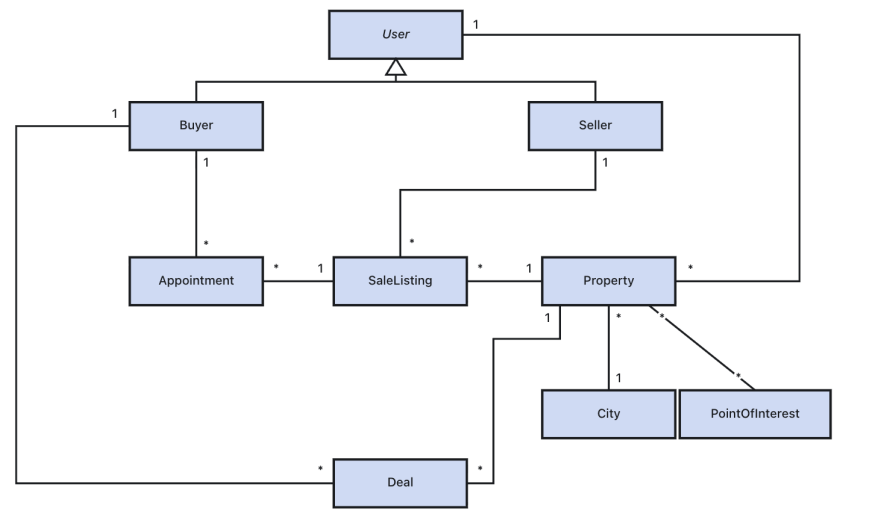

# 1. Index

<!--toc:start-->

- [1. Index](#1-index)
- [2. Guidelines for Selecting a Database](#2-guidelines-for-selecting-a-database)
  - [2.1. Modern Application World](#21-modern-application-world)
    - [2.1.1. Key-Values Databases](#211-key-values-databases)
    - [2.1.2. Document Databases](#212-document-databases)
    - [2.1.3. Graph Databases](#213-graph-databases)
  - [2.2. Using different DBMS](#22-using-different-dbms)
  - [2.3. Example: Real Estate Platform](#23-example-real-estate-platform)
  <!--toc:end-->

# 2. Guidelines for Selecting a Database

Whenever we are asked to design and develop a specific software application,
we must first follow a set of steps:

1. **Requirements Elicitation**: We should gather from customer the
   what the software application we have to develop should do
1. **Requirements Definition**: We then define both _functional_ and _non \_functional_
   requirements in a clear and unambiguous way
1. **Use Case Definition**: both UML Diagrams or Mockups can be used to define the
   use cases of the software application
1. **Analysis Workflow**: Identification of the main data structures (including
   the main procedures) and the relations among them
1. **Project Workflow**: Refinement of the analysis, now we start choosing the
   programming language and to design the actual DB.
1. **Implementation** and **Test**
1. **Deployment**

This above steps represents what is called a **Agile Approach**.

The role of a software architect/engineer is to identify **the most suitable**:

1. Software/Hardware architecture
1. Programming languages and development environments
1. Database management systems: Relational Database are very useful when we
   need to protect **data integrity** and reduce the **risk of anomalies**
   (transactional systems, OTPL applications, ...). In other cases NoSQL
   databases are more suitable (e.g. when we need to manage **huge amount of
   data** or **unstructured data**).

Every choice **must be driven by**:

1. The requirements of the software application
1. **_Common Sense_**
1. Experience

## 2.1. Modern Application World

Modern data management infrastructure is responsible for a **wider range**
of applications and data types **than ever before**:

1. Big Data
1. Internet of Things (IoT)
1. Large Scale Web Applications
1. Mobile Applications
1. AI-based Applications

In this era often **performance** and **availability** are more important than
**data integrity**. In these cases, NoSQL databases are more suitable.

On the basis of our requirements, analysis and project workflows, we can
choice among:

- **Relational databases**: such as `PostgreSQL` and `MySQL`
- **Key-value databases**: such as `Redis`, `Riak` and `DinamoDB`
- **Document databases**: such as `MongoDB` and `CouchDB`
- **Column family databases**: such as `Cassandra` and `HBase`
- **Graph databases**: such as `Neo4j` and `Titan`

The **functional requirements** are related to the _type of queries_ that
describe how the data will be used. Moreover, they also influence the
nature of relationships among entities and the needs of flexibility in
data models.

When choosing a database we have also to analyze other factors (_non-functional_
requirements) such as:

- The **volume** of reads and writes
- **Tolerance** for inconsistent data in replicas
- **Availability** and **disaster recovery** requirements
- **Latency** requirements

### 2.1.1. Key-Values Databases

These databases are preferable when our application has to handle **frequent
but small** read and write operations.

They follow **simple data models** and are able to handle **simple queries**.

If we need to do more complex queries it is needed to manually implemented
software side.

Some example on where KV-DBs are perfectly suitable:

- **Caching Data** from relational databases to improve performance
- **Tracking** transient attributes in a web application (e.g., _shopping carts_)
- **Storing configuration** and **user data information** for mobile applications
- **Storing large objects** such as images, videos or audio files

### 2.1.2. Document Databases

These type of databases are suitable for applications that need to

- **Store varying attributes**, in terms of number and type.
- **Store and elaborate large amount of data** (distributions, std deviation, ...)
- **Make complex queries**
- **Use indexing** to make _advanced filtering_ and _searching_ operations

**Flexibility** is the main feature of this kind of databases, along
with **performance capabilities**, without mentioning that they are **easy to use**.

They support **embedded documents** to use few collections of documents
that store together attributes frequently accessed together, implementing
actual **denormalization**.

In the following, we show some examples of applications that may exploit
these databases:

- Back-end support for websites with high volumes of reads and writes
- Managing data types with **variable attributes**, such as products
- Applications that use `JSON` data structures
- Applications benefiting from _denormalization_ by embedding structures
  within structures

### 2.1.3. Graph Databases

These type of databases are suitable for application that need to represent
their domain as **networks of connected entities**.

They are able to handle instances of entities that have **relations** to other
instances of entities, **rapidly traversing** the paths between them.

In the following, we show some examples of applications that may
exploit these databases:

- Network and IT **infrastructure management**
- **Logistics process** management
- **Recommending** products and services
- **Social networking**

## 2.2. Using different DBMS

When choosing a solution for data storage and management, we are
**not obliged to use _just one type_** of DBMS.

Since different types of SQL and NoSQL DBMSs have different features,
they can be used **concurrently**, each for a different purpose.

For example, an _e-commerce_ application may use:

- **Document database** for _product catalogues_, maybe with several replicas
- **Graph Database** to generate relationship-based _recommendations_. In this case,
  the entities of the products will be other (partial) replicas of the product
  catalogues, and the relationships will be generated
- **Key-value database** to store _shopping carts_

In the example, both graph and document databases share some information.

If we make a change to a product, we have to propagate it software-side to both
DMBSs.

This may lead to some **consistency issues** since there is no one to ensure
us that when we perform the two updates one of them may fail, leaving the two
databases in an inconsistent state.

This are all stuff we need to manually handle when writing the software.

## 2.3. Example: Real Estate Platform

> [!note]
> Inspired by Home Explore Application (Lagonegro, Muraca, Stanzione,
> A.Y. 2024-2025)

The (simplified) goal of this application is to create a _real-estate
platform_ that integrates three types of databases.

Functional Requirements:

- User registration and login (_buyers_ and _sellers_)
- Filtered property search (by city, price, area, type)
- View full property details
- Explore nearby points of interest and neighborhoods on a map
- Suggest similar / nearby houses
- Seller publishes a property to sell
- Book an open house visit
- Users views active listings
- Market analytics (average prices, selling time, neighbourhood stats)

The first simplified UML class diagram of the application is shown below:

The guys who designed the application decided to use three different types of
databases, each handling different aspect of the application:

|           Functionality           | Main Database | Supporting Databases |                                                  How it is used                                                   |                     UML entities Involved                     |
| :-------------------------------: | :-----------: | :------------------: | :---------------------------------------------------------------------------------------------------------------: | :-----------------------------------------------------------: |
|    User registration and login    |   `MongoDB`   |          -           |                                   Stores user accounts, roles and profile info                                    |                   `User`, `Buyer`, `Seller`                   |
|  Propery creation and management  |   `MongoDB`   |      `GraphDB`       |          Stores complete property info. Selected attributes and relationships are copied in the graph          |         `User`, `Property`, `City`, `PointOfInterest`         |
| Publish and manage a sale listing |    `Redis`    |      `MongoDB`       |                    Stores the current state of each listing and its regerence to the property                     |              `Seller`, `Property`, `SaleListing`              |
|       Search for Properties       |   `GraphDB`   |  `MongoDB`, `Redis`  |           Finds matching properties in the graph, verifies active listings and loads additional details           |     `Property`, `City`, `PointOfInterest`, `SaleListing`      |
|       View property details       |   `MongoDB`   |       `Redis`        |                                Loads property details and verifies active listing                                 |     `Property`, `City`, `PointOfInterest`, `SaleListing`      |
| Explore nearby points of interest |   `GraphDB`   |      `MongoDB`       |                     Finds nearby points of interest in the graph and loads additional details                     |             `Property`, `City`, `PointOfInterest`             |
| Find similar / nearby properties  |   `GraphDB`   |      `MongoDB`       | Compaers properties through shared attributes, cities and points of interest. Similarity s computed not stored |             `Property`, `City`, `PointOfInterest`             |
|   Suggest properties to a buyer   |   `GraphDB`   |  `MongoDB`, `Redis`  |   Uses visited and bought properties to generate suggestions, then verifies availability and loads full details   | `Buyer`, `Property`, `City`, `PointOfInterest`, `SaleListing` |
|   Book and manage appointments    |    `Redis`    |          -           |                            Stores available appointment slots and booked appointments                             |  `Buyer`, `Seller`, `Property`, `SaleListing`, `Appointment`  |
|        Purchase a property        |   `MongoDB`   |       `Redis`        |                Creates the deal document and updates the current state of the related sale listing                |          `Buyer`, `Property`, `SaleListing`, `Deal`           |
|          Sales analytics          |   `MongoDB`   |          -           |                    Analysises completed deals together with property, user and location infos                     |              `Deal`, `Property`, `User`, `City`               |
| Listnig and appointment analytics |   `MongoDB`   |       `Redis`        |             Copies relevant historical listing and appointment information to `MongoDB` for analysis              |       `SaleListing`, `Appointment`, `Property`, `Buyer`       |

The design principle followed was to store:

- `GraphDB`: selected redundant attributes for search and recommendation
- `MondoDB`: complete and historical information
- `Redis`: the current operational state of listings and appointments
