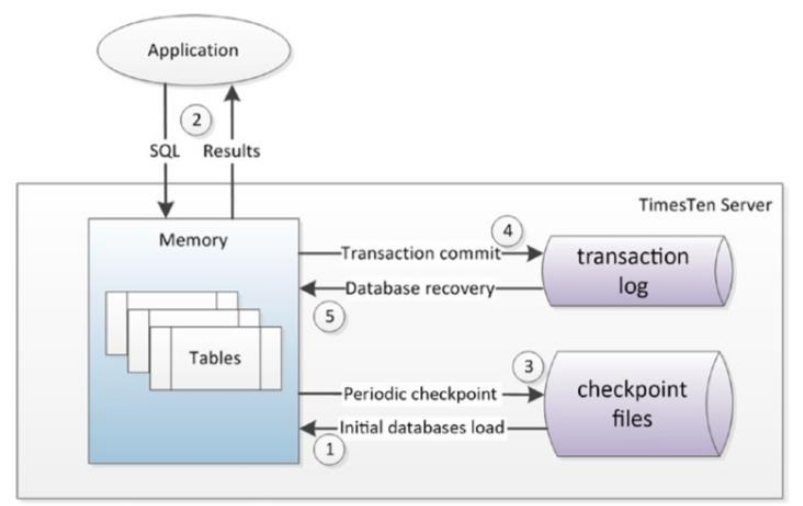
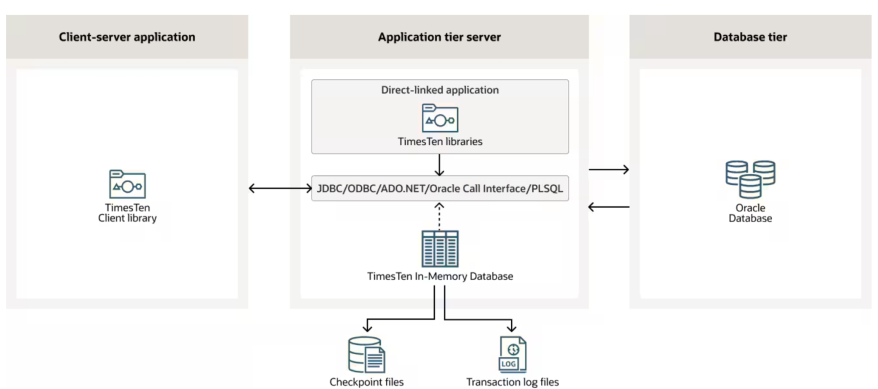
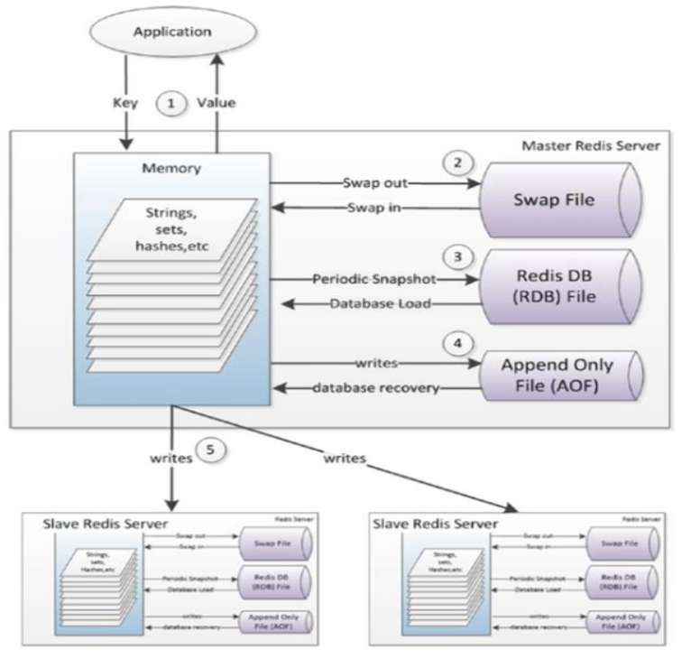
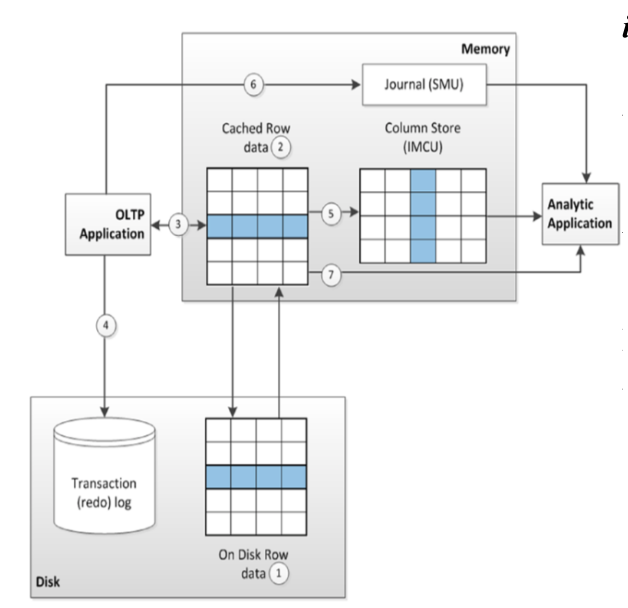

# 1. Index

<!--toc:start-->

- [1. Index](#1-index)
- [2. In Memory Database](#2-in-memory-database)
  - [2.1. Data Persistence](#21-data-persistence)
    - [2.1.1. Times Ten (Oracle Solution)](#211-times-ten-oracle-solution)
    - [2.1.2. Redis](#212-redis)
    - [2.1.3. SAP HANA](#213-sap-hana)
      - [2.1.3.1. Delta Store Mechanism](#2131-delta-store-mechanism)
    - [2.1.4. Oracle 12c](#214-oracle-12c)
    <!--toc:end-->

# 2. In Memory Database

We as seen that the design of a database solution is mainly driven by the
application **requirements**

Thus, if our application **does not need** to handle huge amount of data nor to
scale, both vertically and horizontally, we can thunk about adopting
**different solutions** than the ones discussed so far.

**_In-Memory Databases_** may be suitable for applications whose handled data
may **fit all in the memory of a single server**.

In case we _needed replication_, there also can be databases that can reside in
the **memory capacity of a cluster**.

These kind of databases allow for **very fast data access**, avoiding any type
of bottlenecks due to I/O transfers, becoming perfectly suitable for systems
that do not need **to write continuously to a persistent storage**.
Moreover, they follow a **cache-less architecture**: since everything is already
in memory they don't need to cache anything.

## 2.1. Data Persistence

As we can expect arrived at this point, also these kind of database have some downsides.

In their case the problem lies in case of **power loss**.
Since everything is in memory, turning off the server means losing everything.

To _avoid data loss_ **_ad-hoc architectures_** are needed. In the following sections
we will show some solutions for avoiding data loss in case of power loss.

### 2.1.1. Times Ten (Oracle Solution)

`TimesTen` is an **in-memory relational database** developed by Oracle.

It implements a fairly familiar **SQL-based** relational model, with the distinction
that all data is **memory resident**.

Oracle managed to achieve **persistence** by writing:

- **Periodic snapshots** of memory to disk
- **Transaction logs** following transaction commits

By default, the systems handles the disk writes **asynchronously**, even though
the database can be configured to **synchronously** write to disk to ensure
ACID transactions (at the cost of performance).

<figure class="60">

<figcaption>

`TimesTen` architecture

</figcaption>
</figure>

Today the actual implementation of `TimesTen` is more complex, and can
be seen in the picture on the right.

The persistence is based on a classical `Oracle` database, to which the `TimesTen`
libraries can communicate through classical `JDBC` interfaces.

### 2.1.2. Redis

`Redis` is an in-memory **key-value** store, in which objects consist mainly of
strings and various types of collections of them, such as **lists** and **hashes**.

It only supports **primary key** lookups, meaning that _special attention
should be paid for managing secondary indexing_.

In older versions, `Redis` exploited a sort of "virtual memory" mechanism for
storing an amount of data larger than the server memory. The old keys were swapped
out to the disk and recovered if needed. However, this mechanism is now **deprecated**
since it was not very efficient, and the current recommendation is to use `Redis
Cluster`.

`Redis` supports asynchronous **master/slave replication**, as can be seen
in the picture on the right.

If **performance is very critical**, and **some data loss** is acceptable, then
we can configure the master with _minimal disk.based persistence_ a replica can
be used as a backup database.

`Redis` may replicate the state of the master database _asynchronously_ to
slave servers.

<figure class="">

<figcaption>

The _swap-file_ mechanism is now _deprecated_.

</figcaption>
</figure>

### 2.1.3. SAP HANA

`SAP HANA` is a **relational database** which combines an **in-memory**
technology with a **columnar** storage solution.

To be used, it must be installed on an **optimized hardware configuration**.

It exploits classical **row tables** for **OLTP** operations, storing them
_in memory_.

Whereas, columnar tables are often used for also **OLAP** operations, and they are
_loaded in memory by demand_. They can also serve OLTP operations.

However, the database may be configured to load in memory a default set of
column/tables since the beginning.

By default, the **row store** and **column store** **_do not communicate_** with
each other. When we store some data in the _row store_ it is not automatically
copied to the _column store_.

Row Store

It follows the classical row-oriented storage, with the exception that
data is always kept in memory.

Is perfectly suitable for transactional workloads (OLTP), and comes with the
advantage to be **fast for _single-record_ operations** (read/write).

Column Store

It follows the column-oriented storage we have already seen, keeping the data in
memory in an highly compressed format loaded on demand.

It is perfectly suitable for **analytical workloads** (OLAP), and comes with tools
that enable **fast aggregations** and **scans** over large datasets.

As for persistence, `SAP HANA` implements **two** different mechanisms:

- **Savepoints**: they are **periodic snapshots** of the database, which are
  written to disk. They are used for **recovery** in case of a crash, providing
  a consistent base state.
- **Redo Log**: it is a **transaction log** that records each committed transaction
  on the SSD. It is used to **replay operations** after a crash.

After each restart, `HANA` performs a **Recovery Process**, in which it restores
the last savepoint, and replays the redo logs.

#### 2.1.3.1. Delta Store Mechanism

To handle high write throughput efficiently, the column store uses a **multi-level
delta storage system**.

Whenever we write new data to the column store, they are quickly inserted
in a _row-oriented uncompressed format_, and later **merged** into the main
column store.

This is done taking advantage of a three level architecture:

1. **L1 Delta Store**: it is a _row-oriented uncompressed_ store, which purpose
   is to allow for _fast inserts/updates_
2. **L2 Delta Store**: it is a _column-oriented lightly compressed_ store, which
   purpose is to be an _intermediate buffer_ before the main
   merge.
3. **Main Store**: it is a _column-oriented highly compressed_ store, which
   purpose is to be _read-optimized_. It is the one typically used for analytical
   queries.

The **delta merge operation** periodically consolidates data from L1/L2 into the
main store.

### 2.1.4. Oracle 12c

`Oracle 12c` is a **relational database** which implements a **hybrid architecture**.

Data is maintained in disk files, but **cached in memory**.

An OLTP application primarily reads and writes from memory.

The DBMS has several jobs:

- It immediately writes any **committed transactions** to the transaction
  log on disk.
- It periodically loads _row data_ into a **columnar representation** in memory,
  for analytical applications to use

Any transaction committed after the row data as been loaded to the **columnar
representation** are _recorded_ in a **in-memory journal**.

Analytic queries will **first consult the journal** to determine if they need to:

- Read updated data from the row store
- Rebuild the columnar structure

