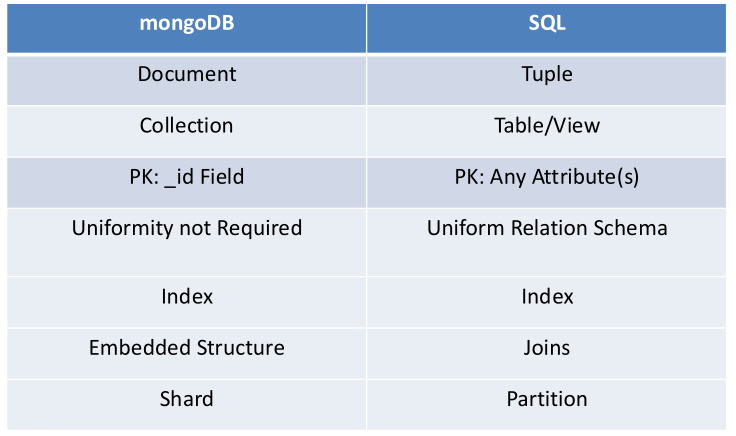

# 1. Index

<!--toc:start-->

- [1. Index](#1-index)
- [2. MongoDB](#2-mongodb)
  - [2.1. Data Model](#21-data-model)
    - [2.1.1. JSON vs BSON](#211-json-vs-bson)
    - [2.1.2. Documents](#212-documents)
  - [2.2. Key Features and Core Processes](#22-key-features-and-core-processes)
  - [2.3. Replica and Sharding Architecture](#23-replica-and-sharding-architecture)
  - [2.4. MongoDB vs SQL](#24-mongodb-vs-sql)
  - [2.5. Usage](#25-usage)
    - [2.5.1. Important Files](#251-important-files)
    - [2.5.2. Mongod Database Server](#252-mongod-database-server)
    - [2.5.3. Mongo Shell](#253-mongo-shell)
    - [2.5.4. Mongo ATLAS](#254-mongo-atlas)
  - [2.6. CRUD Operations](#26-crud-operations)
    - [2.6.1. Create Operations](#261-create-operations)
    - [2.6.2. Read Operations](#262-read-operations)
    - [2.6.3. Update Operations](#263-update-operations)
      - [2.6.3.1. Example](#2631-example)
      - [2.6.3.2. Replace Operations](#2632-replace-operations)
    - [2.6.4. Delete Operations](#264-delete-operations)
  - [2.7. Database Tools](#27-database-tools)
    - [2.7.1. Export Documents](#271-export-documents)
    - [2.7.2. Import Documents](#272-import-documents)
    <!--toc:end-->

# 2. MongoDB

`MongoDB` stands for _HuMONGOus DataBase_, and it is a **document-based** NoSQL
database based on the _"high performance, high scalability"_ principle.

It is a source-available cross-platform database available under the _Server Side
Public License (SSPL)_ license, written in `C++` and is running on `Windows`,
`Linux`, and `macOS`.

Its license allows for the following use cases:

- Students can install it and use it for learning.
- Universities can use it in teaching laboratories.
- Companies can use it for internal applications.
- SaaS (Software as a Service) applications can use it as their internal
  database.
- Companies offering `MongoDB` itself as a managed service must comply
  with _SSPL Section 13_ or obtain a _commercial license_.

It allows for different configurations on the **CAP triangle** (mainly
CP and AP).

> [!TIP]
> The official documentation is available at the following links:
>
> - [Manual Overview](https://www.mongodb.com/docs/manual/)
> - [Document Overview](https://www.mongodb.com/docs/manual/core/document/)
> - [ATLAS Architecture Guide](https://www.mongodb.com/docs/manual/administration/architecture/)
> - [CRUD Manual](https:///docs.mongodb.com/manual/crud/)

## 2.1. Data Model

`MongoDB` is **document-based** database. Documents are saved in `BSON` format,
consisting of field-value pair.

Each document is stored in a **collection**, which are like _tables_ of
relational DBs. The main difference is that the document in a collection
**do not need to have uniform structures**. However, they share the same
**index set**.

Collections are stored in files, which size must not exceed `16MB`. For larger
files, `MongoDB` provides a tool called `GridFS`.

> [!CAUTION]
> For the sake of the project, we **_do not need to use `GridFS`_**.

### 2.1.1. JSON vs BSON

`JSON`, which stands for _JavaScript Object Notation_, is easy for humans to
write/read, and for computers to parse/generate.

`JSON` documents are unordered collections of `field: value` pairs with
6 main data types (`string`, `number`, `object`, `array`, `boolean` and `null`).

It allows for _objects nesting_, and its object fields are not ordered (but array
elements are).

`BSON` instead stands for _Binary JSON_, and it is a **binary-encoded
serialization** of `JSON`-like docs.

It extends the `JSON` model to provide **additional data types**, **ordered fields**,
and to be **efficient for (de)encoding** within different languages.

The `MongoDB BSON` implementation is designed to be **lightweight**, **fast** and
**highly traversable**.

All the `BSON` supported data types are listed in the [official documentation](https://www.mongodb.com/docs/manual/reference/bson-types/).

### 2.1.2. Documents

```bson
{
  _id: 76546567,
  name: "sue",
  age: 26,
  status: "A",
  groups: [ "news", "sports" ]
}
```

There are several advantages of using documents:

- They correspond to **native data types** in many programming languages
- **Embedded documents** and **arrays** reduce need for expensive joins
- **Dynamic schema** supports fluent _polymorphism_.

> [!caution]
> `MongoDB` supports _join_ operation, through the `lookup` operator.  
> However, we **_should avoid using it_ as much as possible**.  
> In the project **_it must be avoided at all costs_**.

By default, each document contains an `_id` field, which has special
characteristics:

- It serves as a **primary key** for the collection
- The value is **unique**, **immutable** and should be any _non-array-type_ or
  _regular expression_.
- Its default data type is `ObjectId`, which is _"small, likely unique, fast to
  generate, and ordered"_

Sorting on ad `ObjectId` value is roughly equivalent to **sorting on
creation time**.

In **sharded collections**, it can be part or not of the _shard key_.

## 2.2. Key Features and Core Processes

It is characterized by **High Performance** by providing:

- **High performance data persistence**
- Support for **embedded data models** reduces I/O activity on database system.
- **Indexes** that support _faster queries_ and can include keys from embedded
  documents and arrays.

We define it as a **Rich Query Language**, since it supports read and write
operations (CRUD) as well as _Data Aggregation_, _Text Search_ and _Geospatial
Queries_.

`MongoDB` also provides a replication facility, called **replica set**, that and
allows for automatic failover and data redundancy though _master/slave_ organization.

As one of its core functionality, it provides _horizontal scalability_ through
**sharding** across a _cluster of machines_, though the creation of
_zones of data_ based on the **shard key**.

> [!note]
> As far as the project is involved, we **need to design the sharding** but
> **_we are not required to actually implement it_**.

The core components in the `MongoDB` package are:

- `mongod`: the main _daemon_ process for the `MongoDB` system. It handles
  data requests, manages data access, and database process. [Here for the offical
  documentation](https://www.mongodb.com/docs/manual/reference/program/mongod/)
- `mongos`: the controller and query router interfaced between client applications
  and the **sharded cluster**. [Here for the offical documentation](https://www.mongodb.com/docs/manual/reference/program/mongos/)
- `mongosh`: the official interactive shell replacing the legacy _mongo client_

## 2.3. Replica and Sharding Architecture

<div class="grid2">
<div class="">

In the image on the right we can see an architecture consisting of a **primary
server** and **two secondary servers**.

If the primary server fails, one of the secondary servers will be automatically
promoted to primary.

Default reads are done on the primary server, but it supports _read-with-preference_,
which allows to read from secondary servers, and _write concern_, which allows to
automatically replicate writes to secondary servers.

</div>
<div class="">

</div>
</div>

`MongoDB` shards data at the **collection level**, distributing the collection data
across the shards in the cluster.

When sharding is enabled, the drivers must have access to:

- **Shard Servers**: they store the actual data. Each server can save
  **one primary shard** and _several secondary shards_ for
  _different sharded collections_.
- **Config Server**: it stores the metadata of the sharded cluster, including
  _the list of shards_, _the sharded collections and their shard keys_ and the _chunk
  distribution_ for each sharded collection.


## 2.4. MongoDB vs SQL

We can summarize the main differences between `MongoDB` and `SQL` databases in
the following table:



## 2.5. Usage

### 2.5.1. Important Files

The most important file in the `MongoDB` package is the **default configuration
file**.

- On `Linux`, the default `/etc/mongod.conf` configuration file is included
  when using a package manager to install MongoDB.
- On `Windows`, a default `<install directory>/bin/mongod.cfg` configuration file
  is included during the installation.
- On `macOS`, a default `/usr/local/etc/mongod.conf` (`/opt/homebrew/etc/mongod.conf`
  on Apple M1 processors) configuration file is included when installing from
  MongoDB’s official Homebrew tap.

To understand the configuration file, we can refer to the [official documentation](https://www.mongodb.com/docs/manual/reference/configuration-options/).

### 2.5.2. Mongod Database Server

We consider a **localhost installation**, where `27017` is the **default port**
the standalone `mongod` listen on.

Different OS have different commands for running and stopping the `modngod` process.

> [!note]
> On this notes I will use the `Linux` commands, but you can refer to the
> [official documentation](https://www.mongodb.com/docs/manual/tutorial/manage-mongodb-processes/)
> for other OS.

```sh
sudo systemctl start mongodb.service      # start the service
sudo systemctl stop mongodb.service       # stop the service

sudo systemctl enable mongodb.service     # start the service now and at each boot
sudo systemctl disable mongodb.service    # stop the service now and at each boot
```

### 2.5.3. Mongo Shell

The _mongo shell_ `mongosh` is an **interactive JavaScript** interface to `MongoDB`.

We can use the mongo shell to **query and update data** as well as
perform **administrative operations**.

To connect to a `MongoDB` instance:

```sh
mongosh                               # default localhost and 27017 port
mongosh "mongodb://localhost:27017"   # explicit ip and port
momngosh --port 27017                 # explicit port
```

Instead, to shutdown the server from the shell:

```mongodb
db.shutdownServer();
```

In the following code block we can see some of the most important commands to use
in the `mongosh` shell.

```mongodb
// show all databases
show databases
show dbs

// Display the current database
db

// Switch to a database (create it if it doesn't exist)
use <database_name>

// Create a new collection by inserting a document
db.<collection_name>.insertOne({ /* ... */});
```

In the next chapter we will see more operations and commands to use in the
`mongosh` shell.

### 2.5.4. Mongo ATLAS

`MongoDB Atlas` is the **fully managed cloud platform** by `MongoDB` that allows
us to build, deploy and scale globally distributed databases with built-in
features for _replication_, _sharding_, _security_, _vector search_ and
_real-time analytics_.

The service is available on [the official website](https://www.mongodb.com/cloud/atlas).

## 2.6. CRUD Operations

### 2.6.1. Create Operations

Create and insert operations are used to **add new documents** to a collection.

In `MongoDB`, **insert** operation target _a single collection_. If it does not
currently exist, it _will be created_.

All write operations are **atomic** on the level of a _single document_.

As we said before, each document stored in a collection **requires a
unique `_id` field** that acts as a primary key.

If an inserted document omits it, the `MongoDB` driver **automatically
generates** a unique `ObjectId` for the `_id` field.

To insert a new document into the `inventory` collection, we can use the
`insertOne()` method:

```mongodb
// The driver will automatically generate a unique ObjectId for the _id field
db.inventory.insertOne(
   {
    item: "canvas",
    qty: 100,
    tags: ["cotton"],
    size: {
      h: 28,
      w: 35.5,
      uom: "cm"
    }
  }
)
```

If this operation is successful, the `mongosh` will output:

```mongodb
{
  "acknowledged" : true,
  "insertedId" : ObjectId("64b8f1e5e4b0c8a1d2f3c4b5")
}
```

If instead we want to insert **multiple documents** at once, we can use
the `insertMany()` method putting them into an `array`:

```mongodb
db.inventory.insertMany([
  {
    item: "journal",
    qty: 25,
    tags: ["blank", "red"],
    size: { h: 14, w: 21, uom: "cm" }
  },
  {
    item: "mat",
    qty: 85,
    tags: ["gray"],
    size: { h: 27.9, w: 35.5, uom: "cm" }
  },
  {
    item: "mousepad",
    qty: 25,
    tags: ["gel", "blue"],
    size: { h: 19, w: 22.85, uom: "cm" }
  }
])
```

In this case the successful output will be:

```mongodb
{
  "acknowledged" : true,
  "insertedIds" : [
    ObjectId("64b8f1e5e4b0c8a1d2f3c4b6"),
    ObjectId("64b8f1e5e4b0c8a1d2f3c4b7"),
    ObjectId("64b8f1e5e4b0c8a1d2f3c4b8")
  ]
}
```

### 2.6.2. Read Operations

Suppose we have created a collection called `inventory` and inserted some
documents into it:

```mongodb
db.inventory.insertMany([
  { item: "journal", qty: 25, size: { h: 14, w: 21, uom: "cm" }, status: "A" },
  { item: "notebook", qty: 50, size: { h: 8.5, w: 11, uom: "in" }, status: "A" },
  { item: "paper", qty: 100, size: { h: 8.5, w: 11, uom: "in" }, status: "D" },
  { item: "planner", qty: 75, size: { h: 22.85, w: 30, uom: "cm" }, status: "D" },
  { item: "postcard", qty: 45, size: { h: 10, w: 15.25, uom: "cm" }, status: "A" }
]);
```

To query all documents of a specific collection we can use the `find()` method:

```mongodb
db.inventory.find()

/**
  * In SQL
  *  SELECT *
  *  FROM inventory
  */
```

> [!NOTE]
> The `mongosh` will display only the first 20 documents of the result set.  
> But, if we where to assign the output to a variable, it will hold the whole
> result set.

If we wanted to specify equality conditions, we can use `<field>:<value>` expressions
as parameters of the `find()` method:

```mongodb
db.inventory.find({ status: "D" })

/**
  * In SQL
  *  SELECT *
  *  FROM inventory
  *  WHERE status = "D"
  */
```

We can also use _query operators_ to specify conditions in the following form:
`{ <field1>: { <operator1>: <value1>}, ... }`.

In the following example we can see some example of operators:

```mongodb
// `status` equals either `A` or `D`:
db.inventory.find({ status: { $in: ["A", "D"] } })

/**
  * In SQL
  *  SELECT *
  *  FROM inventory
  *  WHERE status IN ("A", "D")
  */
```

```mongodb
// `status` equals "A" AND `qty` is less than 30:
db.inventory.find({
  status: "A",
  qty: { $lt: 30}
})

/**
  * In SQL
  *  SELECT *
  *  FROM inventory
  *  WHERE status = "A"
  *    AND qty < 30
  */
```

```mongodb
// `status` equals "A" OR `qty` is less than 30:
db.inventory.find({
  $or : [
    { status: "A" },
    { qty: { $lt: 30} }
  ]
})

/**
  * In SQL
  *  SELECT *
  *  FROM inventory
  *  WHERE status = "A"
  *     OR qty < 30
  */
```

```mongodb
// `status` equals "A" AND either (OR):
//  - `qty` is less than 30
//  - `item` starts with "p"
db.inventory.find({
  status: "A",
  $or: [
    { qty : { $lt: 30} },
    { item: /^p/ }
  ]
})

/**
  * In SQL
  *  SELECT *
  *  FROM inventory
  *  WHERE status = "A"
  *    AND ( qty < 30 OR item LIKE "p%" )
  */
```

The general **comparison operators** are:

- `$eq`: matches values that are **equal** to a specified value.
- `$gt`: matches values that are **greater than** a specified value.
- `$gte`: matches values that are **greater than or equal** to a specified value.
- `$in`: matches **any of the values** specified in an array.
- `$lt`: matches values that are **less than** a specified value.
- `$lte`: matches values that are **less than or equal** to a specified value.
- `$ne`: matches all values that are **not equal** to a specified value.
- `$nin`: matches **none of the values** specified in an array.

Further details about the _Comparison Query Operators_ can be found in the
[official documentation](https://www.mongodb.com/docs/manual/reference/mql/query-predicates/comparison/#std-label-query-selectors-comparison).

### 2.6.3. Update Operations

To update a document there are several methods available, we will see the three
most important ones:

```mongodb
db.collection_name.updateOne( <filter>, <update>, <options> )
db.collection_name.updateMany( <filter>, <update>, <options> )
```

- The `filter` document is defined as a **query** (like the one we previously
  analyzed). It specifies the set of document to update.
- The `update` document specify the modification to apply.
- The `options` document specify a set of parameters for the modifications.

To use the update operators, we need to pass to the update methods an
**update document** as follows:

```mongodb
{
  <update_operator>: { <field1>: <value1>, ... },
  <update_operator>: { <field2>: <value2>, ... },
}
```

> [!NOTE]
> A list with all the details of update operators can be found
> in the [official documentation](https://www.mongodb.com/docs/manual/reference/mql/update/#std-label-update-operators).

Some of the most commonly used update operators are:

- `$currentDate`: sets the value of a field to the current date, either as a
  `Date` or a `Timestamp`.
- `$inc`: increments the value of the field by the specified amount.
- `$min`: only updates the field if the specified value is less than the existing
- `$max`: only updates the field if the specified value is greater than the existing
- `$mul`: multiplies the value of the field by the specified amount.
- `$rename`: renames an existing field _without_ changing its value.
- `$set`: sets the value of a field in a document, creating it if necessary.
- `$setOnInsert`: sets the value of a field if an update results in an insert
  of a document.
- `$unset`: removes the specified field from a document.

#### 2.6.3.1. Example

Suppose we are working with the following document in the `inventory` collection:

```mongodb
db.inventory.insertMany([
  { item: "canvas", qty: 100, size: { h: 28, w: 35.5, uom: "cm" }, status: "A" },
  { item: "journal", qty: 25, size: { h: 14, w: 21, uom: "cm" }, status: "A" },
  { item: "mat", qty: 85, size: { h: 27.9, w: 35.5, uom: "cm" }, status: "A" },
  { item: "mousepad", qty: 25, size: { h: 19, w: 22.85, uom: "cm" }, status: "P" },
  { item: "notebook", qty: 50, size: { h: 8.5, w: 11, uom: "in" }, status: "P" },
  { item: "paper", qty: 100, size: { h: 8.5, w: 11, uom: "in" }, status: "D" },
  { item: "planner", qty: 75, size: { h: 22.85, w: 30, uom: "cm" }, status: "D" },
  { item: "postcard", qty: 45, size: { h: 10, w: 15.25, uom: "cm" }, status: "A" },
  { item: "sketchbook", qty: 80, size: { h: 14, w: 21, uom: "cm" }, status: "A" },
  { item: "sketchpad", qty: 95, size: { h: 22.85, w: 30.5, uom: "cm" }, status: "A" }
]);
```

We can see some example of usages of the update method in the following code
blocks:

```mongodb
// Update the first document that matches the filter by:
//  - changing the `size.uom` field to "cm"
//  - changing the `status` field to "P"
//  - updating the field `lastModified` with the current date
db.inventory.updateOne(
  { item: "paper" },
  {
    $set: { "size.uom": "cm", status: "P" },
    $currentDate: { lastModified: true }  // also creates the new field
  }
)
```

```mongodb
// Update all documents that matches the filter "`qty` is less than 50":
//  - changing the `size.uom` field to "cm"
//  - changing the `status` field to "P"
//  - updating the field `lastModified` with the current date
db.inventoty.updateMany(
  { qty: { $lt: 50 } },
  {
    $set: { "size.uom": "cm", status: "P" },
    $currentDate: { lastModified: true }
  }
)
```

#### 2.6.3.2. Replace Operations

To replace **the entire content** of a document, except for the `_id` field,
to an entirely new document, we can use the `db.collection_name.replaceOne()`
method.

When replacing a document, the replacement one must consist of **only field/value
pairs** (i.e., _do not include any update operators_ expressions).

The replacement document **can have different fields** than the original document.

```mongodb
// Replace the first document where `item: "paper"` with a new document
db.invenory.replaceOne(
  { item: "paper" },
  {
    item: "paper",
    instock: [
      { warehouse: "A", qty: 60 },
      { warehouse: "B", qty: 40 }
    ]
  }
)
```

This will change the document from:

```mongodb
{
  _id: ObjectId("64b8f1e5e4b0c8a1d2f3c4b6"),
  item: "paper",
  qty: 100,
  size: {
    "h": 8.5,
    "w": 11,
    "uom": "cm"
  },
  status: "P",
  lastModified: ISODate("2024-11-11T12:44:56.129Z")
}
```

To:

```mongodb
{
  _id: ObjectId("64b8f1e5e4b0c8a1d2f3c4b6"),
  item: "paper",
  instock: [
    { "warehouse": "A", "qty": 60 },
    { "warehouse": "B", "qty": 40 }
  ]
}
```

### 2.6.4. Delete Operations

To delete an entire collection, we can use the `drop()` method:

```mongodb
db.inventory.drop()
```

Instead, we we want to keep the collection, but delete all the documents in it,
we can use the `deleteMany()` method with an empty filter:

```mongodb
db.inventory.deleteMany({})
```

In this case, a typical output where we deleted $N$ elements will be:

```mongodb
{ "acknowledged" : true, "deletedCount" : N }
```

Of course, we can specify **criteria** (filters) to identify just a subset
of documents to delete.

The _filters_ use the same syntax as the one we saw for the _read operations_:

- `{ field: value }` matches documents where the field is equal to the value.
- `{ field: { $operator: value } }` matches documents where the field satisfies

We can see some examples of delete operations in the following code blocks:

```mongodb
// Remove all documents where the `status` field is equal to "A"
db.inventory.deleteMany({ status: "A" })
```

```mongodb
// Delete at most one single document where the `status` field is equal to "D"
db.inventory.deleteOne({ status: "D" })
```

## 2.7. Database Tools

These tools are part of the `MongoDB Database Tools Package`, which is
distributed separately from `MongoDB Server`.

The installation depends on the operating system and installation method,
and it is described in the [official documentation](https://www.mongodb.com/docs/database-tools/).

### 2.7.1. Export Documents

We can use the `mongoexport` command-line tool to produce a `JSON` or `CSV`
export of data stored in a `MongoDB` instance.

To export a **specified collection** to a specified output file from
a **local MongoDB instance** (port 27017) we can use the following command:

```sh
mongoexport --collection=<collectionName> \
  --db=<dbName> \
  --fields=<field1[,field2]>
  --out=<filename.json(-csv)>
  --type=<json|csv>
```

If we wanted to export from a specific host and port, we can use:

```sh
mongoexport --host= <hostAddress> \
  --port=<portNumber>
  --collection=<collectionName> \
  --db=<dbName> \
  --fields=<field1[,field2]> \
  --out=<filename.json(-csv)> \
  --type=<json/csv>
```

### 2.7.2. Import Documents

The `mongoimport` tool imports content from an `Extended JSON`, `CSV` or `TSV`
export created by `mongoexport`, or potentially, another **third-party
export tool**.

> [!NOTE]
> Since `MongoDB 4.2`, `mongoimport` expects import data to be in
> **Extended JSON v2.0** by default.  
> Details on **JSON v2.0** can be found
> [in the official guide](https://docs.mongodb.com/manual/reference/mongodb-extended-json/)

Some example are the following:

```sh
# Import from json and create:
# - collection: `restaurants`
# - database: `test`
mongoimport \
  -c=restaurants \
  -d=test \
  --file "file_path.json"
```

```sh
# Import from csv and create:
#  - collection: `athlete`
#  - database: `test`
mongoimport \
  -c=athlete \
  -d=test \
  --file "file_path.csv" \
  --type=csv \
  --headerline
```

> [!CAUTION]
> `mongoimport` only supports data files that are `UTF-8` encoded.
> Using other formats will almost certainly produce errors.

To ensure that documents are inserted in the same order in which
they appear in the input file we can use the `--maintainInsertionOrder` option.

This options gives us some reassurances:

- **Insertion Order**
- **Insertion Workers**: only 1 thread
- **Error handling**: stop at the first insertion error
- **Performance**: may be slower

> [!IMPORTANT]
> `mongoexport` and `mongoimport` **do not preserve** indexes, validation
> rules, user roles or sharding configurations as they are just **_data
> exchange tools_**
>
> For **full backup and restore operations use**:
>
> - `mongodump`: creates a **binary snapshot** of our database
> - `mongorestore`: rebuilds a database from the snapshot
>
> Further information can be found on [the official documentation](https://www.mongodb.com/docs/database-tools/mongodump/).
