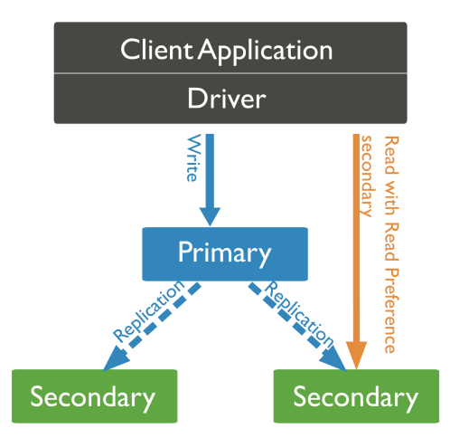
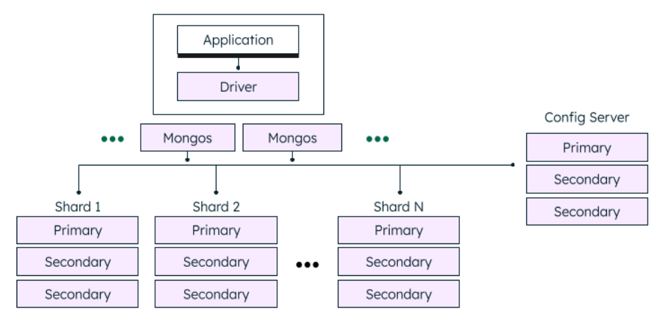
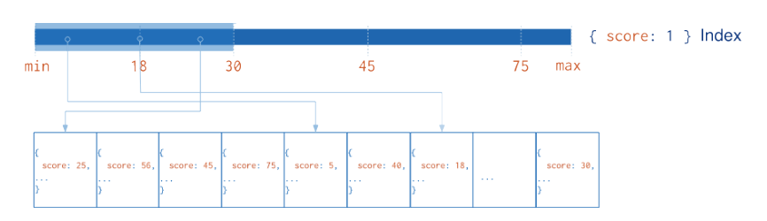
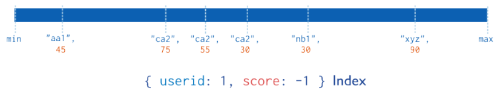
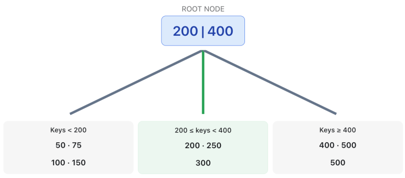
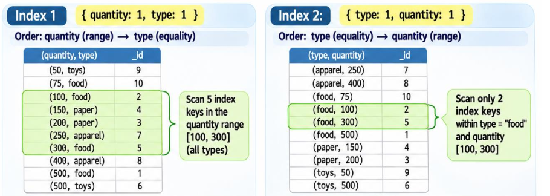

# 1. Index

<!--toc:start-->

- [1. Index](#1-index)
- [2. MongoDB](#2-mongodb)
  - [2.1. Data Model](#21-data-model)
    - [2.1.1. JSON vs BSON](#211-json-vs-bson)
    - [2.1.2. Documents](#212-documents)
  - [2.2. Key Features and Core Processes](#22-key-features-and-core-processes)
  - [2.3. Replica and Sharding Architecture](#23-replica-and-sharding-architecture)
  - [2.4. MongoDB vs SQL](#24-mongodb-vs-sql)
  - [2.5. Usage](#25-usage)
    - [2.5.1. Important Files](#251-important-files)
    - [2.5.2. Mongod Database Server](#252-mongod-database-server)
    - [2.5.3. Mongo Shell](#253-mongo-shell)
    - [2.5.4. Mongo ATLAS](#254-mongo-atlas)
  - [2.6. CRUD Operations](#26-crud-operations)
    - [2.6.1. Create Operations](#261-create-operations)
    - [2.6.2. Read Operations](#262-read-operations)
    - [2.6.3. Update Operations](#263-update-operations)
      - [2.6.3.1. Example](#2631-example)
      - [2.6.3.2. Replace Operations](#2632-replace-operations)
    - [2.6.4. Delete Operations](#264-delete-operations)
  - [2.7. Database Tools](#27-database-tools)
    - [2.7.1. Export Documents](#271-export-documents)
    - [2.7.2. Import Documents](#272-import-documents)
  - [2.8. Query Methods](#28-query-methods)
    - [2.8.1. Cursor Methods](#281-cursor-methods)
    - [2.8.2. Embedded and Nested Documents](#282-embedded-and-nested-documents)
    - [2.8.3. Arrays](#283-arrays)
  - [2.9. Projection Operations](#29-projection-operations)
    - [2.9.1. Project Specific Array Elements](#291-project-specific-array-elements)
    - [2.9.2. Null fields](#292-null-fields)
  - [2.10. Aggregation](#210-aggregation)
    - [2.10.1. Aggregation Pipeline Mapping SQL](#2101-aggregation-pipeline-mapping-sql)
    - [2.10.2. Examples of Aggregation Pipelines](#2102-examples-of-aggregation-pipelines)
  - [2.11. Indexes](#211-indexes)
    - [2.11.1. Default Index](#2111-default-index)
    - [2.11.2. Creating an Index](#2112-creating-an-index)
    - [2.11.3. Compound Indexes](#2113-compound-indexes)
    - [2.11.4 Indexing Embedded Documents](#2114-indexing-embedded-documents)
    - [2.11.5. Indexing Arrays](#2115-indexing-arrays)
    - [2.11.6. Advanced Indexes](#2116-advanced-indexes)
    - [2.11.7. Type of Indexes](#2117-type-of-indexes)
    - [2.11.8. How Index Work](#2118-how-index-work)
  - [2.12. Evaluating Queries Performance](#212-evaluating-queries-performance)
    - [2.12.1. Compare Performance of Indexes](#2121-compare-performance-of-indexes)
    <!--toc:end-->

# 2. MongoDB

`MongoDB` stands for _HuMONGOus DataBase_, and it is a **document-based** NoSQL
database based on the _"high performance, high scalability"_ principle.

It is a source-available cross-platform database available under the _Server Side
Public License (SSPL)_ license, written in `C++` and is running on `Windows`,
`Linux`, and `macOS`.

Its license allows for the following use cases:

- Students can install it and use it for learning.
- Universities can use it in teaching laboratories.
- Companies can use it for internal applications.
- SaaS (Software as a Service) applications can use it as their internal
  database.
- Companies offering `MongoDB` itself as a managed service must comply
  with _SSPL Section 13_ or obtain a _commercial license_.

It allows for different configurations on the **CAP triangle** (mainly
CP and AP).

> [!TIP]
> The official documentation is available at the following links:
>
> - [Manual Overview](https://www.mongodb.com/docs/manual/)
> - [Document Overview](https://www.mongodb.com/docs/manual/core/document/)
> - [ATLAS Architecture Guide](https://www.mongodb.com/docs/manual/administration/architecture/)
> - [CRUD Manual](https:///docs.mongodb.com/manual/crud/)
> - [Operators](https://docs.mongodb.com/manual/reference/operator/)

## 2.1. Data Model

`MongoDB` is **document-based** database. Documents are saved in `BSON` format,
consisting of field-value pair.

Each document is stored in a **collection**, which are like _tables_ of
relational DBs. The main difference is that the document in a collection
**do not need to have uniform structures**. However, they share the same
**index set**.

Collections are stored in files, which size must not exceed `16MB`. For larger
files, `MongoDB` provides a tool called `GridFS`.

> [!CAUTION]
> For the sake of the project, we **_do not need to use `GridFS`_**.

### 2.1.1. JSON vs BSON

`JSON`, which stands for _JavaScript Object Notation_, is easy for humans to
write/read, and for computers to parse/generate.

`JSON` documents are unordered collections of `field: value` pairs with
6 main data types (`string`, `number`, `object`, `array`, `boolean` and `null`).

It allows for _objects nesting_, and its object fields are not ordered (but array
elements are).

`BSON` instead stands for _Binary JSON_, and it is a **binary-encoded
serialization** of `JSON`-like docs.

It extends the `JSON` model to provide **additional data types**, **ordered fields**,
and to be **efficient for (de)encoding** within different languages.

The `MongoDB BSON` implementation is designed to be **lightweight**, **fast** and
**highly traversable**.

All the `BSON` supported data types are listed in the [official documentation](https://www.mongodb.com/docs/manual/reference/bson-types/).

### 2.1.2. Documents

```bson
{
  _id: 76546567,
  name: "sue",
  age: 26,
  status: "A",
  groups: [ "news", "sports" ]
}
```

There are several advantages of using documents:

- They correspond to **native data types** in many programming languages
- **Embedded documents** and **arrays** reduce need for expensive joins
- **Dynamic schema** supports fluent _polymorphism_.

> [!caution]
> `MongoDB` supports _join_ operation, through the `lookup` operator.  
> However, we **_should avoid using it_ as much as possible**.  
> In the project **_it must be avoided at all costs_**.

By default, each document contains an `_id` field, which has special
characteristics:

- It serves as a **primary key** for the collection
- The value is **unique**, **immutable** and should be any _non-array-type_ or
  _regular expression_.
- Its default data type is `ObjectId`, which is _"small, likely unique, fast to
  generate, and ordered"_

Sorting on ad `ObjectId` value is roughly equivalent to **sorting on
creation time**.

In **sharded collections**, it can be part or not of the _shard key_.

## 2.2. Key Features and Core Processes

It is characterized by **High Performance** by providing:

- **High performance data persistence**
- Support for **embedded data models** reduces I/O activity on database system.
- **Indexes** that support _faster queries_ and can include keys from embedded
  documents and arrays.

We define it as a **Rich Query Language**, since it supports read and write
operations (CRUD) as well as _Data Aggregation_, _Text Search_ and _Geospatial
Queries_.

`MongoDB` also provides a replication facility, called **replica set**, that and
allows for automatic failover and data redundancy though _master/slave_ organization.

As one of its core functionality, it provides _horizontal scalability_ through
**sharding** across a _cluster of machines_, though the creation of
_zones of data_ based on the **shard key**.

> [!note]
> As far as the project is involved, we **need to design the sharding** but
> **_we are not required to actually implement it_**.

The core components in the `MongoDB` package are:

- `mongod`: the main _daemon_ process for the `MongoDB` system. It handles
  data requests, manages data access, and database process. [Here for the offical
  documentation](https://www.mongodb.com/docs/manual/reference/program/mongod/)
- `mongos`: the controller and query router interfaced between client applications
  and the **sharded cluster**. [Here for the offical documentation](https://www.mongodb.com/docs/manual/reference/program/mongos/)
- `mongosh`: the official interactive shell replacing the legacy _mongo client_

## 2.3. Replica and Sharding Architecture

<div class="grid2">
<div class="">

In the image on the right we can see an architecture consisting of a **primary
server** and **two secondary servers**.

If the primary server fails, one of the secondary servers will be automatically
promoted to primary.

Default reads are done on the primary server, but it supports _read-with-preference_,
which allows to read from secondary servers, and _write concern_, which allows to
automatically replicate writes to secondary servers.

</div>
<div class="">

</div>
</div>

`MongoDB` shards data at the **collection level**, distributing the collection data
across the shards in the cluster.

When sharding is enabled, the drivers must have access to:

- **Shard Servers**: they store the actual data. Each server can save
  **one primary shard** and _several secondary shards_ for
  _different sharded collections_.
- **Config Server**: it stores the metadata of the sharded cluster, including
  _the list of shards_, _the sharded collections and their shard keys_ and the _chunk
  distribution_ for each sharded collection.



## 2.4. MongoDB vs SQL

We can summarize the main differences between `MongoDB` and `SQL` databases in
the following table:


## 2.5. Usage

### 2.5.1. Important Files

The most important file in the `MongoDB` package is the **default configuration
file**.

- On `Linux`, the default `/etc/mongod.conf` configuration file is included
  when using a package manager to install MongoDB.
- On `Windows`, a default `<install directory>/bin/mongod.cfg` configuration file
  is included during the installation.
- On `macOS`, a default `/usr/local/etc/mongod.conf` (`/opt/homebrew/etc/mongod.conf`
  on Apple M1 processors) configuration file is included when installing from
  MongoDB’s official Homebrew tap.

To understand the configuration file, we can refer to the [official documentation](https://www.mongodb.com/docs/manual/reference/configuration-options/).

### 2.5.2. Mongod Database Server

We consider a **localhost installation**, where `27017` is the **default port**
the standalone `mongod` listen on.

Different OS have different commands for running and stopping the `modngod` process.

> [!note]
> On this notes I will use the `Linux` commands, but you can refer to the
> [official documentation](https://www.mongodb.com/docs/manual/tutorial/manage-mongodb-processes/)
> for other OS.

```sh
sudo systemctl start mongodb.service      # start the service
sudo systemctl stop mongodb.service       # stop the service

sudo systemctl enable mongodb.service     # start the service now and at each boot
sudo systemctl disable mongodb.service    # stop the service now and at each boot
```

### 2.5.3. Mongo Shell

The _mongo shell_ `mongosh` is an **interactive JavaScript** interface to `MongoDB`.

We can use the mongo shell to **query and update data** as well as
perform **administrative operations**.

To connect to a `MongoDB` instance:

```sh
mongosh                               # default localhost and 27017 port
mongosh "mongodb://localhost:27017"   # explicit ip and port
momngosh --port 27017                 # explicit port
```

Instead, to shutdown the server from the shell:

```mongodb
db.shutdownServer();
```

In the following code block we can see some of the most important commands to use
in the `mongosh` shell.

```mongodb
// show all databases
show databases
show dbs

// Display the current database
db

// Switch to a database (create it if it doesn't exist)
use <database_name>

// Create a new collection by inserting a document
db.<collection_name>.insertOne({ /* ... */});
```

In the next chapter we will see more operations and commands to use in the
`mongosh` shell.

### 2.5.4. Mongo ATLAS

`MongoDB Atlas` is the **fully managed cloud platform** by `MongoDB` that allows
us to build, deploy and scale globally distributed databases with built-in
features for _replication_, _sharding_, _security_, _vector search_ and
_real-time analytics_.

The service is available on [the official website](https://www.mongodb.com/cloud/atlas).

## 2.6. CRUD Operations

### 2.6.1. Create Operations

Create and insert operations are used to **add new documents** to a collection.

In `MongoDB`, **insert** operation target _a single collection_. If it does not
currently exist, it _will be created_.

All write operations are **atomic** on the level of a _single document_.

As we said before, each document stored in a collection **requires a
unique `_id` field** that acts as a primary key.

If an inserted document omits it, the `MongoDB` driver **automatically
generates** a unique `ObjectId` for the `_id` field.

To insert a new document into the `inventory` collection, we can use the
`insertOne()` method:

```mongodb
// The driver will automatically generate a unique ObjectId for the _id field
db.inventory.insertOne(
   {
    item: "canvas",
    qty: 100,
    tags: ["cotton"],
    size: {
      h: 28,
      w: 35.5,
      uom: "cm"
    }
  }
)
```

If this operation is successful, the `mongosh` will output:

```mongodb
{
  "acknowledged" : true,
  "insertedId" : ObjectId("64b8f1e5e4b0c8a1d2f3c4b5")
}
```

If instead we want to insert **multiple documents** at once, we can use
the `insertMany()` method putting them into an `array`:

```mongodb
db.inventory.insertMany([
  {
    item: "journal",
    qty: 25,
    tags: ["blank", "red"],
    size: { h: 14, w: 21, uom: "cm" }
  },
  {
    item: "mat",
    qty: 85,
    tags: ["gray"],
    size: { h: 27.9, w: 35.5, uom: "cm" }
  },
  {
    item: "mousepad",
    qty: 25,
    tags: ["gel", "blue"],
    size: { h: 19, w: 22.85, uom: "cm" }
  }
])
```

In this case the successful output will be:

```mongodb
{
  "acknowledged" : true,
  "insertedIds" : [
    ObjectId("64b8f1e5e4b0c8a1d2f3c4b6"),
    ObjectId("64b8f1e5e4b0c8a1d2f3c4b7"),
    ObjectId("64b8f1e5e4b0c8a1d2f3c4b8")
  ]
}
```

### 2.6.2. Read Operations

Suppose we have created a collection called `inventory` and inserted some
documents into it:

```mongodb
db.inventory.insertMany([
  { item: "journal", qty: 25, size: { h: 14, w: 21, uom: "cm" }, status: "A" },
  { item: "notebook", qty: 50, size: { h: 8.5, w: 11, uom: "in" }, status: "A" },
  { item: "paper", qty: 100, size: { h: 8.5, w: 11, uom: "in" }, status: "D" },
  { item: "planner", qty: 75, size: { h: 22.85, w: 30, uom: "cm" }, status: "D" },
  { item: "postcard", qty: 45, size: { h: 10, w: 15.25, uom: "cm" }, status: "A" }
]);
```

To query all documents of a specific collection we can use the `find()` method:

```mongodb
db.inventory.find()

/**
  * In SQL
  *  SELECT *
  *  FROM inventory
  */
```

> [!NOTE]
> The `mongosh` will display only the first 20 documents of the result set.  
> But, if we where to assign the output to a variable, it will hold the whole
> result set.

If we wanted to specify equality conditions, we can use `<field>:<value>` expressions
as parameters of the `find()` method:

```mongodb
db.inventory.find({ status: "D" })

/**
  * In SQL
  *  SELECT *
  *  FROM inventory
  *  WHERE status = "D"
  */
```

We can also use _query operators_ to specify conditions in the following form:
`{ <field1>: { <operator1>: <value1>}, ... }`.

In the following example we can see some example of operators:

```mongodb
// `status` equals either `A` or `D`:
db.inventory.find({ status: { $in: ["A", "D"] } })

/**
  * In SQL
  *  SELECT *
  *  FROM inventory
  *  WHERE status IN ("A", "D")
  */
```

```mongodb
// `status` equals "A" AND `qty` is less than 30:
db.inventory.find({
  status: "A",
  qty: { $lt: 30}
})

/**
  * In SQL
  *  SELECT *
  *  FROM inventory
  *  WHERE status = "A"
  *    AND qty < 30
  */
```

```mongodb
// `status` equals "A" OR `qty` is less than 30:
db.inventory.find({
  $or : [
    { status: "A" },
    { qty: { $lt: 30} }
  ]
})

/**
  * In SQL
  *  SELECT *
  *  FROM inventory
  *  WHERE status = "A"
  *     OR qty < 30
  */
```

```mongodb
// `status` equals "A" AND either (OR):
//  - `qty` is less than 30
//  - `item` starts with "p"
db.inventory.find({
  status: "A",
  $or: [
    { qty : { $lt: 30} },
    { item: /^p/ }
  ]
})

/**
  * In SQL
  *  SELECT *
  *  FROM inventory
  *  WHERE status = "A"
  *    AND ( qty < 30 OR item LIKE "p%" )
  */
```

The general **comparison operators** are:

- `$eq`: matches values that are **equal** to a specified value.
- `$gt`: matches values that are **greater than** a specified value.
- `$gte`: matches values that are **greater than or equal** to a specified value.
- `$in`: matches **any of the values** specified in an array.
- `$lt`: matches values that are **less than** a specified value.
- `$lte`: matches values that are **less than or equal** to a specified value.
- `$ne`: matches all values that are **not equal** to a specified value.
- `$nin`: matches **none of the values** specified in an array.

> [!TIP]
> Further informations can be retrieved on the official documentation:
>
> - [Find Method](https://docs.mongodb.com/manual/reference/method/db.collection.find/)
> - [Comparison Query Operations](https://www.mongodb.com/docs/manual/reference/mql/query-predicates/comparison/#std-label-query-selectors-comparison)

### 2.6.3. Update Operations

To update a document there are several methods available, we will see the three
most important ones:

```mongodb
db.collection_name.updateOne( <filter>, <update>, <options> )
db.collection_name.updateMany( <filter>, <update>, <options> )
```

- The `filter` document is defined as a **query** (like the one we previously
  analyzed). It specifies the set of document to update.
- The `update` document specify the modification to apply.
- The `options` document specify a set of parameters for the modifications.

To use the update operators, we need to pass to the update methods an
**update document** as follows:

```mongodb
{
  <update_operator>: { <field1>: <value1>, ... },
  <update_operator>: { <field2>: <value2>, ... },
}
```

> [!NOTE]
> A list with all the details of update operators can be found
> in the [official documentation](https://www.mongodb.com/docs/manual/reference/mql/update/#std-label-update-operators).

Some of the most commonly used update operators are:

- `$currentDate`: sets the value of a field to the current date, either as a
  `Date` or a `Timestamp`.
- `$inc`: increments the value of the field by the specified amount.
- `$min`: only updates the field if the specified value is less than the existing
- `$max`: only updates the field if the specified value is greater than the existing
- `$mul`: multiplies the value of the field by the specified amount.
- `$rename`: renames an existing field _without_ changing its value.
- `$set`: sets the value of a field in a document, creating it if necessary.
- `$setOnInsert`: sets the value of a field if an update results in an insert
  of a document.
- `$unset`: removes the specified field from a document.

#### 2.6.3.1. Example

Suppose we are working with the following document in the `inventory` collection:

```mongodb
db.inventory.insertMany([
  { item: "canvas", qty: 100, size: { h: 28, w: 35.5, uom: "cm" }, status: "A" },
  { item: "journal", qty: 25, size: { h: 14, w: 21, uom: "cm" }, status: "A" },
  { item: "mat", qty: 85, size: { h: 27.9, w: 35.5, uom: "cm" }, status: "A" },
  { item: "mousepad", qty: 25, size: { h: 19, w: 22.85, uom: "cm" }, status: "P" },
  { item: "notebook", qty: 50, size: { h: 8.5, w: 11, uom: "in" }, status: "P" },
  { item: "paper", qty: 100, size: { h: 8.5, w: 11, uom: "in" }, status: "D" },
  { item: "planner", qty: 75, size: { h: 22.85, w: 30, uom: "cm" }, status: "D" },
  { item: "postcard", qty: 45, size: { h: 10, w: 15.25, uom: "cm" }, status: "A" },
  { item: "sketchbook", qty: 80, size: { h: 14, w: 21, uom: "cm" }, status: "A" },
  { item: "sketchpad", qty: 95, size: { h: 22.85, w: 30.5, uom: "cm" }, status: "A" }
]);
```

We can see some example of usages of the update method in the following code
blocks:

```mongodb
// Update the first document that matches the filter by:
//  - changing the `size.uom` field to "cm"
//  - changing the `status` field to "P"
//  - updating the field `lastModified` with the current date
db.inventory.updateOne(
  { item: "paper" },
  {
    $set: { "size.uom": "cm", status: "P" },
    $currentDate: { lastModified: true }  // also creates the new field
  }
)
```

```mongodb
// Update all documents that matches the filter "`qty` is less than 50":
//  - changing the `size.uom` field to "cm"
//  - changing the `status` field to "P"
//  - updating the field `lastModified` with the current date
db.inventoty.updateMany(
  { qty: { $lt: 50 } },
  {
    $set: { "size.uom": "cm", status: "P" },
    $currentDate: { lastModified: true }
  }
)
```

#### 2.6.3.2. Replace Operations

To replace **the entire content** of a document, except for the `_id` field,
to an entirely new document, we can use the `db.collection_name.replaceOne()`
method.

When replacing a document, the replacement one must consist of **only field/value
pairs** (i.e., _do not include any update operators_ expressions).

The replacement document **can have different fields** than the original document.

```mongodb
// Replace the first document where `item: "paper"` with a new document
db.invenory.replaceOne(
  { item: "paper" },
  {
    item: "paper",
    instock: [
      { warehouse: "A", qty: 60 },
      { warehouse: "B", qty: 40 }
    ]
  }
)
```

This will change the document from:

```mongodb
{
  _id: ObjectId("64b8f1e5e4b0c8a1d2f3c4b6"),
  item: "paper",
  qty: 100,
  size: {
    "h": 8.5,
    "w": 11,
    "uom": "cm"
  },
  status: "P",
  lastModified: ISODate("2024-11-11T12:44:56.129Z")
}
```

To:

```mongodb
{
  _id: ObjectId("64b8f1e5e4b0c8a1d2f3c4b6"),
  item: "paper",
  instock: [
    { "warehouse": "A", "qty": 60 },
    { "warehouse": "B", "qty": 40 }
  ]
}
```

### 2.6.4. Delete Operations

To delete an entire collection, we can use the `drop()` method:

```mongodb
db.inventory.drop()
```

Instead, we we want to keep the collection, but delete all the documents in it,
we can use the `deleteMany()` method with an empty filter:

```mongodb
db.inventory.deleteMany({})
```

In this case, a typical output where we deleted $N$ elements will be:

```mongodb
{ "acknowledged" : true, "deletedCount" : N }
```

Of course, we can specify **criteria** (filters) to identify just a subset
of documents to delete.

The _filters_ use the same syntax as the one we saw for the _read operations_:

- `{ field: value }` matches documents where the field is equal to the value.
- `{ field: { $operator: value } }` matches documents where the field satisfies

We can see some examples of delete operations in the following code blocks:

```mongodb
// Remove all documents where the `status` field is equal to "A"
db.inventory.deleteMany({ status: "A" })
```

```mongodb
// Delete at most one single document where the `status` field is equal to "D"
db.inventory.deleteOne({ status: "D" })
```

## 2.7. Database Tools

These tools are part of the `MongoDB Database Tools Package`, which is
distributed separately from `MongoDB Server`.

The installation depends on the operating system and installation method,
and it is described in the [official documentation](https://www.mongodb.com/docs/database-tools/).

### 2.7.1. Export Documents

We can use the `mongoexport` command-line tool to produce a `JSON` or `CSV`
export of data stored in a `MongoDB` instance.

To export a **specified collection** to a specified output file from
a **local MongoDB instance** (port 27017) we can use the following command:

```sh
mongoexport --collection=<collectionName> \
  --db=<dbName> \
  --fields=<field1[,field2]>
  --out=<filename.json(-csv)>
  --type=<json|csv>
```

If we wanted to export from a specific host and port, we can use:

```sh
mongoexport --host= <hostAddress> \
  --port=<portNumber>
  --collection=<collectionName> \
  --db=<dbName> \
  --fields=<field1[,field2]> \
  --out=<filename.json(-csv)> \
  --type=<json/csv>
```

### 2.7.2. Import Documents

The `mongoimport` tool imports content from an `Extended JSON`, `CSV` or `TSV`
export created by `mongoexport`, or potentially, another **third-party
export tool**.

> [!NOTE]
> Since `MongoDB 4.2`, `mongoimport` expects import data to be in
> **Extended JSON v2.0** by default.  
> Details on **JSON v2.0** can be found
> [in the official guide](https://docs.mongodb.com/manual/reference/mongodb-extended-json/)

Some example are the following:

```sh
# Import from json and create:
# - collection: `restaurants`
# - database: `test`
mongoimport \
  -c=restaurants \
  -d=test \
  --file "file_path.json"
```

```sh
# Import from csv and create:
#  - collection: `athlete`
#  - database: `test`
mongoimport \
  -c=athlete \
  -d=test \
  --file "file_path.csv" \
  --type=csv \
  --headerline
```

> [!CAUTION]
> `mongoimport` only supports data files that are `UTF-8` encoded.
> Using other formats will almost certainly produce errors.

To ensure that documents are inserted in the same order in which
they appear in the input file we can use the `--maintainInsertionOrder` option.

This options gives us some reassurances:

- **Insertion Order**
- **Insertion Workers**: only 1 thread
- **Error handling**: stop at the first insertion error
- **Performance**: may be slower

> [!IMPORTANT]
> `mongoexport` and `mongoimport` **do not preserve** indexes, validation
> rules, user roles or sharding configurations as they are just **_data
> exchange tools_**
>
> For **full backup and restore operations use**:
>
> - `mongodump`: creates a **binary snapshot** of our database
> - `mongorestore`: rebuilds a database from the snapshot
>
> Further information can be found on [the official documentation](https://www.mongodb.com/docs/database-tools/mongodump/).

## 2.8. Query Methods

### 2.8.1. Cursor Methods

We will be working over the following collection called `inventory`:

```mongodb
db.inventory.insertMany([
{ item: "journal", qty: 25, size: { h: 14, w: 21, uom: "cm" }, status: "A" },
{ item: "notebook", qty: 50, size: { h: 8.5, w: 11, uom: "in" }, status: "A" },
{ item: "paper", qty: 100, size: { h: 8.5, w: 11, uom: "in" }, status: "D" },
{ item: "planner", qty: 75, size: { h: 22.85, w: 30, uom: "cm" }, status: "D" },
{ item: "postcard", qty: 45, size: { h: 10, w: 15.25, uom: "cm" }, status: "A" }
]);
```

When we talked about the `find()` method, we actually omitted that it returns
a **cursor** to the results.

A **cursor** is an object that **provides access** to the result set of a query
executed by the `MongoDB` server. It allows **retrieving documents progressively
in _batches_**, as the application iterates over the results.

This avoids loading the entire result set into client memory at once,
allowing just **on-demand processing** of large query results.

In the `mongosh`, when the returned cursor is not assigned to a variable,
it will be automatically iterated **up to the first 20 documents**, hence
what we said before about the `find()` method.

To manually iterate, we must first assign a variable with the `var` keyword,
and call one of its method:

```mongodb
// Equivalent to `db.inventory.find()` but
// without the 20 documents limit
var myCursor = db.inventory.find()

while (myCursor.hasNext()) {
  var myDocument = myCursor.next();
  var myName = myDocument.item;
  print (tojson(myName));
}
```

To limit the number of documents in the result set, we can use the `limit()` method.
Instead, if we want to tweak the _starting point_ of the result set, we can use
the `skip()` method:

```mongodb
// Returns up to three documents
db.inventory.find().limit(3);

// Returns all the documents, skipping the first three
db.inventory.find().skip(3);
```

Often, when we query for a result set, we want it to be sorted in a specific order.
To do that in `MongoDB`, we can use the `sort()` method, which takes a
**sort specification document**:

```mongodb
// Collection sorted by `qty` in ASCENDING order
db.inventoty.find().sort({ qty: 1 });

// Collection sorted by `qty` in DESCENDING order
db.inventoty.find().sort({ qty: -1 });

// Collection sorted:
//  1. First in ASCENDING order by `status`
//  2. Then in DESCENDING order by `qty`
db.collection.find().sort({ status: 1, qty: -1 });
```

> [!NOTE]
> If the specified attribute does not exist in a document, it will be placed:
>
> - At the top of the result set if the sort order is **descending**.
> - At the bottom of the result set if the sort order is **ascending**.

Of course it is possible to **combine** the `limit()`, `skip()` and `sort()` methods:

```mongodb
// Collection:
//  1. Sorted in DESCENDING order by `qty`
//  2 Skipping the first two documents

db.inventory.find().sort({ qty: -1 }).skip(2);
```

> [!NOTE]
> The two operations `skip()` and `limit()` are commutative with the `sort()` method.

To return the count of documents in a collection that **would match** a `find()`
query for the collection, we can use the `countDocuments()` method:

```mongodb
// Count the number of documents with `status` equal to "A"
db.inventory.countDocuments({ status: "A" });
```

> [!WARNING]
> There exists the `.find(...).count()` method, but has been **deprecated** in
> `MongoDB 5`

<br>

> [!TIP]
> For further informations we can refer to the official documentation:
>
> - [Cursor Methods](https://www.mongodb.com/docs/manual/reference/method/cursor/).
> - [Count Documents Method](https://docs.mongodb.com/manual/reference/method/db.collection.countDocuments/)

### 2.8.2. Embedded and Nested Documents

To match an **Embedded Document** we can use the **query filter**
document `{ <field>: <value> }`, where `<value>` is the document to match.

For example:

```mongodb
// Select all documents where `size` equals the document
// {h: 14, w: 21, uom: "cm" }
db.inventory.find({ size: { h: 14, w: 21, uom: "cm" } });
```

Instead, if we want to specify a condition inside an embedded/nested document
we use **dot notation** to access the field:

```mongodb
// Select all documents where the field `uom`, nested in `size`, equals "in"
db.inventory.find({ "size.uom": "in" });

// Select all documents where the field `h`, nested in `size`, is less than 15
db.inventory.find({ "size.h": { $lt: 15 } });

// Select all documents where:
// - the field `h`, nested in `size`, is less than 15
// - the field `uom`, nested in `size`, equals "in"
// - the field `status` equals "D"
db.inventory.find({ "size.h": { $lt : 15 }, "size.uom": "in", status: "D" })
```

### 2.8.3. Arrays

For this part we suppose our data is the following:

```mongodb
db.inventory.insertMany([
{ item: "journal", qty: 25, tags: ["blank", "red"], dim_cm: [ 14, 21 ] },
{ item: "notebook", qty: 50, tags: ["red", "blank"], dim_cm: [ 14, 21 ] },
{ item: "paper", qty: 100, tags: ["red", "blank", "plain"], dim_cm: [ 14, 21 ] },
{ item: "planner", qty: 75, tags: ["blank", "red"], dim_cm: [ 22.85, 30 ] },
{ item: "postcard", qty: 45, tags: ["blue"], dim_cm: [ 10, 15.25 ] }
]);
```

To specify **equality condition** on an array we use, once again, the
query document, where `<value>` is now the **exact array to match** (the order
is important).

```mongodb
// Select all documents where the `tags` is exactly equal to ["red", "blank"]
db.inventory.find({ tags: ["red", "blank"] });
```

Instead, if order does not matter to us, we can use the `$all` operator:

```mongodb
// Select all documents where the `tags` array contains both "red" and "blank"
db.inventory.find({ tags: { $all: ["red", "blank"] } });
```

If we want to query for documents where the array field contains **at least one**
element with the **specified value**, we still use the _query document_, but now
`<value>` will be **just the value to match** (not the whole array):

```mongodb
// Select all documents where the `tags` array contains the value "red"
// as one of its elements
db.inventory.find({ tags: "red" });
```

We can also use **query filter document**
`{ <array_field> : { <operator1> : <value1>, ... }}` to specify conditions on the
**elements of an array**.

```mongodb
// Select all documents where the array `dim_cm` contains
// AT LEAST ONE ELEMENT whose value is GREATER than 25
db.inventory.find({ dim_cm : { $gt : 25 }});

// Select all documents where the array `dim_cm` contains
// AT LEAST ONE ELEMENT whose value is LOWER than 20
db.inventory.find({ dim_cm : { $lt : 20 }});


// Select all documents where the array `dim_cm` contains A COMBINATION
// of the following conditions:
// - AT LEAST ONE value is GREATER than 15
// - AT LEAST ONE value is LOWER than 20
// (they can be the same value or different ones)
db.inventory.find({ dim_cm : { $gt : 15, $lt : 20 }});

// Select all documents where the array `dim_cm` contains
// AT LEAST ONE ELEMENT whose value is BOTH:
// - GREATER than 12
// - LOWER than 30
db.inventory.find({ dim_cm: {$elemMatch: { $gt: 22, $lt: 30 }}})
```

We can use **dot notation** for arrays as well. In this case, it
indicates the **particular index of the array** (_zero-based_).

```mongodb
// Select all documents where the second element of the array `dim_cm`
// is GREATER than 25
db.inventory.find({ "dim.1": { $gt: 25 }})
```

We can also filter upon the **size of an array** using the `$size` operator:

```mongodb
// Select all documents where the `tags` array has 3 elements
db.inventory.find({ tags: { $size: 3 }});
```

> [!TIP]
> For further informations we can refer to the official documentation:
>
> - [Query Embedded Documents](https://docs.mongodb.com/manual/tutorial/query-embedded-documents/)
> - [Query Arrays](https://docs.mongodb.com/manual/tutorial/query-arrays/)

## 2.9. Projection Operations

By default, queries in `MongoDB` return **all fields** in matching documents.

To limit the amount of data that the database sends to the application, we can
include a **projection document** to specify/restrict **fields to return**.

We will be considering the following collection:

```mongodb
db.inventory.insertMany([
  {
    item: "journal", status: "A", size: {h: 14, w: 21, uom: "cm"},
    instock: [{ warehouse: "A", qty: 5}]
  },
  {
    item: "notebook", status: "A", size: {h: 8.5, w: 11, uom: "in"},
    instock: [ {warehouse: "C", qty: 5}]
  },
  {
    item: "paper", status: "D", size: {h: 8.5, w: 11, uom: "in"},
    instock: [ {warehouse: "A", qty: 60}]
  },
  {
    item: "planner", status: "D", size: {h: 22.85, w: 30, uom: "cm"},
    instock: [ {warehouse: "A", qty: 40}]
  },
  {
    item: "postcard", status: "A", size: {h: 10, w: 15.25, uom: "cm"},
    instock: [ {warehouse: "B", qty: 15}, {warehouse: "C", qty: 35}]
  }
]);
```

A **projection** can explicitly include several fields by setting `<field>: 1`
in the projection document, or exclude them by setting `<field>: 0`.
However, we cannot **mix inclusion and exclusion** in the same projection document,
with the exception of the `_id` field.

```mongodb
// Returns all documents that match the query, limited to fields item and status
db.inventory.find(
  { status: "A" },
  { item : 1, status: 1, _id: 0 } // Exclude the `_id` field from the result set
)

// Returns all fields except for the `status` and the
// `instock` fields in the matching documents
db.inventory.find(
  { status: "A" },
  { status: 0, instock: 0 }
)
```

> [!NOTE]
> By default, the `_id` field is **always included** in the result set, unless
> we manually exclude it by setting `_id: 0` in the projection document.

We can also return/suppress specific fields from embedded documents using _dot
notation_:

```mongodb
// Returns all documents that match the query, limited to fields `item`,
// `status` and the embedded document `size`
db.inventory.find(
  { status: "A" },
  { item: 1, status: 1, size: 1}
)

// Returns all documents that match the query, limited to fields `item`,
// `status` and the embedded field `size.uom`
db.inventory.find(
  { status: "A" },
  { item: 1, status: 1, "size.uom": 1}
)

// Returns all documents that match the query, except for the fields `status`,
// `instock` and the embedded field `size.uom`
db.inventory.find(
  { status: "A" },
  { status: 1, instock: 0, "size.uom": 0}   // Will still return `size.h` and `size.w`
)


// Return all documents that match the query, limited to the following fields:
//  - The `_id` field (returned by default),
//  - The `item` field,
//  - The `status` field,
//  - The `qty` field in the documents embedded in the `instock` array.
db.inventory.find(
  { status: "A" },
  { item: 1, status: 1, "instock.qty": 1}
)
```

### 2.9.1. Project Specific Array Elements

For fields that contain arrays, the database provides two **projection
operators** for manipulating their contents: `$slice` and `$elemMatch`.

```mongodb
// Returns the documents that match the query, limited to the FIRST element of
// the `instock` field
db.inventory.find(
  { status: "A" },
  { instock: { $slice: 1 }}
)

// Returns the documents that match the query, limited to the FIRST TWO elements
// of the `instock` field
db.inventory.find(
  { status: "A" },
  { instock: { $slice: 2 }}
)

// Returns the documents that match the query, limited to the LAST element of
// the `instock` array
db.inventory.find(
  { status: "A" },
  { instock: { $slice: -1 }}
)

// Returns the documents that match the query, limited to the LAST THREE elements
// of the `instock` array
db.inventory.find(
  { status: "A" },
  { instock: { $slice: -3 }}
)
```

The `$elemMatch` operator projects the _first matching element from an array_
based on a condition:

```mongodb
// Returns the documents that match the query, limited to the FIRST element
// of the `instock` array that has a `qty` GREATER than 20
db.inventory.find(
  { status: "A" },
  { instock: { $elemMatch: { qty: { $gt: 20 }}}}
)
```

Unlike `$elemMatch`, `$filter` returns **all elements** of an array that match
the specified condition. However, it has a slightly more complex syntax,
as it requires an **aggregation pipeline**:

```mongodb
// Returns the documents that match the query, limited to ALL the elements
// of the `instock` array that has a `qty` LESS than 10
db.inventory.find(
  { status: "A" },
  {
    instock: {
      $filter: {
        input: "$instock",                      // `$` refers to the `instock` field
        as: "stock",                            // creates a local variable
        cond: { $gt: ["$$stock.qty", 20] }      // `$$` refers to the local variable
      }
    }
  }
)
```

> [!WARNING]
> Notice the difference between `$` and `$$`:
>
> - `$instock` refers to a **field in the current document**
> - `$$stock` refers to a **local variable** defined using `as`
> - `$$stock.qty` accesses the `qty` attribute of the **local variable**

### 2.9.2. Null fields

`MongoDB` supports the `null` value, which is used to represent **undefined fields**.

Let's consider the following collection:

```mongodb
db.inventory.insertMany([
  { _id: 1, item: null },
  { _id: 2 },
  { _id: 3, item: "book" }
])
```

The `{ item: null }` query will match documents that either:

- Contain the `item` field with a value of `null`
- Do not contain the `item` field at all

Thus if we ran `db.inventory.find({ item: null })`, the result set would include
both documents with `_id: 1` and `_id: 2`.

To query documents that **contain fields of a _specific type_** we can the
`$type` operator:

```mongodb
// Returns all documents where the `item` field is of type `string`
db.inventory.find({ item: { $type: 2 } })

// Returns all documents where the `item` field is of type `null`
db.inventory.find({ item: { $type: 10 } })
```

> [!NOTE]
> For further information about the `$type` operator, please refer to the
> [official documentation](https://www.mongodb.com/docs/manual/reference/operator/query/type/#mongodb-query-op.-type).

We can also use the `$exists` operator to filter documents based on the
**existence of a field**:

```mongodb
// Returns all documents where the `item` field exists
db.inventory.find({ item: { $exists: true } })

// Returns all documents where the `item` field does not exist
db.inventory.find({ item: { $exists: false } })
```

> [!TIP]
> For further informations we can refer to the official documentation:
>
> - [Projection from Query Results](https://docs.mongodb.com/manual/tutorial/project-fields-from-query-results/)
> - [Null fields](https://docs.mongodb.com/manual/tutorial/query-for-null-fields/)

## 2.10. Aggregation

Aggregation operations **process data records** and **_return computed results_**.

Aggregation operation **group** values from multiple documents together
and can perform a **variety of operations** on the grouped data to
**_return a single result_**.

`MongoDB` provides two ways to perform aggregation:

- **Aggregation Pipeline**
- **Single Purpose Aggregation Methods** (we will not cover them in this course)

In the **Aggregation Pipeline** way, documents enter a **multi-stage
pipeline** that transforms them into aggregated results.

Considering the following collection:

```mongodb
db.orders.insertMany([
  { cust_id: "A123", amount: 500, status: "A" },
  { cust_id: "A123", amount: 250, status: "A" },
  { cust_id: "B212", amount: 200, status: "A" },
  { cust_id: "A123", amount: 300, status: "D" }
])
```

For example we could:

1. Filter documents to pass only those that match the specified condition(s)
   `{ status: "A" }`
2. Group them by a common field `_id`, and calculate the sum of the amount of a
   numeric field `amount` for each unique group

This translates to the following aggregation pipeline:

```mongodb
db.orders.aggregate(
/* First Stage */  { $match: { status: "A" }},
/* Second Stage */ { $group: { _id: "$cust_id", total: { $sum: "$amount" }}}
)
```

As we said before, the `$` character is used to access the value of a field
in the current document, in this case the `cust_id` and `amount` fields.

The result of the aggregation pipeline will be:

```mongodb
[
  { "_id" : "A123", "total" : 750 },
  { "_id" : "B212", "total" : 200 }
]
```

The aggregation pipeline consists to an arbitrary number of **stages**, where each
one transforms the documents as they pass through the pipeline.

Pipeline stages **_do not need to produce_** one output document for
every input document. For example, a `$match` stage can filter out documents
during the pipeline, and a `$group` stage can combine multiple input documents
into a single one.

Pipeline stages can appear **multiple times** into the pipeline, with the exception
of `$out`, `$merge` and `$geoNear` stages, which **can appear only once**.

### 2.10.1. Aggregation Pipeline Mapping SQL

In the following table, we can see a mapping between the **SQL** and the
**Aggregation Pipeline**:

<div class="flexbox" markdown="1">

|   `SQL`    | `MongoDB Aggregation` |                                       Explanation                                       |
| :--------: | :-------------------: | :-------------------------------------------------------------------------------------: |
|  `WHERE`   |       `$match`        |                                    Filter documents                                     |
| `GROUP BY` |       `$group`        | Group document by value.<br>Afterwards, accumulator expression will apply to each group |
|  `HAVING`  |       `$match`        |                                    Filter documents                                     |
|  `SELECT`  |      `$project`       |              Reshape documents, including, excluding and adding new fields              |
| `ORDER BY` |        `$sort`        |                                    Reorder document                                     |
|  `SUM()`   |        `$sum`         |                 Return sum of each group.<br>Ignores non-numeric values                 |
| `COUNT()`  |        `$sum`         |                 Return sum of each group.<br>Ignores non-numeric values                 |
|    N/A     |       `$unwind`       |           Deconstructs an array and returns a document for each array element           |

</div>

> [!CAUTION]
> For the sake of knowledge, there exist also the mapping of the `JOIN` operation
> with the `$lookup` stage, which performs the _left outer join_ operation
> between two collections.
>
> However, it is **_FORBIDDEN_** to use it in this course, as it is
> **_not a good practice_**.

### 2.10.2. Examples of Aggregation Pipelines

The following examples will use the **Zipcodes collection** available
from [the official mongodb collections](media.mongodb.org/zips.json).

We can use `mongoimport` to load the dataset into our `mongod` instance.

Each document in the collection has the following structure:

```json
{
  "_id": "10280",
  "city": "NEW YORK",
  "state": "NY",
  "pop": 5574,
  "loc": [-74.016323, 40.710537]
}
```

Let's now see some examples of aggregation pipelines:

<p class="subt"> Return States with Populations above 10 Million </p>

<div class="grid2">
<div class="">

The query on the right performs the following operations:

1. Groups the document by `state` and **sums** the population of each group. The
   output will be a document consisting of two fields: `_id` (the state) and
   `totalPop` (the total population of the state).
2. Filters the document produced in the first stage, maintaining only the
   states with a total population greater than 10 million.

</div>
<div class="">

```mongodb
db.zipcodes.aggregate([
  { $group: { _id: "$state", totalPop: { $sum: "$pop" }}},
  { $match: { totalPop: { $gte: 10*1000*1000 }}}
])
```

</div>
</div>

<p class="subt"> Return Average City Population by State </p>

<div class="grid2">
<div class="">

The query on the right performs two `$group` operations:

1. The first one groups the documents by **the combination of `state` and `city`**,
   using the `$sum` expression to calculate the total population of each combination.
2. The second stage, groups documents in the pipeline by the `"_id.state"` field,
   using the `$avg` expression to calculate the average city population `avgCityPop`
   for each state, outputting a document for each state.

</div>
<div class="">

```mongodb
db.zipcodes.aggregate([
  { $group: { _id: { state: "$state", city: "$city" }, pop: { $sum: "$pop"}}},
  { $group: {_id: "$_id.state"}, avgCityPop: { $avg: "$pop" }}
])
```

</div>
</div>

<p class="subt"> Return Largest and Smallest Cities by state </p>

<div class="grid2">
<div class="">

This is a bit more complex than the queries we have seen so far.

It performs _four_ different stages:

1. We filter the document by grouping them by the combination of `state` and
   `city`, and summing the population of each combination, to obtain the total
   population of each city.
2. We then `$sort` the output of the first stage in **ascending order** by population.
   This means that now the **city with the smallest population** will be the
   **first document**, while the **city with the largest population** will be
   the **last**.
3. We perform another `$group` operation, this time grouping by `state`, and creating
   four new fields using the `$first` and `$last` expressions:
   - `biggestCity`: the name of the city with the largest population in the state
   - `biggestPop`: the largest population in the state
   - `smallestCity`: the name of the city with the smallest population in the state
   - `smallestPop`: the smallest population in the state
4. This last stage is not strictly necessary, but it is used to **reshape the output**
   of the previous stage. Using the `$project` operation, we rename the `_id`
   field to `state`, and we create two new embedded documents: `biggestCity`
   and `smallestCity`. They contain respectively the name and population of the
   biggest and smallest cities in each state. Furthermore, we exclude the `_id`
   field from the output by setting it to `0`.

</div>
<div class="">

```mongodb
db.zipcodes.aggregate([
  {
    $group : {
      _id: { state: "$state", city: "$city"},
      pop: { $sum: "$pop" }}
  },
  { $sort: { pop : 1 }}
  {
    $group : {
      _id: "$_id.state",
      biggestCity:  { $last: "$_id.city" },
      biggestPop:   { $last: "$pop" },
      smallestCity: { $first: "$_id.city" },
      smallestPop:  { $first: "pop"}
    }
  }
  {
    $project: {
      _id: 0,
      state: "$_id",
      biggestCity:  { name: "$biggestCity",  pop: "$biggestPop" },
      smallestCity: { name: "$smallestCity", pop: "$smallestPop" }
    }
  }
])
```

</div>
</div>

> [!TIP]
> For further informations we can refer to the official documentation:
>
> - [Aggregation Stages](https://www.mongodb.com/docs/manual/reference/mql/aggregation-stages/#std-label-aggregation-pipeline-operator-reference)
> - [Aggregation Pipelines](https://www.mongodb.com/docs/manual/core/aggregation-pipeline/)

## 2.11. Indexes

Indexes support the **efficient execution** of _read queries_.

Without indexes, `MongoDB` must perform a _collection scan_, i.e. scan **every
document** in a collection to **select** those document that **match** a **query**
statement.

Instead, if an appropriate index exists for a query, `MongoDB` can use it
to **limit** the number of documents it must inspect.

An **index** is a _special data structure_ that stores a **small portion of the
collection's data set** in an easy-to-traverse form.

The index stores the value of a **specific field** or **set of fields**,
**ordered** by the value of the field.

The ordering of the index entries supports efficient **equality matches** and
**range-based** query operations.

In addition, `MongoDB` can **_return sorted results_** by using the ordering
in the index.

In `MongoDB`, indexes are defined at the **collection level**, and are
supported for **any field or sub-field** of the document in a collection.

For example, if we have a collection with a numeric attribute `score`, we
could have an index of this field on which make access when performing
queries like:

```mongodb
db.users.find({ score: { $gt: 30 }}).sort({ score: -1 })
```



The performance are heavily improved by the usage of the index:

- **Without index**: we have to scan everything for any type of query $O(n)$
- **With Index**: since it is sorted, we can use either _binary search_ for
  single value queries $O(\log n)$, or more in general only needed
  iteration over the range of the $k$ desired values $O(k)$

Of course, the improvement in performance comes at some costs:

- **Need of more storage space**: we now have to store also the index
  beside the collection itself
- **Index maintenance overhead**: every time we insert, update or delete a document,
  the indexes must be updated as well, which can slow down write operations.

> [!TIP]
> For further informations we can refer to the official documentation:
>
> - [Indexes](https://www.mongodb.com/docs/manual/indexes/)

### 2.11.1. Default Index

`MongoDB` automatically creates a **_unique index_** on the `_id` field during
the creation of a collection.

> [!NOTE]
> **Unique Indexes** ensures that the indexed fields **_do not store
> duplicate values_**.  
> It is the equivalent of the `UNIQUE` constraint in `SQL`.

The `_id` index **prevents** clients from inserting two document
with the same `_id` value into the same collection.

The `_id` index **_cannot be dropped_**,

This index allows for **fast lookups** of documents by their `_id` field,
allowing for more performant lookups when we want to use _document linking_.

### 2.11.2. Creating an Index

To define an index we can use the following method:

```mongodb
db.collection.createIndex(keys, options)
```

Where:

- `keys` is a document that contains the field-value pairs where:
  - `field` is the _index key_
  - `value` describes the type of index for that field. It takes value
    `1` for _ascending order_ and `-1` for _descending order_.
- `options`: is a document which contains a set of options that controls
  the creation of the index.

The method creates an index **_only if_** an index with the same specification
does not already exist.

For example, if we wanted to create an index for the `zipcodes` collection
on the population field `pop`:

```mongodb
db.zipcodes.createIndex(
  { pop: 1 },
  { name: "query for population" }
)
```

This will produce an output that describes the index that was created:

```json
{
  "createdCollectionAutomatically": false,
  "numIndexesBefore": 1,
  "numIndexesAfter": 2,
  "ok": 1
}
```

For a **singe-field index** and sort operation, the **sort order** of the key
**_does not matter_**.

To get all index names we can use the `.getIndexes()` method.

Beware that we **cannot rename** an index once created. If we want to change
the name the only possible course is to _drop it_ with `dropIndex(name)`
method and _create a new one_.

### 2.11.3. Compound Indexes

We can also create **compound indexes** on multiple fields, which can support
queries for **_any prefix_** of the indexed fields.

In this case the **order** of fields listed in a compound index **_does matter_**.

<figure class="">

<figcaption>

Had we inverted the index order into `{ score: -1, userId: 1}`, the final ordering
of the index would have been different.

</figcaption>
</figure>

We can specify a sort query on **all the keys** of the index or on a **subset**.

However, the sort keys **must be listed in _the same order_** as they appear
in the index.

For example, if we had an index key pattern `{ a: 1, b: 1 }`, it is able to support
sorting on `{ a: 1, b: 1 }` but not on `{ b: 1, a: 1 }`.

For a query to use a compound index for a sort, the specified sort
direction for all keys must match the index key pattern or match the
inverse of the index key pattern.

For example, the key pattern on the image `{ userId: 1, score: -1 }` can support
sorts on `{ a: 1, b: -1 }`, `{ a: -1, b: 1 }` or simply `{ a: 1 }`, `{ a: -1 }`
but **not** on `{ a: -1, b: -1 }`, `{a: 1, b: 1}` or on the `b` field.

This does not mean that the database will not perform the `{ a: -1, b: -1 }` sort,
but rather that it will **not use the index** to perform the sort, and will instead
perform a **collection scan** and sort the results in memory.

> [!TIP]
> A compound index can support sorted queries on the _first $1 \le k \le n$ fields_
> of the index, as long the ordering is **the one specified in the index** or in
> **its complement** (every field is in the reverse order than the one specified).

### 2.11.4 Indexing Embedded Documents

Indexes can be created on keys in **embedded documents** in the same
way they are created on normal keys.

Suppose we gave a collection of document like the following:

```json
{
  "username": "sid",
  "loc": {
    "ip": "1.2.3.4",
    "city": "Springfield",
    "state": "NY"
  }
}
```

We can define an index on the sub-field `city`:

```mongodb
db.users.createIndex({ "loc.city": 1 })
```

We can also **index the entire document** `db.users.createIndex({ loc: 1 })`, which
will create an index where the **key** is the entire `loc` document.

This type of indexes are rarely used, as they do not bring relevant improvements.

Furthermore, this type of indexes cannot be used to query sub-fields of the document.

### 2.11.5. Indexing Arrays

Let suppose to have a collection of posts extracted from a social network. Each
post includes a set of comments modelled as an array of documents:

```mongodb
{
  _id: 1,
  title: "post title",
  body: "post body",
  comments = [
    { text: "this is the first comment", date: "2016-05-18T16:00:00Z" },

    { text: "this is the second comment", date: "2016-05-18T16:10:00Z" },
  ]
}
```

We can create an index on the `date` sub-field of the field comments as follows:

```mongodb
db.blog.createIndex({ "comments.date" : 1 })
```

For this index, supposing we only have the document in the example, the following
two entries are created:

<div class="flexbox" markdown="1">

| Index key: `comments.date` | Document Reference: `_id` |
| :------------------------: | :-----------------------: |
|   `2016-05-18T16:00:00Z`   |            `1`            |
|   `2016-05-18T16:10:00Z`   |            `1`            |

</div>

Notice that indexing an array **_creates an index entry foe each element of the
array_**. If a post had 20 comments, the index would have 20 entries for that post.

**Multi-key indexes** can be more expensive to maintain than single key indexes,
increasing storage requirements and the cost of insertions and deletions.

Updates may also require modifying multiple index entries, depending on which
values change.

Let's now consider a collection composed by documents like the following:

```mongodb
{
  _id: 1,
  item: "ABC",
  ratings: [ 2, 5, 9 ]
}
```

If we create an index `db.survey.createIndex({ ratings: 1 })`
the index contains three keys, each pointing to the same document.

Indexes or array elements **_do not keep any notion of position_**, thus we
cannot use this index for a query that is looking for a specific array element.

However, the index can be used to support _range-based queries_ on the indexed array
elements:

```mongodb
db.coll.find({ ratings: { $elemMathc: { $gt: 6 }}})
```

### 2.11.6. Advanced Indexes

`MongoDB` offers the possibility of defining several **advanced indexes**:

- **Geospatial Index**: supports efficient queries of geospatial coordinate data.
  `MongoDB` provides _two special indexes_:
  - **2d indexes**: they use planar geometry when returning results
  - **2dsphere indexes**: they use spherical geometry to return results
- **Text Index**: `MongoDB` provides text indexes to support _text search
  queries_ on string content. Text indexes can include any field whose value is
  a string or an array of string elements.
- **Hash Index**: `MongoDB` supports hash based sharding and indexes the hash
  of the value of a field. Only support equality matches and cannot support
  range-based queries.

> [!TIP]
> For further informations we can refer to the official documentation:
>
> - [Geospatial Indexes](https://www.mongodb.com/docs/manual/core/indexes/index-types/index-geospatial)
> - [Text Indexes](https://www.mongodb.com/docs/manual/core/indexes/index-types/index-text/)
> - [Hash Indexes](https://www.mongodb.com/docs/manual/core/indexes/index-types/index-hashed/)

### 2.11.7. Type of Indexes

There are several types of indexes that can be created in `MongoDB`:

- **Unique Indexes**: The unique property for an index causes MongoDB to
  **reject duplicate** values for the indexed field.
- **Partial Indexes**: only index the documents in a collection that meet a
  specified filter expression. By indexing a subset of the documents in a collection,
  partial indexes have lower storage requirements and reduced performance costs
  for index creation and maintenance.
- **Sparse Indexes**: the sparse property of an index ensures that the index
  **only contain entries for documents that have the indexed field**.
  The index skips documents that do not have the indexed field.
- **TTL Indexes**: are special indexes that `MongoDB` can use to automatically
  remove documents from a collection after a certain amount of time. This is
  ideal for certain types of information like machine generated event data, logs,
  and session information that only need to **persist in a database for a finite
  amount of time**.

> [!TIP]
> For further informations we can refer to the official documentation:
>
> - [Unique Indexes](https://www.mongodb.com/docs/manual/core/index-unique/)
> - [Partial Index](https://docs.mongodb.com/manual/core/index-partial/)
> - [Sparse Index](https://docs.mongodb.com/manual/core/index-sparse/)
> - [TTL Index](https://docs.mongodb.com/manual/core/index-ttl/)

### 2.11.8. How Index Work

<div class="grid2">
<div class="">

`MongoDB` uses a **B-tree** index to iterate over the index entries, performing
two main operation:

1. **Index Seek**: It find the starting point navigating the B-tree to locate
   the first matching key, without needing to examine all preceding keys.  
   The access costs in $\sim O(\log N)$, where $N$ is the total number of
   keys in the index
2. **Index Scan**: It iterates over the index entries in order, starting from the
   first matching key, until it finds the last. The scanning costs depends on the
   number of **keys examined** $K$, for a cost of $\sim O(K)$.

The total cost on an **index search** is therefore $\sim O(K + \log N)$.

</div>
<div class="">
<figure class="75">

<figcaption>

The root acts as an **index of indexes**, telling us where to look
to locate the desired key without needing to scan all the preceding ones.

</figcaption>
</figure>
</div>
</div>

## 2.12. Evaluating Queries Performance

Suppose we have the following collection:

```mongodb
{ _id : 1, item : "f1", type: "food", quantity: 500 }
{ _id : 2, item : "f2", type: "food", quantity: 100 }
{ _id : 3, item : "p1", type: "paper", quantity: 200 }
{ _id : 4, item : "p2", type: "paper", quantity: 150 }
{ _id : 5, item : "f3", type: "food", quantity: 300 }
{ _id : 6, item : "t1", type: "toys", quantity: 500 }
{ _id : 7, item : "a1", type: "apparel", quantity: 250 }
{ _id : 8, item : "a2", type: "apparel", quantity: 400 }
{ _id : 9, item : "t2", type: "toys", quantity: 50 }
{ _id : 10, item : "f4", type: "food", quantity: 75 }
```

To evaluate the performance of a query, we can chain the `cursor.explain("executionStats")`
cursor method to the end of the find command.

For example:

```mongodb
db.inventory.find({ quantity: { $gte: 100, $lte: 200 }}).explain("executionStats")
```

This will return something along the lines of this:

```json
{
  "queryPlanner": {},
  "executionStats": {
    "executionSuccess": true,
    "nReturned": 3,
    "executionTimeMillis": 0,
    "totalKeysExamined": 0,
    "totalDocsExamined": 10,
    "executionStages": {
      "stage": "COLLSCAN"
      //...
    }
    //...
  }
  //...
}
```

We can confront the performance of the _same query_ had we first defined the
index `db.inventory.createIndex({ quantity: 1 })`:

```json
{
  "queryPlanner": {},
  "executionStats": {
    "executionSuccess": true,
    "nReturned": 3,
    "executionTimeMillis": 0,
    "totalKeysExamined": 3,
    "totalDocsExamined": 3,
    "executionStages": {
      //...
    }
    //...
  }
  //...
}
```

We can notice how the number of total documents examined has dropped from `10`
to `3`, and the number of total keys examined has increased from `0` to `3`, as
the query is now using the index.

### 2.12.1. Compare Performance of Indexes

Consider the following query:

```mongodb
db.inventory.find({ type: "food", quantity: { $gte: 100, $lte: 300 }})
```

Which returns:

```mongodb
{ _id : 2, item : "f2", type: "food", quantity: 100 }
{ _id : 5, item : "f3", type: "food", quantity: 300 }
```

We can define **two compound indexes**:

- `db.inventory.createIndex( { quantity: 1, type: 1 } )`: orders by `quantity`
  first and then by the `type` field.
- `db.inventory.createIndex( { type: 1, quantity: 1 } )`: orders by `type`
  first and then by the `quantity` field.

> [!WARNING]
> We should avoid having both indexes in the same collection, as it is
> **_not a good practice_**.  
> However, it can be useful to have them both to produce statistics to compare for
> our final decision.

To find which one of the two has a better performance for our query,
we can use the `hint()` method to **force the query to use a specific index**:

```mongodb
db.inventory
  .find( { quantity: { $gte: 100, $lte: 300 }, type: "food" } )
  .hint({ quantity: 1, type: 1 })
  .explain("executionStats")
```

That will produce:

```json
{
  "queryPlanner": {},
  "executionStats": {
    "executionSuccess": true,
    "nReturned": 2,
    "executionTimeMillis": 0,
    "totalKeysExamined": 5,
    "totalDocsExamined": 2,
    "executionStages": {
      //...
    }
    //...
  }
  //...
}
```

Had we used the second index instead:

```mongodb
db.inventory
  .find( { quantity: { $gte: 100, $lte: 300 }, type: "food" } )
  .hint({ type: 1, quantity: 1 })
  .explain("executionStats")
```

We would have obtained:

```json
{
  "queryPlanner": {},
  "executionStats": {
    "executionSuccess": true,
    "nReturned": 2,
    "executionTimeMillis": 0,
    "totalKeysExamined": 2,
    "totalDocsExamined": 2,
    "executionStages": {
      //...
    }
    //...
  }
  //...
}
```

We can easily see how the second index has a better performance, as it only
examines `2` keys instead of `5`.



> [!TIP]
> `MongoDB` provides an [official ESR guideline](https://www.mongodb.com/docs/manual/tutorial/equality-sort-range-guideline/)
> for creating indexes.
