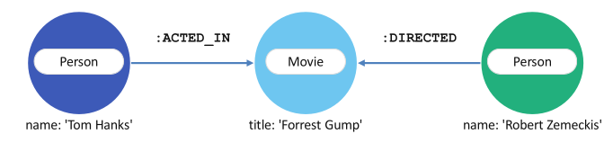
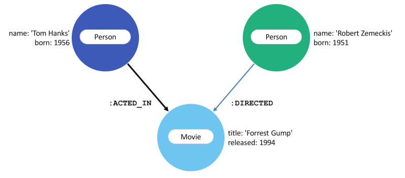
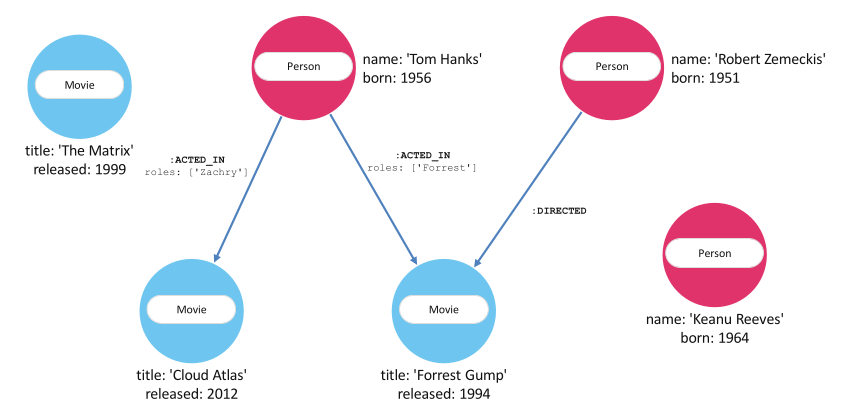

# 1. Index

<!--toc:start-->

- [1. Index](#1-index)
- [2. Neo4j](#2-neo4j)
  - [2.1. Introduction](#21-introduction)
    - [2.1.1. Nodes](#211-nodes)
    - [2.1.2. Relationships](#212-relationships)
    - [2.1.3. Traversal and Path](#213-traversal-and-path)
    - [2.1.4. Indexes](#214-indexes)
    - [2.1.5. Constraints](#215-constraints)
    - [2.1.6. Naming Conventions](#216-naming-conventions)
  - [2.2. Components](#22-components)
  - [2.3. The query Language: Cypher](#23-the-query-language-cypher)
    - [2.3.1. Creating a Node](#231-creating-a-node)
    - [2.3.2. Retrieving a Node](#232-retrieving-a-node)
    - [2.3.3. Creating a graph](#233-creating-a-graph)
      - [2.3.3.1. Attach to Existing Nodes](#2331-attach-to-existing-nodes)
      - [2.3.3.2. Creating A Note Only If Not Present](#2332-creating-a-note-only-if-not-present)
    - [2.3.4. Pattern Matching](#234-pattern-matching)
    - [2.3.5. Recommended Resources](#235-recommended-resources)
    - [2.3.6. Pattern Variables](#236-pattern-variables)
    - [2.3.7. Updating Data](#237-updating-data)
    - [2.3.8. Relationships Properties and Node Labels](#238-relationships-properties-and-node-labels)
    - [2.3.9. Remove a Property](#239-remove-a-property)
    - [2.3.10. Delete Operation](#2310-delete-operation)
    - [2.3.11. Examples of Queries](#2311-examples-of-queries)
    <!--toc:end-->

# 2. Neo4j

> [!TIP]
> Most of the information included in this presentation
> has been extracted from the [official documentation of Neo4j](https://neo4j.com/docs/).
>
> For further information, please refer to the official documentation:
>
> - [GraphAccademy](hhps://graphacademy.neo4j.com/)
> - [Cypher Cheat Sheet](https://neo4j.com/docs/cypher-cheat-sheet/current/)
> - [Complete Chyper Manual](https://neo4j.com/docs/cypher-manual/current/)

`Neo4j` is a **native graph database**, built to store not only data, but
also the _relationships_ between them.

Instead of _rows_, _columns_ and _tables_, graph databases use a **flexible
structure** defined by stored relationships.

Each node **stores direct pointers** to all the nodes it is
connected to.

Queries with complex connections are **orders of magnitude faster**
and can go deeper than other databases.

## 2.1. Introduction

A `Neo4j` graph is composed of:

- **Nodes**: describe the **entities** of a domain
- **Properties**: key-value pairs that can be associated with nodes and relationships.
- **Labels**: used to group nodes into sets, similar to tables in relational databases.
- **Relationships**: the connections between nodes, which can also have
  _properties_ and _types_. It is always **one direction** and **exactly one type**.
- **Indexes**: used to speed up the retrieval of nodes and relationships based
  on their properties.
- **Constraints**: used to enforce rules on the data, such as uniqueness of
  properties or existence of relationships.



### 2.1.1. Nodes

**Nodes** are the entities of the graph, storing data like rows in a relational
database or documents in a NoSQL database.

They are _schema-less_, meaning that two nodes with the same label can have
different _properties_.

Each node can have zero to many labels, which are used to group nodes into sets
and can be added/removed dynamically.

**Super-nodes** are nodes with a **huge number of relationships**
(in the order of the hundreds of thousands).

They slow down a traversal when all their relationships must be followed.

For example, in a social network graph, a super-node may be a celebrity
followed by millions of users

### 2.1.2. Relationships

We can connect different nodes through **directed relationships**.

They allow to organize nodes into structures (e.g., lists, maps, trees, ...).

_Relationships_ have **exactly one relationship type**, which is typically
written in **UPPER_SNAKE_CASE**, but can support having _properties_,
though they are not necessary.

Like labels, also relationships can be added/removed dynamically.

`Neo4j` also supports **relationships to itself**, which can be useful for
modeling hierarchical structures.

**Properties** are name-value pairs that **add qualities to modes and
relationships**.

They are _key-value_ pairs, where the value can be of several types:

- **Number**: `Integer` and `Float`
- **String**
- **Boolean**
- The spatial type **Point**
- **Temporal types**: `Date`, `Time`, `LocalTime`, `DateTime`, `LocalDateTime`,
  `Duration`
- Lists of these types

### 2.1.3. Traversal and Path

Traversing a graph means visiting nodes by following relationships, according
to some rules.

The result of a traversal can be returned as a **path**.

<div class="grid2">
<div class="">

For example, if we want to retrieve all the movies in which _Tom Hanks_ acted in,
we could start from the `Tom Hanks` node, and follow the `ACTED_IN` relationship,
ending at the `Movie` node `Forrest Gump`.

The result of the traversal can be returned as a **path of length 1**.

</div>
<div class="">

</div>
</div>

### 2.1.4. Indexes

Indexes are used to find the **starting point** of a graph traversal.

Indexes can be:

- **Single-property**: created on a single property of a node or relationship.
  It allows us to math **ranges**
- **Composite**: created on multiple properties of a node or relationship.
  It allows us to match **exact values**.

### 2.1.5. Constraints

**Constraints** make sure that the data adheres to **the rules of the domain**

There are two main types of constraints:

- **Uniqueness constraints**: ensure that a property or a combination of
  properties is unique across all nodes or relationships with a given label or
  type. For example, we can enforce that no two `Person` nodes have the same
  email address.
- **Existence constraints**: ensure that a property exists on all nodes or
  relationships with a given label or type. For example, we can enforce that
  every `Person` node has a `name` property.

### 2.1.6. Naming Conventions

Labels, relationship types and properties keys are **case sensitive** inside
`Neo4j`.

In general there is a style guide that is followed to name them:

<div class="flexbox" markdown="1">

|   Graph Entity    | Reccommended Style |     Example     |
| :---------------: | :----------------: | :-------------: |
|    Node Label     |   UpperCamelCase   | `:VehicleOwner` |
| Relationship Type |  UPPER_SNAKE_CASE  | `:OWNS_VEHICLE` |
|     Property      |   lowerCamelCase   |   `firstName`   |

</div>

## 2.2. Components

Around the database, there are several components that allow to interact with it:
the query language, the cloud service, analytics tools, visualization drivers, etc.

## 2.3. The query Language: Cypher

In a _Index-Free Adjacency (IFA)_ world, to go from one element to another we
just follow a pointer, whereas in a _relational_ world we would have to get to
a central index to retrieve the coordinates of our desired destination.

As we know, in RDBMS relationships require **foreign keys**, and possibly
a **lookup table**. To follow the foreign keys we must perform **index lookups**.

They are optimized with structures like `B+-Tree indexes`, but still are
very slow.

Instead, in IFA we can store pointers to target directly our destination.

`Cypher` is a **declarative query language** that focuses on what to retrieve
rather than on how.

It has some _SQL-like keywords_, like `MATCH`, `WHERE`, `CREATE`, etc. And it
is heavily based on **patterns**.

A typical query has the following structure:

```cypher
(:nodes) - [:ARE_CONNECTED_TO] -> (:otherNodes)
```

Where:

- `()`: indicate a node
- `-[]->`: indicate a directed relationship
- `:`: introduces a label or a relationship type

### 2.3.1. Creating a Node

To create a node we use the `CREATE` clause to create data.

```cypher
CREATE (ee: Person { name: "Emil", from: "Sweden", age: 29 })
```

This creates a **node** `()` with label `Person`. `ee` is a variable
that indicate the node.

The `{}` add properties to the node.

```cypher
()                // anonymous node
(p:Person)        // variable `p` and label `Person`
(:Technology)     // no variable, label `Technology`
(work:Company)    // variable `work` and label `Company`
```

### 2.3.2. Retrieving a Node

To retrieve a node we can use the `MATCH`-`WHERE`-`RETURN` clause:

```cypher
MATCH (ee:Person)
  WHERE ee.name = "Emil"
  RETURN ee;
```

This query specifies we want to search for a single node pattern
with label `Person`, constraining the results to `ee.name = "Emil"` with the
`WHERE` clause.

The `RETURN` clause specifies the result we want.

### 2.3.3. Creating a graph

To create a graph from scratch we can combine several `CREATE` clauses:

```cypher
CREATE (matrix:Movie {title: 'The Matrix', released: 1999})
CREATE (cloudAtlas:Movie {title: 'Cloud Atlas', released: 2012})
CREATE (forrestGump:Movie {title: 'Forrest Gump', released: 1994})
CREATE (keanu:Person {name: 'Keanu Reeves', born: 1964})
CREATE (robert:Person {name: 'Robert Zemeckis', born: 1951})
CREATE (tom:Person {name: 'Tom Hanks', born: 1956})
CREATE (tom)-[:ACTED_IN {roles: ['Forrest']}]->(forrestGump)
CREATE (tom)-[:ACTED_IN {roles: ['Zachry']}]->(cloudAtlas)
CREATE (robert)-[:DIRECTED]->(forrestGump)
```

The resulting graph is the following:



#### 2.3.3.1. Attach to Existing Nodes

A `CREATE` can also create many nodes and relationships at once.

By combining `MATCH` and `CREATE` we can attach a new sub-graph to existing nodes

```cypher
MATCH (ee:Person) WHERE ee.name = "Emil"
  CREATE
    (js:Person { name: "Johan", from: "Sweden", learn: "surfing" }),
    (ir:Person { name: "Ian", from: "England", title: "author" }),
    (rvb:Person { name: "Rik", from: "Belgium", pet: "Orval" }),
    (ally:Person { name: "Allison", from: "California", hobby: "surfing" }),
    (ee)-[:KNOWS {since: 2001}]->(js),
    (ee)-[:KNOWS {rating: 5}]->(ir),
    (js)-[:KNOWS]->(ir), (js)-[:KNOWS]->(rvb),
    (ir)-[:KNOWS]->(js), (ir)-[:KNOWS]->(ally),
    (rvb)-[:KNOWS]->(ally)
```

From the example above we can notice that `Keanu Reeves` is not attached
through a relationship with the `Movie` `The Matrix`.

To add the relationship we can use a new `CREATE` clause:

```cypher
MATCH (p:Person) WHERE p.name = "Keanu Reeves"
MATCH (m:Movie) WHERE m.name = "The Matrix"
  CREATE (p) -[:ACTED_IN {roles: ['Neo']}]-> (m)
```

#### 2.3.3.2. Creating A Note Only If Not Present

The `MERGE` clause allows to create a new node **only if it does
not exists**.

```cypher
MERGE (pp:Person { name: "Pietro", from: "Italy" })
```

We can use it to:

```cypher
// Set properties only if we are creating it
MERGE (pp:Person { name: "Pietro", from: "Italy" })
  ON CREATE SET pp.created = timestamp()

// Set properties if found
MERGE (pp:Person { name: "Pietro", from: "Italy" })
  ON MATCH SET pp.found = TRUE
```

### 2.3.4. Pattern Matching

We can be interested in not only find a single node, but a **pattern** of nodes
that share a relationship, no matter its direction.

```cypher
// Find all the friends of Johan
MATCH (p:Person) -[:KNOWS]- (friend)
  WHERE p.name = "Johan"
  RETURN friend
```

We can also filter result no only on labels but also on patterns:

```cypher
// Query 1: people who are friends of someone who works for Neo4j
MATCH (p:Person) - [r:IS_FRIENDS_WITH]-> (friend: Person)
  WHERE EXISTS { (friend) -[:WORKS_FOR]-> (:Company {name: "Neo4j"}) }
  RETURN p, f, friend;

// Query 2: Jennifer's friends who do not work for a company
MATCH (jennifer:Person {name: "Jennifer"}) -[:KNOWS]-> (friend)
  WHERE NOT EXISTS { (friend) -[:WORKS_FOR]-> (:Company) }
  RETURN friend.name;
```

### 2.3.5. Recommended Resources

We can use `Neo4j` in several ways, depending on our needs.
In particular, one of the most useful ways, is to retrieve data in order
to make recommendations.

For example, suppose we have `Johan` who is learning to surf, and we want to
find a _new friend_ who already surf.

```cypher
MATCH (js: Person) -[:KNOWS]-()-[:KNOWS]- (surfer)
  WHERE js.name = "Johan" AND surfer.hobby = "surfing"
  RETURN DISTINCT surfer
```

`DISTINCT` is needed to avoid duplicates, since the same `surfer` may be
connected to two different friends of `Johan`.

### 2.3.6. Pattern Variables

A pattern can be assigned to a **variable**, which can be later inspected,
returned or used in other patterns.

```cypher
MATCH acted_in = (:Person) -[:ACTED_IN]-> (:Movie)
  RETURN acted_in
```

`acted_in` is now a variable that contains, for each path found, the _two nodes_
and the _relationship_ between them.

We can access them using the `nodes()` and `relationships()` functions.

### 2.3.7. Updating Data

We can update the properties of a node or relationship using the `SET` clause.

```cypher
// Set or update a property of a specific node
MATCH (p: Person { name = 'Jennifer' })
  SET p.birthdate = date("1980-01-01")
  RETURN p

// Update only on a condition
MATCH (n:Person {name: 'Emil'})
  SET (CASE
        WHEN n.from = "Sweden" THEN n
      END).worksIn = "Malmo"
RETURN n.name, n.from, n.worksIn
```

### 2.3.8. Relationships Properties and Node Labels

We can set the value of a property on a relationship or add a label to
a node using the `SET` clause.

```cypher
// Add `since` property to all `KNOWS` relationships
MATCH p = ()-[r:KNOWS]->()
  SET r.since = 2020
  RETURN p

// Add label Young to a specific node
MATCH (p:Person)
  WHERE p.name: "IAN"
  SET p:Young
  RETURN labels(p)
```

### 2.3.9. Remove a Property

We can remove a property from a node or relationship by:

```cypher
// Setting it to `NULL`
MATCH (n:Person)
  SET n.worksIn = NULL
  RETURN n

// Use REMOVE clause
MATCH (n:Person)
  REMOVE n.worksIn
  RETURN n
```

### 2.3.10. Delete Operation

There are several deletion operation that can be achieves using the `DELETE` clause.

```cypher
// Delete the relationship of a node
MATCH (n:Person { name: 'Ian' }) -[r:KNOWS]-> (c:Person { name: 'Allison' })
  DELETE r

// All the relationships of a node
MATCH (n {name: 'Ian' }) -[r:KNWOS]-()
  DELETE n

// A node (only if there are no relationships left)
MATCH ( n { name: 'Ian' })
  DELETE n

// A node with all its relationships
MATCH (n { name: 'Ian' })
  DETACH
  DELETE n

// The whole graph
MATCH (n)
  DETACH
  DELETE n
```

### 2.3.11. Examples of Queries

In the following examples we will use the default `Movie` graph
that can be created using `neo4j-desktop`.

```cypher
// Find the actor named "Tom Hanks"
MATCH (tom {name: "Tom Hanks"})
  RETURN tom

// Find 10 people
MATCH (p:Person)
  RETURN p.name LIMIT 10

// Find the movies released in 1999 or 2003
MATCH (m:Movie)
  WHERE m.released IN [1999, 2003]
  RETURN m.title, m.released AS `Year of Release`

// Movies that start with 'T', end with 'x' and contain 'the'
MATCH (m:Movie)
  WHERE m.title
    STARTS WITH 'T'
    AND m.title ENDS WITH 'x'
    AND toLower(m.title) CONTAINS 'the'
RETURN m.title
```

```cypher
// "Tom Hanks"'s co-actors
MATCH (tom:Person {name: "Tom Hanks"}) -[:ACTED_IN]-> (m) <-[:ACTED_IN]- (coActors)
  RETURN coActors.name

// Movies and actors up to 4 "hops" away from "Kevin Bacon"
MATCH (b:Person {name: "Kevin Bacon"}) -[*1..4]- (hollywood)
  RETURN DISTINCT hollywood

// The shortest path from "Kevin Bacon" to "Meg Ryan"
MATCH p = shortestPath(
  (b:Person {name: "Kevin Bacon"}) -[*]- (meg:Person {name: "Meg Ryan"})
)
RETURN p
```

```cypher
// Co-co-actors who HAVEN'T worked with "Tom Hanks"
MATCH (tom:Person {name: "Tom Hanks"}) -[:ACTED_IN]-> (m) <-[:ACTED_IN]- (coActors),
      (coActors) -[:ACTED_IN]-> (m2) <-[:ACTED_IN]- (cocoActors)
  WHERE NOT (tom) -[:ACTED_IN]-> () <-[:ACTED_IN]- (cocoActors)
    AND tom <> cocoActors
RETURN cocoActors.name AS Recommended, count(*) AS Strength
ORDER BY Strength DESC
```

```cypher
// Find someone to introduce Tom Hanks to Tom Cruise
MATCH (tom:Person {name: "Tom Hanks"}) -[:ACTED_IN]-> (m) <-[:ACTED_IN]- (coActors),
      (coActors) -[:ACTED_IN]-> (m2) <-[:ACTED_IN]- (cruise:Person {name: "Tom Cruise"})
RETURN tom, m, coActors, m2, cruise
```
