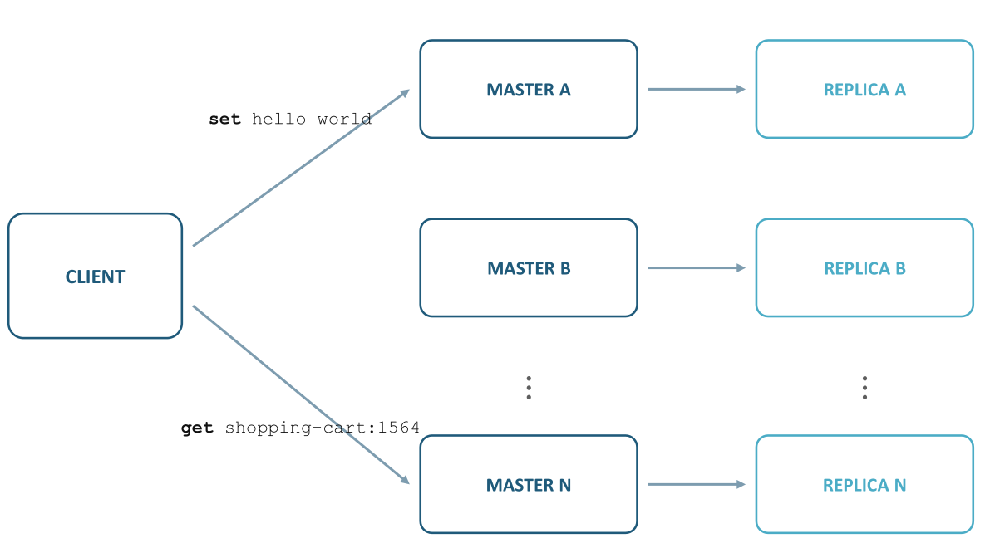

# 1. Index

<!--toc:start-->

- [1. Index](#1-index)
- [2. Redis](#2-redis)
  - [2.1. Connecting to Redis](#21-connecting-to-redis)
  - [2.2. Redis Keys](#22-redis-keys)
  - [2.3. Redis Commands](#23-redis-commands)
  - [2.4. Transactions](#24-transactions)
  - [2.5. Java Client for Redis (Jedis)](#25-java-client-for-redis-jedis)
  - [2.6. When to Use Redis](#26-when-to-use-redis)
  - [2.7. Eviction Policies](#27-eviction-policies)
  - [2.8. Persistence](#28-persistence)
  - [2.9. High Availability](#29-high-availability)
  - [2.10. Clustered Database](#210-clustered-database)
    - [2.10.1. Setting up the cluster](#2101-setting-up-the-cluster)
  - [2.11. Key-space Notifications](#211-key-space-notifications)
  - [2.12. Using Jedis](#212-using-jedis)
    - [2.12.1. Cluster Databases](#2121-cluster-databases)
    - [2.12.2. Receiving keyspace notifications](#2122-receiving-keyspace-notifications)
    - [2.12.3. Publisher Receiver Definition](#2123-publisher-receiver-definition)
    <!--toc:end-->

# 2. Redis

**`Redis`** is an acronym for _REmote Dictionary Server_.
It is an open-source, **in-memory database** that supports various data structures
as well as **atomic operations** on them.

Because of this, it is mainly used as a **cache**, **message broker**, and **streaming
engine**.

It leverages the speed of main memory and alleviates load off the central application
database, especially for data that changes infrequently and is accessed often.

`Redis` is typically used under this workflow:

1. Look for the data in `Redis`.
1. If data is found, return it.
1. If data is not found, query the database for it.
1. Store the data in `Redis` for future requests.

However, `Redis` gives enough guarantees to be used as a primary database for
some use cases.

It also supports **periodic data persistence** to disk, as well as
transactions, pub/sub messaging, _keys with limited time-to-live replications_,
scaling and more.

## 2.1. Connecting to Redis

We can download and install `Redis` from the official website: [https://redis.io/download](https://redis.io/download).

By default, `Redis` allows connection only from `127.0.0.1`, but for
development purposes, we can allow connections from any IP address by changing
the `bind` directive in the `Redis` configuration file (`/etc/redis/redis.conf`):
<small>(on arch the package is called `valkey`)</small>

```conf
# bind 127.0.0.1
bind 0.0.0.0
```

Once we update the configuration file, we **must restart** the `Redis` service.

To connect to `Redis`, we can use the `redis-cli` command-line tool:

```bash
redis-cli ping
```

If everything is working correctly, we should see the response `PONG`.

## 2.2. Redis Keys

Keys are **unique** in `Redis`. They are used to locate a specific value.

`Redis` is _binary safe_, meaning that we can use both a string or the content
of a JPEG file as a key, as well as an _empty string_. However, it is recommended
to use **human-readable strings** as keys.

Very long keys can have a negative impact on performance, so it is recommended to
instead use hash functions to generate shorter keys.

```sh
sales-app:invoice:10012:status = "PAID"
shopping-card:1002 = "[{product_id: 1001, quantity: 2}]"
```

Try to stick with a schema for the keys, such as `EntityName:EntityId:EntityAttribute`.

`Redis` supports a maximum key length of **512 MB**. However, it is
recommended to keep keys under **1 KB** in size.

## 2.3. Redis Commands

The following are some of the most commonly used `Redis` commands:

```sh
# Set a new key-value pair
SET <key> <value>

# Get the value of a key
GET <key>

# Set a key with an expiration time
EXPIRE <key> seconds> NX
SET <key> <value> EX seconds

# See the time to live of a key
TTL <key>

# To delete a key
DEL <key>
```

For integer values, we can use the following commands:

```sh
SET counter 10

# Increment the value of the key by 1
INCR counter

# Increment the value of the key by 5
INCRBY counter 5

# Decrement the value of the key by 1
DECR counter

# Decrement the value of the key by 3
DECRBY counter 3
```

`Redis` also supports **Pipelining**, a technique that allows to **improve performance**
by sending _more commands at once_, without waiting for the response of each one.

To do pipelining we can invoke:

```sh
redis-cli --pipe
```

## 2.4. Transactions

`Redis` supports transactions, which allow us to execute a group of commands in
a **serialized and sequential manner**.

To do so we use a few commands:

```sh
# Start a transaction
MULTI

# ... Commands that will be Queued ...

# Discard the transaction and all commands queued
DISCARD

# ... Commands that will be Queued ...

# Triggers the execution of all commands in the transaction
EXEC
```

If we have multiple clients trying to modify the same key, it is important
to use the `WATCH` command to **monitor** the key for changes.

If the key is modified by another client before the transaction is executed,
the transaction will be aborted (returns a `(nil)` response).

```sh
WATCH <watched_key>

MULTI

# ... Commands that will be Queued ...

EXEC
```

## 2.5. Java Client for Redis (Jedis)

`Jedis` is a Java client library for `Redis`. It provides a simple and
easy-to-use API which commands are implemented as methods of the
`redis.clients.jedis.Jedis` class, with specification on the official
documentation [https://javadoc.io/doc/redis.clients/jedis/latest/index.html](https://javadoc.io/doc/redis.clients/jedis/latest/index.html).

On GitHub, we can find the project at [https://github.com/redis/jedis](https://github.com/redis/jedis).

Jedis is supported by Maven, and it includes **by default** the `GSON` dependency,
which is useful for serializing and deserializing JSON data.

```xml
<dependency>
  <groupId>redis.clients</groupId>
  <artifactId>jedis</artifactId>
  <version>7.0.0</version>
</dependency>
```

To establish a connection to `Redis` a first code snippet would look like this:

```java
import redis.clients.jedis.Jedis;

String redisHost = "localhost";
Integer redisPort = 6379;

Jedis jedis = new Jedis(redisHost, redisPort);

// Stuff here

jedis.close();
```

We can also use a `try-with-resources` statement to automatically close the connection:

```java
import redis.clients.jedis.Jedis;

String redisHost = "localhost";
Integer redisPort = 6379;

try (Jedis jedis = new Jedis(redisHost, redisPort)) {
    // Stuff here
}
```

If we want to improve the performance of our application, we can use a
`JedisPool` to manage a pool of connections:

```java
import redis.clients.jedis.Jedis;
import redis.clients.jedis.JedisPool;

try (JedisPool pool = new JedisPool(redisHost, redisPort);
    Jedis jedis = pool.getResource()) {
  // Stuff Here
}
```

We can execute the commands using the `Jedis` instance:

```java
String key = "my-app:some-key";

jesis.set(key, "Hello World!");
jedis.expire(key, 60); // Set the key to expire in 60 seconds

String valule = jedis.get(key);
long ttl = jedis.ttl(key);
```

It also supports transactions using the `Transaction` class:

```java
String key1 = "my-app:some-key-1";
String key2 = "my-app:some-key-2";

jedis.watch(key1);

Transaction transaction = jedis.multi();
transaction.set(key1, "Hello World!");
transaction.set(key2, "Hello Redis!");

/**
 * The output will be a list with the output of
 *  each command in the transaction, in the order they were queued.
 *
 * If a key marked with `WATCH` is modified by another client before the
 *  transaction is executed, the function will return `null`
 */
List<Object> results = transaction.exec();
```

## 2.6. When to Use Redis

`Redis` is a great choice for application that deals with **volatile data**, for
example when we have a _shopping cart_, when the data is **frequently
accessed** but **rarely modified**, for example a list of countries, or when we
**only access data by identifier** and we want to _reduce response time_.

Several big companies use `Redis` in production, including **GitHub**,
**Twitter**, **StackOverflow**.

For example, **Trenitalia** uses `Redis` for the shopping-cart, using the time-to-live
feature to automatically delete the cart after 10 minutes if not purchased yet.

## 2.7. Eviction Policies

It is not possible to store all data in memory, so `Redis` provides several
**eviction policies** to remove keys when the memory limit is reached.

The configured eviction policy is `maxmemory-policy`, and it's activated when
the _maximum memory limit_ (`maxmemory`) is reached.

At this point there are different policies from which we can choose:

- `noeviction`: it stops saving new values when the memory limit is reached.
  When replication is enabled, this policy applies to the primary database
- `allkeys-lru`: it keeps the most **recently** used keys, removing the _least
  recently used_ (LRU) keys.
- `allkeys-lfu`: it keeps the most **frequently** used keys, removing the _least
  frequently used_ (LFU) keys.
- `volatile-lru`: removes the _least recently_ used keys that **hold an expiration
  set**.
- `volatile-lfu`: removes the _least frequently_ used keys that **hold an expiration
  set**.
- `allkeys-random`: removes **random** keys to make space.
- `volatile-random`: removes **random** keys that **hold an expiration set**.
- `volatile-ttl`: removes keys with an expiration set that have the
  **shortest time-to-live** (TTL).

The default value for `maxmemory-policy` is `noeviction`, and the default
value for `maxmemory` is `0`:

```sh
# Get the value of the policies

CONFIG GET maxmemory-policy
CONFIG GET maxmemory

# Set the limit to 100 MB and the policy to `allkeys-lru`
CONFIG SET maxmemory 100mb
CONFIG SET maxmemory-policy allkeys-lru
```

## 2.8. Persistence

**Persistence** is the ability to writing data to "durable storage" (disk).

Redis provides a range of several persistence options:

- **RDB (Redis Database File)**: it is a snapshot of the database at a specific
  point in time. It is created by default every 60 seconds if at least one
  key has changed. It is a binary file that can be used to restore the database.
- **AOF (Append Only File)**: it is a _log file_ of all the write operations performed
  on the database. It is more durable than RDB, but it can be slower. It can be
  configured to save data either every second or every write operation.
- **RDB + AOF**: it is possible to use both RDB and AOF, but it can be slower and
  more complex to manage. This would allow to keep trace of write operation
  in the AOF file only _from the last snapshot_. This way when we restore
  the database we take the snapshot and then replay the AOF file to restore
  the database to the last state.
- **NO PERSISTENCE**: it is possible to disable persistence, but it is not recommended
  for production environments.

## 2.9. High Availability

So far we dealt with a single instance of `Redis`, hosted on a single server.

In this configuration, if the server goes down, our service **will not be available**.

For this reason, it is useful to **have some replication** of the `Redis` instance,
so that if the primary instance goes down, we can switch to a secondary instance.

In this architecture when we try to set a new value the operation will be:

1. Client to Primary Server: `SET foo "bar"`
1. Primary Server to Secondary Server: `SET foo "bar"`
1. Primary Server to Client: `OK`

By default `Redis` uses **asynchronous replication**, meaning that the primary server
does not wait for the secondary server to acknowledge the write operation before
returning the response to the client.

This can lead to **data loss** if the primary server goes down before the
secondary server has received the write operation.

It is also possible to configure **synchronous replication** of certain keys.
This can lead instead to **slower write operations**, but it guarantees that
the data is replicated to the secondary server before returning the response
to the client.

At this point the question comes naturally: _how many replicas should we have?_.

This question does not have a closed answer, but rather it is highly dependent on
our use cases are.

## 2.10. Clustered Database

When having several nodes of `Redis` we can configure them to work as a **clustered
database**, in which each node handles a subset of the keys.

To determine in which node a key is stored a `HASH_SLOT` is computed:

```bash
HASH_SLOT = CRC16(key) mod 16384
```

The number `16384` is not random, but it represents the toal **hash slots** in `Redis
Cluster`.

Supposing to have three nodes ($A$, $B$ and $C$), in this configuration the
hash slots would be distributed as follows:

- **Node** $\mathbf{A}$: `0` - `5500`
- **Node** $\mathbf{B}$: `5501` - `11000`
- **Node** $\mathbf{C}$: `11001` - `16383`

Each node could have one or more replicas, and the cluster will automatically handle
the failover of a node if it goes down.



### 2.10.1. Setting up the cluster

In this section we will see how to setup a `Redis` cluster of 6 instances
on our local machine.

The first step is to create 6 folder. Thei name should be a number (e.g, from
`7000` to `7005`) and will represent the **port number** of that `Redis` instance.

```sh
mkdir 7000 7001 7002 7003 7004 7005
```

Inside each folder we have to create a `redis.conf` file with the following content:

```conf
port <port_number>
cluster-enabled yes
cluster-config-file nodes.conf
cluster-node-timeout 5000
appendonly yes
# If we work on different hosts add this
# bind 0.0.0.0
```

The `appendonly yes` directive is used to enable the **AOF persistence**.

At this point, for each instance we start the `Redis` server with the
following command:

```sh
redis-server ./redis.conf
```

To actually create the cluster we can use the `redis-cli` command:

```sh
redis-cli --cluster create \
  127.0.0.1:7000 \
  127.0.0.1:7001 \
  127.0.0.1:7002 \
  127.0.0.1:7003 \
  127.0.0.1:7004 \
  127.0.0.1:7005 \
  --cluster-replicas 1
```

The option `--cluster-replicas 1` means that each node will have **one replica**.

> [!note]
> The command will produce a warning, since replicas are hosted on the same host
> as their masters. This is not a good practice, but for testing purposes it is
> acceptable.

Then the prompt will ask for confirmation to create the cluster, we will have
to type `yes` to accept the configuration.

We can then test our configuration by creating some keys:

```sh
redis-cli -c -p 7000
```

This at this point each key we create will be automatically assigned to a node
based on the hash slot.

To stop the cluster, we should stop each `Redis` instance.

## 2.11. Key-space Notifications

`Redis` offers **monitoring of changes _on keys and values in real time_**.

To do so, clients must subscribe to **Pub**/**Sub** channels to receive this events.

The events are divided in two types:

- **Keyspace Events**: they are triggered when an operation is performed **on a
  particular key**. The channel name is `__keyspace@<db>__key` where `<bd>` is the
  database number and `<key>` is the key name.
- **Keyevent Events**: they are triggered when **a particular action** is
  performed _on any key_. The channel name is `__keyevent@<db>__event` where
  `<bd>` is the database number and `<event>` is the event name.

By default notifications are disabled. To enable events we can either modify the
`redis.conf` or using the command line. The default database index is `0`, and
`Redis` uses up to 16 database (so `0`-`15`).

The client can activate the events:

```sh
CONFIG SET notify-keyspace-events Ex  # expiration
```

A subscriber can then subscribe to the events:

```sh
subscribe __keyevent@0__:expired
```

When a key expires, the subscriber will receive a message with the name of the
key.

The `subscribe` command is blocking, so it will not return until the client unsubscribes.

It can also be used for notification from a _publisher_:

<div class="grid2">
<div class="top">
<p class="subt">Publisher</p>

```sh
publish my-channel "Hello Clients!"
```

</div>
<div class="top">
<p class="subt">Subscriber</p>

```sh
subscribe my-channel
1) "subscribe"
2) "my-channel"
3) (integer) 1
1) "message"
2) "my-channel"
3) "Hello Clients!"
```

</div>
</div>

## 2.12. Using Jedis

### 2.12.1. Cluster Databases

To connect to a `Redis` cluster using `Jedis`, we can use the `JedisCluster` class.

```java
import redis.clients.jedis.*;
import java.util.HashSet;
import java.util.Set;

Set<HostAndPort> jedisClusterNodes = new HashSet<>();
jedisClusterNodes.add(new HostAndPort("127.0.0.1", 7001));
jedisClusterNodes.add(new HostAndPort("127.0.0.1", 7002));
jedisClusterNodes.add(new HostAndPort("127.0.0.1", 7003));

try (JedisCluster jedis = new JedisCluster(jedisClusterNodes)) {
  /*
    do stuff here
  */
}
```

### 2.12.2. Receiving keyspace notifications

To receive keyspace notifications, for example on expired keys, we can use the
`JedisPubSub` class to subscribe to the events.

```java
JedisPubSub jedisPubSub = new JedisPubSub() {
  @Override
  public void onPMessage(String pattern, String channel, String message) {
    System.out.println("Patterns: " + pattern + ", channel: " + channel
                + ", message" + message);
  }
};

try (Jedis jedis = new Jedis("localhost", 6379)) {
  jedis.psubscribe(jedisPubSub, "__keyevent@0__:expired");
}
```

> [!warning]
> For this to work in `Jedis` the `notify-keyspace-events` must be set to `Ex`
> (expiration events) in the `redis.conf` file or using the command line.

### 2.12.3. Publisher Receiver Definition

To define a **subscriber** we can again use the `JedisPubSub` class:

```java
JedisPubSub jedisPubSub = new JedisPubSub() {
  @Override
  public void onMessage(String channel, String message) {
    System.out.println("Channel " + channel
      + " has sent a message: " + message);
  }

  @Override
  public void onSubscribe(String channel, int subscribedChannels) {
    System.out.println("Client is subscribed to channel: " + channel);
    System.out.println("Client is subscribed to " + subscribedChannels
      + " channels");
  }

  @Override
  public void onUnsubscribe(String channel, int subscribedChannels) {
    System.out.println("Client is unsubscribed from channel: "
      + channel);
    System.out.println("Client is subscribed to "
      + subscribedChannels + " channels");
  }
};

try (Jedis jedis = pool.getResource()) {
  // Subscribe to multiple channels
  jedis.subscribe(jedisPubSub, "Channel1", "Channel2");
}
```

As for a publisher, we can use the `publish` method of the `Jedis` class:

```java
try (Jedis jedis = pool.getResource()) {
  /* Publishing a message to channel Channel1 */
  jedis.publish("Channel1", "First message to channel Channel1");
  /* Publishing a message to channel Channel2 */
  jedis.publish("Channel2", "First message to channel Channel2");
  /* Publishing a message to channel Channel1 */
  jedis.publish("Channel1", "Second message to channel Channel1");
  /* Publishing a message to channel Channel2 */
  jedis.publish("Channel2", "Second message to channel Channel2");
}
```
